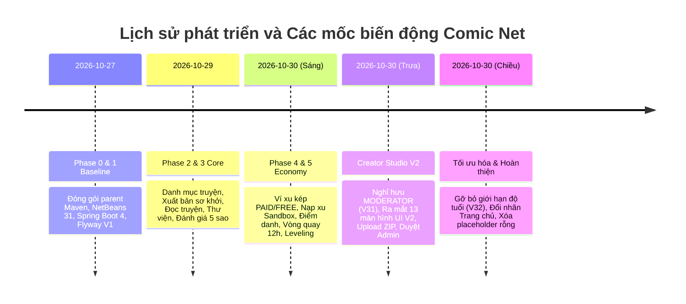
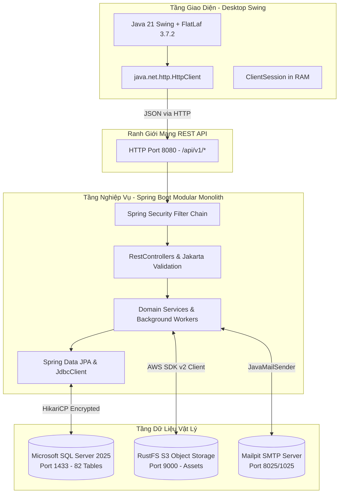

# BÁO CÁO TOÀN DIỆN VỀ HỆ THỐNG COMIC NET
## KIỂM TOÁN MÃ NGUỒN, LỊCH SỬ PHÁT TRIỂN VÀ HỒ SƠ BẢO VỆ ĐỒ ÁN TỐT NGHIỆP

---

> **Tên đề tài:** Comic Net — Nền tảng phân phối, xuất bản và đọc truyện tranh số bản quyền  
> **Cấp độ dự án:** Đồ án tốt nghiệp Đại học ngành Công nghệ Thông tin / Dự án phần mềm thực tế  
> **Phiên bản mã nguồn kiểm toán:** Commit `c30c6be` (2026-10-30)  
> **Kiến trúc:** Modular Monolith (Java 21, Spring Boot 4.1.2, Java Swing FlatLaf, Microsoft SQL Server 2025, RustFS S3)  
> **Tình trạng nghiệm thu:** BUILD SUCCESS, 55/55 Unit Tests PASS, 174/174 OpenAPI Contracts PASS, 16/16 SQL Server Integration Tests PASS  

---

## MỤC LỤC BÁO CÁO TỔNG HỢP

1. [Tổng quan dự án và Tuyên ngôn phạm vi](#1-tổng-quan-dự-án-và-tuyên-ngôn-phạm-vi)
2. [Lịch sử phát triển và Biến động thiết kế](#2-lịch-sử-phát-triển-và-biến-động-thiết-kế)
3. [Kiến trúc hệ thống và Ngăn xếp công nghệ](#3-kiến-trúc-hệ-thống-và-ngăn-xếp-công-nghệ)
4. [Giải phẫu Package, Module và Mô hình dữ liệu](#4-giải-phẫu-package-module-và-mô-hình-dữ-liệu)
5. [Kiểm toán Giao diện Java Swing và Tương tác Button](#5-kiểm-toán-giao-diện-java-swing-và-tương-tác-button)
6. [Hệ thống Kinh tế số, Ví xu và Gamification](#6-hệ-thống-kinh-tế-số-ví-xu-và-gamification)
7. [An ninh, Xác thực và Phân quyền RBAC](#7-an-ninh-xác-thực-và-phân-quyền-rbac)
8. [Kết quả Kiểm thử và Hướng dẫn Triển khai](#8-kết-quả-kiểm-thử-và-hướng-dẫn-triển-khai)
9. [Chỉ dẫn Bộ tài liệu chuyên sâu dành cho Bảo vệ](#9-chỉ-dẫn-bộ-tài-liệu-chuyên-sâu-dành-cho-bảo-vệ)

---

## 1. TỔNG QUAN DỰ ÁN VÀ TUYÊN NGÔN PHẠM VI

**Comic Net** được xây dựng nhằm giải quyết triệt để bài toán phân phối truyện tranh bản quyền trực tuyến, kết hợp xuất bản số đa bước và trải nghiệm tương tác cộng đồng.

Hệ thống được thiết kế theo nguyên lý **Decoupled Client-Server**:
- **Desktop Client (Java Swing + FlatLaf):** Là giao diện chính/MVP để sinh viên trình diễn và bảo vệ trực tiếp trong NetBeans 31 trên máy tính để bàn. Ứng dụng bản địa giúp tối ưu hóa hiệu năng render hình ảnh nét cao, hỗ trợ phím tắt và hoàn toàn độc lập với trình duyệt web.
- **Backend Service (Spring Boot 4.1.2):** Là pháo đài bảo mật và nghiệp vụ duy nhất. Toàn bộ logic giao dịch, phân quyền và lưu trữ được bảo vệ trên máy chủ. Desktop Swing không bao giờ nhúng driver JDBC hay giữ mật khẩu SQL Server.

📄 *Xem tài liệu chi tiết:* [00_TONG_QUAN.md](file:///c:/Users/studi/OneDrive/Documents/Tools/Comic%20Net/docs/defense/00_TONG_QUAN.md)

---

## 2. LỊCH SỬ PHÁT TRIỂN VÀ BIẾN ĐỘNG THIẾT KẾ

Quá trình điều tra lịch sử Git từ commit gốc đến hiện tại xác nhận các biến động kiến trúc then chốt:

### Các kết luận kiểm toán quan trọng:
1. **Từ 23 Module gốc thành 19 Module thực tế:** Module `minigame` được gộp vào `gamification`; module `dataprotection` chuyển thành tài liệu vận hành và runbook SSMS; 2 package placeholder rỗng `ai` và `offline` được dọn dẹp sạch sẽ để tránh mã nguồn rác.
2. **Nghỉ hưu vai trò `MODERATOR` (Migration V31):** Toàn bộ quyền kiểm duyệt được giao cho `ADMINISTRATOR` nhằm tinh giản quy trình thẩm định.
3. **Loại bỏ hoàn toàn ràng buộc độ tuổi (Migration V32):** Chuẩn hóa mọi truyện về `AgeRating = 'ALL_AGE'`, gỡ bỏ các bộ lọc ngầm để toàn bộ truyện công khai đều xuất hiện trên Trang chủ.

📄 *Xem tài liệu chi tiết:* [01_LICH_SU_THAY_DOI.md](file:///c:/Users/studi/OneDrive/Documents/Tools/Comic%20Net/docs/defense/01_LICH_SU_THAY_DOI.md)

---

## 3. KIẾN TRÚC HỆ THỐNG VÀ NGĂN XẾP CÔNG NGHỆ

- **Phân tách cổng mạng tuyệt đối:** Desktop chỉ giao tiếp qua cổng HTTP `8080`. Chỉ duy nhất Backend được phép kết nối vào cổng SQL Server `1433`.
- **Không dùng Lombok:** Dự án khai thác chuẩn ngôn ngữ Java 21 **Records** cho toàn bộ DTO, bảo đảm tính bất biến và triệt tiêu lỗi phụ thuộc plugin IDE.

📄 *Xem tài liệu chi tiết:* [02_CONG_NGHE_KIEN_TRUC.md](file:///c:/Users/studi/OneDrive/Documents/Tools/Comic%20Net/docs/defense/02_CONG_NGHE_KIEN_TRUC.md)

---

## 4. GIẢI PHẪU PACKAGE, MODULE VÀ MÔ HÌNH DỮ LIỆU

Hệ thống bao gồm **19 module nghiệp vụ** và **5 package kỹ thuật dùng chung**, lưu trữ trên **82 bảng cơ sở dữ liệu** thuộc Microsoft SQL Server 2025.

### 4.1. Bảng tóm tắt các Module cốt lõi

| Nhóm Module | Tên Module | Trách nhiệm chính | Bảng dữ liệu cốt lõi |
|---|---|---|---|
| **Người dùng** | `identity`, `admin` | Đăng ký, đăng nhập JWT/Cookie, RBAC, khóa tài khoản, Audit Logs. | `dbo.[User]`, `dbo.[Role]`, `dbo.UserSession`, `dbo.AuditLog` |
| **Nội dung** | `catalog`, `publishing`, `creator` | Quản lý tác phẩm, tác giả, thể loại, upload ZIP, hàng chờ duyệt Admin. | `dbo.Comic`, `dbo.Chapter`, `dbo.ChapterVersion`, `dbo.UploadJob` |
| **Độc giả** | `reader`, `library`, `search` | Trình đọc tối ưu, lưu tiến độ, tủ sách theo dõi, tìm kiếm đa tiêu chí. | `dbo.ReadingProgress`, `dbo.ComicFollow`, `dbo.SearchHistory` |
| **Cộng đồng** | `recommendation`, `community`, `analytics` | Đánh giá 5 sao, bình luận theo chương, thống kê view hợp lệ, Top 3 Podium. | `dbo.ComicRating`, `dbo.Comment`, `dbo.ComicView`, `dbo.ComicStatDaily` |
| **Kinh tế số** | `wallet`, `monetization`, `finance`, `entitlement` | Ví xu kép, sổ cái kế toán cân bằng, nạp xu Sandbox, bán chương trả phí. | `dbo.WalletAccount`, `dbo.LedgerEntry`, `dbo.ChapterPrice`, `dbo.Purchase` |
| **Tương tác** | `gamification`, `notification` | Điểm danh 7 ngày, Vòng quay may mắn 12h, Cấp độ 1-10, thông báo hệ thống. | `dbo.UserGamification`, `dbo.CheckInHistory`, `dbo.LuckyWheelHistory`, `dbo.Notification` |

📄 *Xem tài liệu chi tiết:*
- [03_MODULE_PACKAGE_CLASS.md](file:///c:/Users/studi/OneDrive/Documents/Tools/Comic%20Net/docs/defense/03_MODULE_PACKAGE_CLASS.md)
- [05_DATABASE.md](file:///c:/Users/studi/OneDrive/Documents/Tools/Comic%20Net/docs/defense/05_DATABASE.md)
- [06_LUONG_NGHIEP_VU.md](file:///c:/Users/studi/OneDrive/Documents/Tools/Comic%20Net/docs/defense/06_LUONG_NGHIEP_VU.md)

---

## 5. KIỂM TOÁN GIAO DIỆN JAVA SWING VÀ TƯƠNG TÁC BUTTON

Kiểm toán toàn diện ghi nhận **26 màn hình, panel và dialog** tương tác thực tế.

Mọi nút bấm trên giao diện đều được ánh xạ khép kín theo mô hình:
$$\text{Người dùng} \longrightarrow \text{Nút bấm} \longrightarrow \text{Event Handler} \longrightarrow \text{ApiClient} \longrightarrow \text{Spring Controller} \longrightarrow \text{Service} \longrightarrow \text{SQL Server} \longrightarrow \text{UI Update}$$

- **100% không có nút giả:** Các nút như "Điểm danh ngay", "Quay may mắn", "✓ Xuất bản ngay", "Mở khóa chương", "Nạp xu" đều gọi HTTP API thật và tác động dữ liệu thật vào SQL Server.
- **Không đơ giao diện:** Toàn bộ tác vụ mạng và upload ảnh được điều phối qua luồng nền (`SwingWorker`, `HttpClient async`), giải phóng hoàn toàn Event Dispatch Thread (EDT).

📄 *Xem tài liệu chi tiết:*
- [04_GIAO_DIEN_BUTTON.md](file:///c:/Users/studi/OneDrive/Documents/Tools/Comic%20Net/docs/defense/04_GIAO_DIEN_BUTTON.md)
- [12_MA_TRAN_TRUY_VET.md](file:///c:/Users/studi/OneDrive/Documents/Tools/Comic%20Net/docs/defense/12_MA_TRAN_TRUY_VET.md)

---

## 6. HỆ THỐNG KINH TẾ SỐ, VÍ XU VÀ GAMIFICATION

Điểm sáng nổi bật của đồ án Comic Net là hệ thống Gamification và Kinh tế số hoàn chỉnh:

1. **Ví xu kép (Dual-Token Wallet):**
   - Phân định rõ giữa **Xu nạp (`PAID`)** và **Xu thưởng (`FREE`)**.
   - Ràng buộc cơ sở dữ liệu `CHECK (Balance >= 0)` trong `dbo.WalletAccount` kết hợp khóa giao dịch bi quan `SELECT ... WITH (UPDLOCK, HOLDLOCK)` đảm bảo ví không bao giờ bị chi tiêu âm.
   - Sổ cái kế toán kép `dbo.LedgerEntry` ghi nhận minh bạch mọi biến động nạp/trừ tiền.
2. **Điểm danh nhận quà hằng ngày (Daily Check-in):** Nhận 5 xu và 20 EXP mỗi ngày. Khóa Unique trên ngày ngăn chặn triệt để việc bấm nhận thưởng 2 lần.
3. **Vòng quay may mắn chu kỳ 12 giờ (Lucky Wheel):** Cấp 1 lượt quay miễn phí mỗi 12 giờ. Thuật toán trúng thưởng được tính toán ngẫu nhiên trên Server (Server-Side RNG) đảm bảo công bằng.
4. **Hệ thống cấp độ độc giả (Level 1–10):** Đọc xong mỗi chương truyện nhận ngay 15 EXP. Cấp độ được tính toán lũy tiến tự động theo công thức: $\text{Level} = \min(10, \lfloor\sqrt{\text{EXP} / 50}\rfloor + 1)$.

---

## 7. AN NINH, XÁC THỰC VÀ PHÂN QUYỀN RBAC

- **Cơ chế xác thực kép (Dual-Token):** Access Token (JWT Bearer) thời hạn 10 phút lưu trên RAM; Refresh Token (Session Cookie) thời hạn 30 ngày lưu trong Database hỗ trợ thu hồi từ xa.
- **Kiểm tra quyền sở hữu tác phẩm (Data Ownership Check):** Creator chỉ được quyền sửa và nộp bản thảo truyện do chính mình tạo ra (`target.author().equals(actor.username())`). Admin có toàn quyền quản trị tối cao.
- **Phòng vệ nguồn gốc và dữ liệu:** Sử dụng `OriginPolicyFilter`, chuẩn hóa lỗi RFC 7807, tham số hóa 100% câu lệnh SQL chống SQL Injection và cơ chế kiểm soát tương tranh `ETag` chống ghi đè dữ liệu.

📄 *Xem tài liệu chi tiết:* [07_BAO_MAT_PHAN_QUYEN.md](file:///c:/Users/studi/OneDrive/Documents/Tools/Comic%20Net/docs/defense/07_BAO_MAT_PHAN_QUYEN.md)

---

## 8. KẾT QUẢ KIỂM THỬ VÀ HƯỚNG DẪN TRIỂN KHAI

### 8.1. Bằng chứng kiểm thử tự động (Test Evidences)
- **Maven Reactor Unit Tests:** **55/55 PASS** (Backend: 29 tests, Desktop Swing: 26 tests).
- **OpenAPI MVP Contract:** **174/174 operations PASS** (`ApiContractTest`).
- **Module Boundaries Architecture:** **19 real modules, 0 cycles PASS** (`ModuleBoundariesTest`).
- **SQL Server & S3 Storage Integration Tests:** **16/16 PASS** trên môi trường cơ sở dữ liệu thật.
- **UI Integration Tests:** **PASS 100%** (`CaptureCreatorStudioV2IT`, `RedesignUiLiveIT`).

### 8.2. Hướng dẫn khởi động nhanh (Quick Start)
1. **Khởi động dịch vụ S3 & Mail:** Chạy `.\deploy\Start-LocalServices.ps1` (lắng nghe tại Port 9000 & 8025).
2. **Khởi động Backend Spring Boot:** Chạy `.\deploy\Start-Backend.ps1 -Mode Run -UseLocalConfiguration` (lắng nghe tại Port 8080).
3. **Khởi động Desktop Swing:** Chạy `.\deploy\Start-Desktop.ps1` (hoặc mở NetBeans 31 và bấm Run).

📄 *Xem tài liệu chi tiết:* [08_KIEM_THU_TRIEN_KHAI.md](file:///c:/Users/studi/OneDrive/Documents/Tools/Comic%20Net/docs/defense/08_KIEM_THU_TRIEN_KHAI.md)

---

## 9. CHỈ DẪN BỘ TÀI LIỆU CHUYÊN SÂU DÀNH CHO BẢO VỆ

Toàn bộ 13 tài liệu chuyên đề đã được tạo sẵn tại thư mục [`docs/defense/`](file:///c:/Users/studi/OneDrive/Documents/Tools/Comic%20Net/docs/defense/):

1. **[00_TONG_QUAN.md](file:///c:/Users/studi/OneDrive/Documents/Tools/Comic%20Net/docs/defense/00_TONG_QUAN.md):** Tổng quan dự án, bối cảnh thực tiễn và mục tiêu hệ thống.
2. **[01_LICH_SU_THAY_DOI.md](file:///c:/Users/studi/OneDrive/Documents/Tools/Comic%20Net/docs/defense/01_LICH_SU_THAY_DOI.md):** So sánh thiết kế gốc 23 module và 19 module hiện tại; các tính năng đã xóa, gộp và bổ sung.
3. **[02_CONG_NGHE_KIEN_TRUC.md](file:///c:/Users/studi/OneDrive/Documents/Tools/Comic%20Net/docs/defense/02_CONG_NGHE_KIEN_TRUC.md):** Chi tiết công nghệ (Java 21, Spring Boot 4, Swing FlatLaf, SQL Server) và kiến trúc Modular Monolith.
4. **[03_MODULE_PACKAGE_CLASS.md](file:///c:/Users/studi/OneDrive/Documents/Tools/Comic%20Net/docs/defense/03_MODULE_PACKAGE_CLASS.md):** Phân tích chi tiết từng package, vai trò class, phương thức và các annotation Spring.
5. **[04_GIAO_DIEN_BUTTON.md](file:///c:/Users/studi/OneDrive/Documents/Tools/Comic%20Net/docs/defense/04_GIAO_DIEN_BUTTON.md):** Kiểm toán 26 màn hình Swing và bảng truy vết từng button tương tác.
6. **[05_DATABASE.md](file:///c:/Users/studi/OneDrive/Documents/Tools/Comic%20Net/docs/defense/05_DATABASE.md):** Cấu trúc 82 bảng SQL Server, sơ đồ ERD, khóa ngoại, ràng buộc và di trú Flyway V1-V32.
7. **[06_LUONG_NGHIEP_VU.md](file:///c:/Users/studi/OneDrive/Documents/Tools/Comic%20Net/docs/defense/06_LUONG_NGHIEP_VU.md):** 20 luồng nghiệp vụ xương sống kèm Sequence Diagrams chuẩn mực.
8. **[07_BAO_MAT_PHAN_QUYEN.md](file:///c:/Users/studi/OneDrive/Documents/Tools/Comic%20Net/docs/defense/07_BAO_MAT_PHAN_QUYEN.md):** Phân tích cơ chế bảo mật xác thực, ma trận RBAC, chống IDOR, CSRF và khóa bi quan.
9. **[08_KIEM_THU_TRIEN_KHAI.md](file:///c:/Users/studi/OneDrive/Documents/Tools/Comic%20Net/docs/defense/08_KIEM_THU_TRIEN_KHAI.md):** Báo cáo kết quả kiểm thử và hướng dẫn cài đặt từ đầu trên máy Windows sạch.
10. **[09_150_CAU_HOI_BAO_VE.md](file:///c:/Users/studi/OneDrive/Documents/Tools/Comic%20Net/docs/defense/09_150_CAU_HOI_BAO_VE.md):** Bộ ngân hàng 150 câu hỏi phản biện của 3 giảng viên có đáp án chi tiết.
11. **[10_KICH_BAN_THUYET_TRINH.md](file:///c:/Users/studi/OneDrive/Documents/Tools/Comic%20Net/docs/defense/10_KICH_BAN_THUYET_TRINH.md):** Kịch bản thuyết trình 3 phút, 5 phút, kịch bản demo 15 phút và bí quyết xử lý sự cố.
12. **[11_TU_DIEN_THUAT_NGU.md](file:///c:/Users/studi/OneDrive/Documents/Tools/Comic%20Net/docs/defense/11_TU_DIEN_THUAT_NGU.md):** Từ điển tra cứu thuật ngữ chuyên ngành, annotation Spring và từ viết tắt.
13. **[12_MA_TRAN_TRUY_VET.md](file:///c:/Users/studi/OneDrive/Documents/Tools/Comic%20Net/docs/defense/12_MA_TRAN_TRUY_VET.md):** Ma trận truy vết đầu-cuối từ Yêu cầu $\leftrightarrow$ UI $\leftrightarrow$ Button $\leftrightarrow$ API $\leftrightarrow$ DB $\leftrightarrow$ Test.
