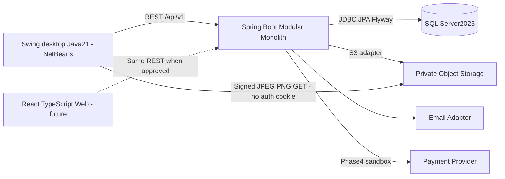

# Kiến trúc Modular Monolith

Revision3: Java21 / Spring Boot4.1.2 / Maven, SQL Server2025, Swing là desktop UI chính; React + TypeScript là Web extension ngoài MVP. User đã cho phép JUnit6 thay JUnit5. Một backend deployable, một DB; thêm desktop executable client chạy JVM riêng. Maven parent có đúng hai executable children backend/desktop-swing, không microservices, không CQRS/event sourcing hoặc Maven project riêng cho23 nghiệp vụ. Version/config evidence và trạng thái runtime ở [environment baseline](../deployment/environment-baseline.md).

## Ownership và ranh giới

- Mỗi feature package có public `api` (Java interfaces/records, không phải HTTP route) khi module khác cần gọi; `service/repository/entity` là nội bộ.
- HTTP controller, DTO và mapper thuộc module sở hữu nghiệp vụ. UI Creator Portal gọi publishing API; không vì màn hình có tên Creator mà chuyển publishing service vào creator.
- `common`: kiểu lỗi/pagination/clock abstractions tối thiểu; không chứa nghiệp vụ. `config`: wiring/security/Jackson. `infrastructure`: adapter DB job/mail/storage transport; không điều phối mua hàng.
- Security filter và method guard gọi identity/permission service; không để module nghiệp vụ phụ thuộc `admin`.
- `observability` sở hữu AuditLog và `AuditWriter`; `admin` chỉ có giao diện truy vấn audit. Không tạo phụ thuộc ngược từ nghiệp vụ sang admin để ghi log.
- `creator` sở hữu team/membership/task metadata và kiểm tra quyền team; dashboard composition dùng Swing views (Web sau này) và read-only projections. Không gọi ngược publishing/finance/analytics từ team domain.
- `entitlement` sở hữu access decision; `reader` gọi decision rồi lấy nội dung/signed URLs. `publishing` cung cấp content status và access-policy snapshot; không gọi reader/entitlement.
- `storage` không biết giá/chapter purchase; chỉ cấp URL qua internal service cho caller đã qua access boundary. Không expose public endpoint ký tùy ý asset ID.
- `monetization` sở hữu price/product/purchase và điều phối giao dịch mua bằng coin; `finance` sở hữu payment và subscription lifecycle. `wallet` và `entitlement` không gọi ngược hai module điều phối.

## Dependency DAG

`A → B` nghĩa A được phép import **public API** của B. Danh sách là direct dependencies được cho phép, không bắt buộc tạo dependency chỉ để lấp bảng. FK SQL là quan hệ dữ liệu, không tự động là Java dependency. Các module đều có thể dùng common và adapter abstractions; chúng không được import entity/repository module khác.

| Package | Direct dependencies được phép |
|---|---|
| observability | common |
| identity | observability |
| storage | identity, observability |
| creator | identity, observability |
| catalog | identity, creator, storage, observability |
| publishing | identity, catalog, creator, storage, observability |
| entitlement | identity, publishing, observability |
| reader | identity, publishing, storage, entitlement, observability |
| library | identity, catalog, reader, observability |
| search | catalog, publishing, observability |
| analytics | identity, catalog, publishing, observability |
| community | identity, catalog, publishing, entitlement, observability |
| recommendation | identity, catalog, analytics, observability |
| wallet | identity, observability |
| monetization | identity, publishing, wallet, entitlement, observability |
| finance | auth, monetization, wallet, entitlement, creator, observability |
| notification | identity, library, observability |
| gamification | identity, wallet, entitlement, observability |
| minigame | auth, gamification, wallet, entitlement, monetization, observability |
| ai | publishing, storage, community, search, recommendation, observability |
| offline | identity, reader, publishing, storage, entitlement, observability |
| dataprotection | identity, storage, observability |
| admin | identity, catalog, creator, publishing, community, monetization, finance, observability, dataprotection |

Thứ tự topo hợp lệ: observability → auth → storage → creator → catalog → publishing → entitlement → reader → library → search → analytics → community → recommendation → wallet → monetization → finance → notification → gamification → minigame → ai → offline → dataprotection → admin. Đây là thứ tự dependency; roadmap có thể xây một phần module sớm, không cần hoàn thành toàn bộ module trước module sau. Catalog gọi creator public API để kiểm tra team khi tạo bản dịch; creator không query ngược catalog. Dashboard team comics được Swing composition qua catalog API; không cần React.

Events là hợp đồng public, payload dùng ID và primitive snapshot, không JPA entity. Publishing phát `ChapterPublished`; notification lắng nghe và tra subscriber; analytics nhận reading events; gamification nhận event hợp lệ; AI workers gọi các public APIs ở layer cao hơn. Publisher không import consumer. Không dùng event để che giấu vòng gọi đồng bộ A→B→A. Contract của event do producer sở hữu; consumer compile-dependency đến producer cần bổ sung DAG nếu thực sự import, hoặc dùng event envelope common có payload versioned (đề xuất envelope chung để giữ DAG trên). Không tạo event bus network ở MVP.

Để publish không import entitlement mà vẫn có policy: publishing sở hữu `FREE|RESTRICTED` và trạng thái hiển thị của chapter; monetization về sau cập nhật commercial offer riêng. Entitlement phối hợp các snapshot và grants; chỉ nhận grant APIs từ orchestrator, không query ngược monetization/finance.

## Giao dịch và background processing

1. Giao dịch đồng bộ liên module dùng cùng SQL Server + Spring transaction propagation REQUIRED. Public API phải nêu rõ rollback; không REQUIRES_NEW cho debit hoặc grant.
2. Publish: validate version READY/APPROVED và assets READY → cập nhật published pointer → audit → outbox trong cùng DB transaction. DB commit xong mới gửi notifications/indexing.
3. Upload: tạo job trong DB trước; upload staging object, validate/convert; transaction ghi asset/page bindings và READY. Crash giữa object write và DB commit tạo orphan candidate; cleanup có grace period và kiểm tra reference. Không giả định object storage cùng transaction DB.
4. MVP dùng SQL-backed job polling có lease, attempts, nextAttemptAt, timeout, terminal failure và retry thủ công. Không dùng chỉ in-memory `@Async` cho job cần phục hồi.
5. Phase 4 purchase: lock tài khoản theo thứ tự cố định → kiểm tra entitlement/idempotency → snapshot giá → purchase + balanced ledger + balance cache + grant + outbox → commit. Nếu bất kỳ phần nào lỗi, rollback tất cả.
6. Payment provider không gọi trong DB lock dài. Verify webhook → ghi inbox unique → xử lý idempotent → commit credit/grant/status → acknowledge; reconcile khi timeout/không rõ.

## Storage, cache và tìm kiếm

- MVP chọn adapter S3-compatible, triển khai local bằng MinIO hoặc endpoint tương thích khi cấu hình đã xác nhận; SQL Server chỉ lưu metadata/key, không nhúng ảnh vào DB.
- Raw chapter assets private; cover public hoặc signed theo policy. URL hết hạn ngắn, không lưu URL tạm trong database.
- Search MVP dùng SQL Server query có parameter binding, pagination, normalized search fields; LIKE/contains baseline được ghi đúng là basic search. Full-text/Meilisearch/Elasticsearch là bước sau, không giả danh basic search là semantic/full-text engine.
- Ban đầu không cache permission/coin balance để ra quyết định. Catalog cache optional sau đo; invalidation theo change event. Redis leaderboard/rate limit phân tán khi Phase 3–6 có nhu cầu; một instance MVP có limiter cục bộ được ghi rõ giới hạn.

## Cây NetBeans/Maven — khung kiến trúc và phần mở rộng

```text
Comic Net/
  pom.xml                        # comic-net-parent, packaging=pom
  mvnw, mvnw.cmd, .mvn/           # wrapper dùng chung khi được phép
  prj_app.md
  docs/
  backend/                       # child comic-net-backend, Boot executable
    pom.xml                      # Boot4.1.2 BOM/plugin chỉ repackage child này
    src/main/java/com/comicnet/
      ComicNetApplication.java
      identity/ catalog/ publishing/ reader/ storage/ search/
      analytics/ library/ community/ recommendation/ wallet/
      monetization/ notification/ creator/ admin/ gamification/
      minigame/ ai/ offline/ entitlement/ observability/
      dataprotection/ finance/
      common/ config/ infrastructure/
    src/main/resources/
      application.yaml
      application-local.yaml     # env references; DB secrets chỉ backend
      db/migration/
    src/test/java/com/comicnet/
  desktop-swing/                 # child comic-net-desktop-swing, Java SE
    pom.xml                      # không Boot starter/repackage/JDBC/JPA
    src/main/java/com/comicnet/desktop/
      DesktopApplication.java   # main riêng; EDT bootstrap
      app/                      # navigation/presenter composition
      ui/layout/ ui/components/ # shared Swing primitives
      features/                 # implemented Swing features named for their owning M01–M23 module
      client/http/ client/api/ client/dto/
      session/ config/          # API URL + memory-only credentials, không DB
    src/main/resources/
      assets/                   # font/icon được kiểm tra quyền sử dụng
      runbooks/                 # hướng dẫn ops versioned, không secret
    src/test/java/com/comicnet/desktop/
  frontend/                     # reserved Web extension, ngoài MVP/reactor
    README.md                   # chỉ tạo khi bắt đầu Web phase được duyệt
    src/app/ pages/ features/ components/ hooks/ services/
    src/types/ styles/ assets/ utils/
  infra/                        # supporting services khi cần
  .gitignore
  README.md
```

Hai Maven child và source P1/P2 đã tồn tại. Backend có đủ 23 direct child business packages theo feature register; 8 module chưa có implementation chỉ có package-info.java đánh dấu rõ trạng thái, không coi là đã triển khai. Desktop thực tế có ui/ và features/{identity,catalog,search,analytics,recommendation,publishing,reader,library,community,notification,admin,observability,dataprotection}, resources/{fonts,operations}; app/ và các thư mục Web vẫn là định hướng. Trạng thái kiểm chứng tại [implementation status](../implementation-status.md). Root import dependency management/plugin management và release21; không gắn Spring Boot executable plugin lên desktop hoặc root. Không dependency Maven desktop-swing→backend, không entity/shared-domain module; contract REST/OpenAPI là ranh giới. JSON DTO client tối thiểu dùng mapper library đã quản lý version, không kéo Spring container vào Swing. JDK modules java.desktop/java.net.http/java.sql là khái niệm khác Maven modules; desktop không dùng java.sql.

Backend feature packages vẫn api/controller/service/repository/entity/dto/mapper/exception/event khi có class thật. Client views/presenters gọi client/api qua client/http; service nghiệp vụ và SQL chỉ backend. NetBeans GUI Builder chỉ layout/form, không nhúng REST hoặc SQL trong generated handler. Swing và backend có main class khác nhau; root không có main Run.

NetBeans mở parent và hai children; Run/Debug backend child trước, desktop child sau. Root Maven reactor build cả hai, có thể build từng child; Web/npm không tham gia. P1 kiểm chứng cấu hình Run cụ thể (Spring Boot goal cho backend, Java main/exec cho desktop), không giả định build parent tự launch hai ứng dụng. Desktop close đóng resources/client, không tự dừng SQL/backend không do nó sở hữu.

## Desktop transport, session và media

Java21 HttpClient tái sử dụng, timeout/cancel; JSON/error/ETag/revision mapping tập trung. HTTP/image decode/scale/upload ngoài EDT; completion SwingWorker.done/process hoặc SwingUtilities.invokeLater. Không get/join chờ I/O trên EDT; đọc kết quả đã hoàn tất trong done hợp lệ. Bỏ stale response theo navigation/session generation, polling jobs có backoff.

Session giữ access token10m và cookie store riêng trong memory; không CookieHandler global, không lưu refresh/password vào Preferences/file/DB. Share getCsrf/login/refresh/logout REST với Web tương lai; desktop không giả Origin5173, backend kiểm tra Origin khi có và luôn CSRF cho cookie-auth mutation. Không dùng header client type để bypass. Login lại khi restart là baseline MVP;30ngày là trần server session, không lời hứa auto-login sau đóng app. Logout/window close best effort revoke; khi mất mạng local memory vẫn xóa, backend session chỉ hết hạn/revoke theo policy thật.

Image transport dùng HttpClient riêng **không** Cookie/Authorization, chỉ approved storage hosts/schemes và không redirect credential. Backend mặc định cấp JPEG/PNG display derivatives cho cover/banner/manifest/preview, URL sau entitlement. Không tự giả Java ImageIO hỗ trợ WebP/AVIF; codec/variant phục vụ Swing phải kiểm chứng trước publish P2. Thumb/reader cache private chỉ memory; offline/download license toàn phần P6.

React/TypeScript/Vite/Tailwind/Router, Query/RHF/Zod/Context/Fetch vẫn giữ ở Web extension, cần xác nhận riêng sau P2; không WebView hoặc embedded React trong Swing. P3–7 business có thể tiếp tục bằng Swing qua API mà không đợi Web.

## Deployment/component view



Development: Swing gọi http://localhost:8080/api/v1, backend trên loopback và SQL ComicNetDev dùng SQL login riêng/dev encrypt=true/trustServerCertificate=true. Client không có SQL credential. Hai Java JVM riêng; storage/mail adapters theo nhu cầu. Production client→backend HTTPS và SQL certificate validation, không reuse dev trust exception.

Delivery MVP: backend executable JAR + desktop JAR/distribution kèm runtime dependencies, launch instructions/main riêng. Chưa cần jpackage/native installer/bundledJRE ở P1; nếu chọn phải có yêu cầu và kiểm chứng riêng. Web tương lai mới build Vite static assets hoặc host riêng; giữ SPA fallback tránh /api routes, không là dependency build/demo MVP.
