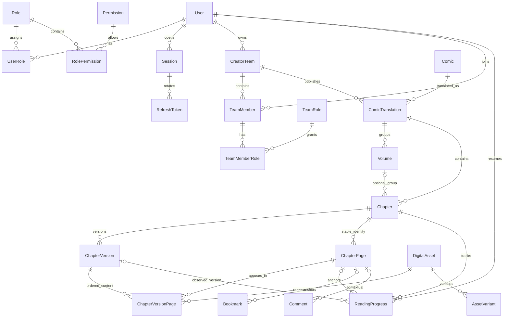
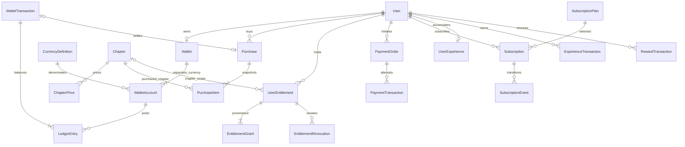

# Core ERD — Microsoft SQL Server 2025

Logical design để review, **không phải migration đã chạy**. Bảng thuộc module sở hữu; FK cross-module bảo đảm integrity, không yêu cầu JPA association cross-module. SQL Server schema đề xuất `dbo`, tên bảng theo PascalCase, migration Flyway quản lý tuần tự. Không tạo 23 SQL schemas hoặc shards.

Revision3 Swing-first: domain ERD/IDs giữ nguyên, chỉ backend truy cập DB; desktop không tạo DB local, không dùng entities/JPA/JDBC. Bổ sung BootstrapState phục vụ wizard Admin đã được user duyệt; asset JPEG/PNG display variants là nội dung delivery, không đổi Page/Version identity. Backup/restore procedure vẫn operator theo runbook, không thêm RESTORE command table/API chỉ để có nút Swing.

## Quy ước dữ liệu

- PK nội bộ `bigint IDENTITY`; JSON API biểu diễn ID bằng decimal string để tránh giới hạn số nguyên JavaScript. Slug là lookup riêng, không PK.
- Thời gian UTC `datetime2(3)`; API ISO-8601 có `Z`. `rowversion` là concurrency token 8 bytes, không phải timestamp; API ETag opaque, `If-Match` trên mutation.
- Text Unicode `nvarchar`; title 300, slug 200, language tag 35; mô tả `nvarchar(max)` có max payload ở DTO. Unique normalized email dùng `nvarchar(320)`; normalization được application quyết định nhất quán và ghi test collation SQL Server.
- Tiền thật `decimal(19,4)` + ISO currency; coin proposed `bigint` nguyên không âm. Không FLOAT cho tiền, giá, ledger. Relative offset có thể `decimal(6,5)` trong [0,1].
- Audit timestamps `CreatedAt`, `UpdatedAt`, `CreatedBy`; soft hide `Visibility`, `DeletedAt` khi cần. Financial ledger append-only; correction bằng reversal. Không cascading delete User/Comic/Chapter xuống purchase/ledger/progress/comment.
- FK `NO ACTION` mặc định để tránh multiple cascade paths; service xử lý xóa mềm/thứ tự. Unique index có filter cho nullable/soft-delete theo từng bảng, không giả định nhiều NULL trong SQL unique thông thường.

## ERD nội dung — identity ổn định

### Mô hình Comic / Translation / Chapter / Version / Page

1. **Comic** là tác phẩm, độc lập ngôn ngữ và nhóm. **ComicTranslation** là edition của một tác phẩm theo language + team + edition key; nhiều nhóm có thể cùng ngôn ngữ.
2. **Volume** thuộc một translation, optional trên Chapter. Không bắt buộc truyện webtoon có volume.
3. **Chapter** có ID ổn định xuyên các lần thay ảnh; display number/string khác `SortOrder`. Giá, purchase và entitlement trỏ Chapter, không trỏ version.
4. **ChapterVersion** là snapshot nội dung và trạng thái review. Mỗi version có thứ tự version tăng. Approved/published version bất biến; chỉnh sửa tạo version mới. Một Chapter có thể đang public V1 và đang draft V2.
5. **ChapterPage** là định danh trang logic trong Chapter, không chứa asset hoặc thứ tự. **ChapterVersionPage** là association `(Version, Page)` mang `Position` và `AssetId`. Cùng PageId có asset khác ở V1/V2; giữ anchor khi chỉ thay ảnh cùng trang.
6. Chèn trang mới cấp PageId mới; xóa khỏi version mới không xóa ChapterPage cũ; reorder đổi Position trên draft snapshot. Không tự ghép trang dựa tên file. Split/merge yêu cầu mapping hoặc đánh dấu anchor unavailable; không âm thầm chuyển comment sang nội dung khác.
7. Published pointer một nơi: `Chapter.PublishedVersionId`. Không dùng cờ `IsCurrent` rải rác. Chapter visibility/archived độc lập với state version.
8. Bookmark/comment lưu PageId và relative offset; ReadingProgress lưu thêm observed VersionId. Nếu PageId không còn ở published version, response `ANCHOR_UNAVAILABLE`, trả vị trí gần nhất nếu có mapping rõ; user xác nhận fallback về đầu chapter. Giữ anchor gốc cho audit, không tự xóa.

## Dictionary MVP

Mọi bảng có PK `Id` trừ join table ghi composite PK; FK và các trường bắt buộc dưới đây là NOT NULL trừ dấu `?`. Runtime timestamps omitted trong bảng tóm tắt nhưng áp dụng theo quy ước; bảng immutable chỉ cần CreatedAt.

| Table / owner | Fields, FK và constraints trọng yếu |
|---|---|
| User / auth | Email, NormalizedEmail UNIQUE, PasswordHash?, DisplayName, Status ACTIVE/SUSPENDED/DELETED, EmailVerifiedAt?, AuthVersion, RowVersion; hash nullable dành SSO tương lai |
| Role, Permission / auth | Code UNIQUE; RolePermission(RoleId,PermissionId) PK; UserRole(UserId,RoleId) PK |
| Session / auth | UserId FK, DeviceLabel, ExpiresAt, RevokedAt?, LastSeenAt; index UserId/RevokedAt |
| RefreshToken / auth | SessionId, TokenHash UNIQUE, ParentTokenId? self FK, ExpiresAt, UsedAt?, RevokedAt?; lineage không chứa raw secret |
| AccountActionToken / auth | UserId, Purpose VERIFY_EMAIL/RESET_PASSWORD, TokenHash UNIQUE, ExpiresAt, ConsumedAt?; không dùng chung refresh token |
| BootstrapState / auth | Singleton Id=1, InitializedAt?, AdministratorUserId? FK User, SetupGeneration/RowVersion; unique singleton seeded cùng auth schema P2. Lock row trước create User+Role+Audit; state/identity commit cùng tx, không reset khi account bị suspend. Setup secret từ backend env, không plaintext trong DB |
| CreatorTeam / creator | OwnerUserId FK, Name, Slug UNIQUE, Status, RowVersion |
| TeamMember / creator | TeamId + UserId UNIQUE, Status ACTIVE/REMOVED, JoinedAt |
| TeamRole / creator | Code UNIQUE (OWNER/CREATOR/TRANSLATOR/EDITOR/PROOFREADER/UPLOADER); permission mapping cấu hình qua TeamRolePermission |
| TeamMemberRole / creator | PK(MemberId,TeamRoleId); không trùng TeamMember chính vì một người nhiều role |
| TeamRolePermission / creator | PK(TeamRoleId,PermissionId); Permission registry dùng auth, không lưu system role vào membership |
| Comic / catalog | OwnerUserId, Title, Slug UNIQUE, Description, Type, CountryCode, Status, AgeRating, Visibility, CoverAssetId?, BannerAssetId?, DeletedAt?, RowVersion |
| ComicAlternativeTitle / catalog | ComicId, Title, NormalizedTitle, LanguageTag?; UNIQUE(ComicId,NormalizedTitle) |
| Author / catalog | Name; ComicAuthor PK(ComicId,AuthorId,ContributionType AUTHOR/ARTIST) |
| Publisher / catalog | Name; ComicPublisher PK(ComicId,PublisherId) |
| Genre, Tag, ContentWarning / catalog | Code UNIQUE; ComicGenre/ComicTag/ComicContentWarning composite PKs |
| ComicTranslation / catalog | ComicId, TeamId, LanguageTag, EditionKey, TitleOverride?, Visibility, RowVersion; UNIQUE(ComicId,TeamId,LanguageTag,EditionKey) |
| Volume / publishing | TranslationId FK, DisplayLabel, SortOrder decimal(12,4); UNIQUE(TranslationId,SortOrder) |
| Chapter / publishing | TranslationId, VolumeId?, DisplayNumber nvarchar(50), Title, SortOrder decimal(12,4), Visibility, AccessPolicy FREE/RESTRICTED, PublishedVersionId?, PublishedAt?, DeletedAt?, RowVersion; UNIQUE(TranslationId,SortOrder) |
| ChapterVersion / publishing | ChapterId, VersionNumber int >0, State, CreatedBy, SubmittedBy?, ReviewedBy?, ReviewedAt?, ReviewReason?, RowVersion; UNIQUE(ChapterId,VersionNumber), UNIQUE(ChapterId,Id) |
| ChapterPage / publishing | ChapterId, CreatedAt, RetiredAt?; UNIQUE(ChapterId,Id); không có Position/AssetId |
| ChapterVersionPage / publishing | ChapterId, VersionId, PageId, Position int >0, AssetId; PK(VersionId,PageId), UNIQUE(VersionId,Position) |
| DigitalAsset / storage | Bucket, ObjectKey UNIQUE cùng Bucket, Kind, DetectedMime, ByteSize >0, Width/Height >0 nếu ảnh, SHA256, Status STAGING/READY/FAILED/RETIRED, UploadedBy, RowVersion; source không public |
| AssetVariant / storage | AssetId, Format, Width, Height, ObjectKey, ByteSize; UNIQUE(AssetId,Format,Width,Height) |
| AssetAccessPolicy / storage | AssetId UNIQUE FK, Policy PRIVATE/PUBLIC, UrlTtlSeconds >0; quyết định entitlement không nằm ở bảng này |
| UploadJob / publishing | ChapterId, VersionId, RequestedBy, ClientRequestKey, Status, Attempts, LeaseUntil?, NextAttemptAt?, ErrorCode?, StagingKey?, RowVersion; UNIQUE(RequestedBy,ClientRequestKey) |
| BackgroundJob / observability | JobType, PayloadRef, State, Attempts, MaxAttempts, LeaseOwner?, LeaseUntil?, NextAttemptAt?, ErrorCode?; index State/NextAttemptAt |
| ReadingProgress / reader | UserId, ChapterId, VersionId?, PageId?, RelativeOffset [0,1], Completed bool, LastReadAt server, Revision bigint >0, LastMutationId; UNIQUE(UserId,ChapterId) |
| ReadingPreference / reader | UserId UNIQUE, Mode SCROLL/PAGED, Direction LTR/RTL, Fit WIDTH/HEIGHT, RowVersion |
| ReadingHistoryState / reader | UserId UNIQUE, HistoryGeneration bigint >=0, RowVersion; clear history tăng generation trong cùng transaction xóa progress, không đặt field reader vào auth.User |
| ProgressMutation / reader | UserId, MutationId UUID, ChapterId, HistoryGeneration, PayloadHash, ResultRevision, ResultSnapshot, ExpiresAt; UNIQUE(UserId,MutationId). TTL tối thiểu 30 ngày; generation cũ vẫn bị từ chối sau TTL |
| LibraryCollection / library | UserId, Name, IsSystem, SystemKey?; filtered UNIQUE(UserId,SystemKey) WHERE SystemKey IS NOT NULL |
| CollectionItem / library | PK(CollectionId,ComicId), ReadingStatus? WANT_TO_READ/READING/COMPLETED/REREAD, IsFavorite? bool, AddedAt, RowVersion; status/favorite chỉ áp dụng default collection |
| ComicFollow / library | PK(UserId,ComicId), CreatedAt; notification không sở hữu follow thứ hai |
| Bookmark / library | UserId, ChapterId, PageId?, VersionId?, RelativeOffset [0,1], Label?, RowVersion |
| AuditLog / observability | ActorUserId?, Action, TargetType, TargetId?, Outcome, RequestId, SafeMetadata, CreatedAt; append-only, index TargetType/TargetId/CreatedAt |
| OutboxEvent / observability | EventId UNIQUE, Type, SchemaVersion, AggregateId, Payload, CreatedAt, PublishedAt?, Attempts, NextAttemptAt? |
| IdempotencyRecord / observability | ActorId, Operation, Key, RequestHash, State, ResponseRef?, ExpiresAt; UNIQUE(ActorId,Operation,Key) |

### Cross-parent constraints bắt buộc

- ChapterVolume: Volume có UNIQUE(TranslationId,Id); Chapter composite FK `(TranslationId,VolumeId)` bảo đảm volume cùng translation (nullable VolumeId hợp lệ).
- VersionPage có composite FK `(ChapterId,VersionId) → ChapterVersion(ChapterId,Id)` và `(ChapterId,PageId) → ChapterPage(ChapterId,Id)`; cấm trộn trang/version của chapter khác.
- Published pointer composite FK `(Id,PublishedVersionId) → ChapterVersion(ChapterId,Id)` nullable. Đây là FK cycle **dữ liệu**, không Java module cycle. Tạo Chapter trước với pointer NULL, tạo Version rồi mới set pointer; NO ACTION, không cascading.
- Pointer version phải APPROVED/đã qua publish transition và có >=1 trang READY. CHECK không kiểm tra bảng khác được; enforce trong transaction service với lock/version token và integration test.
- Progress/Bookmark dùng composite FK ChapterId với PageId/VersionId. Membership trang trong version được service validate vì anchor cũ được phép không còn trong version mới.
- Chỉ một draft sửa được mỗi Chapter: filtered unique index ChapterId trên trạng thái mutable DRAFT/UPLOADING/PROCESSING/READY_FOR_REVIEW/APPROVED/SCHEDULED (predicate SQL cụ thể xác nhận trong migration); nếu SQL predicate không hỗ trợ biểu thức dự kiến, dùng `IsWorkingCopy` persisted field + filtered unique, giữ state/flag nhất quán trong service. Chưa tuyên bố cú pháp migration đã kiểm chứng.
- Một version PageCount không lưu như nguồn sự thật thứ hai; query/materialized count chỉ là projection, publish validate bằng rows thật.
- Default collection `SystemKey=LIBRARY` là nguồn chính thức của ReadingStatus/IsFavorite; custom collections chỉ nhóm comic, hai cột đó NULL và response bỏ hai field. PUT custom item nhận object rỗng; PUT default item cho phép status/favorite, create default values WANT_TO_READ/false. Service enforce dựa parent collection, không tạo nhiều nguồn sự thật.
- Mọi thay đổi bindings/job state chạm RowVersion của ChapterVersion. Reorder dùng vị trí tạm dương ngoài khoảng hiện hành trong một transaction rồi ghi vị trí cuối để tránh UNIQUE(Position) conflict; không dùng vị trí âm trái CHECK >0.
- P2 READY cho publishing yêu cầu có bản display JPEG/PNG đọc được trên Swing (có thể reuse source nếu định dạng phù hợp); WebP input cần backend decoder/derivative kiểm chứng. Đây là baseline format compatibility, không tự kéo toàn tính năng nhiều kích thước/WebP/AVIF P3 vào MVP. Cover/banner API cũng trả compatible derivative, không để client tự đoán object key/codec.

## Index/access paths

Catalog: Slug UNIQUE; Comic(Visibility,UpdatedAt,Id); translation(ComicId,Visibility); tên normalized indexed theo query thực tế. Chapters(TranslationId,Visibility,SortOrder,Id), VersionPage(VersionId,Position) include PageId/AssetId; Progress(UserId,LastReadAt DESC,Id); Follow(ComicId,UserId) cho notifications; Job(State,NextAttemptAt); Audit(TargetType,TargetId,CreatedAt). Không index mọi cột; đo query plan với SQL Server trong phase triển khai.

## ERD thương mại và reward (Phase 4–5, thiết kế lõi)

| Nhóm / owner | Key fields và invariants |
|---|---|
| Wallet, WalletAccount / wallet | Wallet.UserId UNIQUE; Account(WalletId?,SystemAccountCode?,CurrencyId,Type, BalanceCache bigint, RowVersion). Mỗi account thuộc đúng user wallet hoặc platform system, không cả hai. UNIQUE(WalletId,CurrencyId) filtered user accounts; SystemAccountCode+Currency UNIQUE filtered system accounts |
| CurrencyDefinition / wallet | Code PAID_COIN/REWARD_COIN UNIQUE, Precision=0 baseline. Không chuyển Reward→Paid mặc định |
| WalletTransaction / wallet | IdempotencyKey/Actor/Operation UNIQUE, Status PENDING/COMPLETED/FAILED/REVERSED, SourceType, SourceId, ReversalOfId? UNIQUE filtered; Completed immutable |
| LedgerEntry / wallet | TransactionId, AccountId, Side DEBIT/CREDIT, Amount bigint >0, CurrencyId; mỗi transaction cân tổng debit=credit **theo currency**. Service transaction + reconcile, CHECK cục bộ không đủ bảo đảm aggregate |
| ChapterPrice / monetization | ChapterId, CurrencyId, Amount bigint >=0, ValidFrom/To?, RowVersion. Không overlap cùng policy/currency; serialize write và validate interval, không giả định SQL Server có exclusion constraint |
| Purchase, PurchaseItem / monetization | Purchase(UserId,IdempotencyKey,Status,WalletTransactionId?,CreatedAt); Item(PurchaseId,ChapterId,PriceId?,PriceAmountSnapshot,CurrencySnapshot,ProductType). Snapshot bất biến; cùng entitlement hiện hành không debit lần nữa |
| UserEntitlement / entitlement | UserId, Scope CHAPTER/GLOBAL, ChapterId?, Kind, ValidFrom/To?, State, RowVersion; CHECK scope/ChapterId khớp. Mỗi nguồn grant có unique SourceType/SourceId/UserId/ScopeKey; nhiều grants khác nguồn được phép, revoke một nguồn không xóa quyền nguồn khác |
| EntitlementGrant/Revocation | EntitlementId, SourceType/Id, CreatedAt, Reason; không FK polymorphic giả: source được service validate, index theo SourceType/Id, records bất biến |
| PaymentOrder/Transaction/WebhookInbox / finance | MerchantReference UNIQUE, Provider/ProviderReference UNIQUE filtered, amount/currency snapshot; inbox UNIQUE(Provider,EventId), payload hash và processing state |
| SubscriptionPlan / monetization | Version, ProductCode, duration/price/benefits snapshot; thay plan không sửa lịch sử |
| Subscription/SubscriptionEvent / finance | UserId, PlanId, PlanSnapshot, State, CurrentPeriodStart/End, CancelAtPeriodEnd; UNIQUE provider subscription ref khi có. Events append-only; renewal payment độc lập |
| RefundRecord/ReconciliationRecord/Dispute / finance | OriginalTransactionId, provider ref UNIQUE, state/reason; links coin reversal và grant revocation; không xóa ledger để refund |
| CreatorTeam/RevenueShareRule/PayoutRequest | Rule effective interval/version và immutable snapshot khi ghi earning. Payout state REQUESTED/APPROVED/PROCESSING/PAID/REJECTED/FAILED. Creator sở hữu request/rule; finance sở hữu settlement/reconcile |
| UserExperience/ExperienceTransaction / gamification | Experience total projection, transaction Amount signed, SourceType/Id/RuleVersion UNIQUE với user; reversal reference; level thresholds trong LevelDefinition |
| RewardTransaction / gamification | RewardType, source unique, UserId, granted amount, wallet/grant/inventory reference, State; EXP và coin không dùng chung balance |

Các ledger entry platform system account là cần thiết để sổ cân; không bắt mọi WalletAccount có Wallet của User. Mua nhiều currency tách các posting cân riêng. BalanceCache phải bằng tổng posted ledger theo quy ước side của account; không cập nhật ngoài cùng transaction ledger.

Baseline quy ước số dư coin: credit tăng, debit giảm; BalanceCache = tổng credit - debit của postings COMPLETED. User account bắt buộc không âm; platform issuance/clearing account được âm có kiểm soát để mint/top-up vẫn cân sổ. WalletAccount có UNIQUE(Id,CurrencyId), LedgerEntry composite FK(AccountId,CurrencyId) ngăn posting currency sai account. Account loại USER phải có WalletId và không SystemAccountCode; loại PLATFORM ngược lại. Không dùng cùng account cho tiền thật của provider và coin ảo. Reversal tạo postings ngược đầy đủ, không sửa entry đã COMPLETED.

## Entity tiếp theo vẫn trong scope

Community: Comment(target Comic/Chapter/Page, ParentId?, version anchor?, spoiler, state), CommentReaction unique(user,comment), Report, UserBlock. Comment target CHECK và composite FK khi có chapter/page; giữ tombstone khi có replies.

Recommendation: Rating UNIQUE(user,comic), Review, RecommendationRecord/Feature. Notifications: Notification/Preference/Delivery unique(recipient,event,channel). PublishingSchedule ở Phase 3. AuthProvider/MFA/RecoveryCode ở Phase 3–6. GameSession/SpinRecord/RewardDefinition/Inventory/Card/UserCard ở Phase 5. AIProcessingJob/ModerationDecision ở Phase 6. OfflineManifest/DownloadRecord và local IndexedDB schema ở Phase 6 sau threat model. ModerationReport/SystemSetting/FeatureFlag/Banner thuộc admin, AuditLog chuyển owner observability để tránh dependency cycle.

Đây là mô hình logic đầy đủ cho quyết định lõi; physical DDL/index predicate/constraint names và dữ liệu seed sẽ được kiểm chứng trên SQL Server 2025 khi được phép triển khai.
