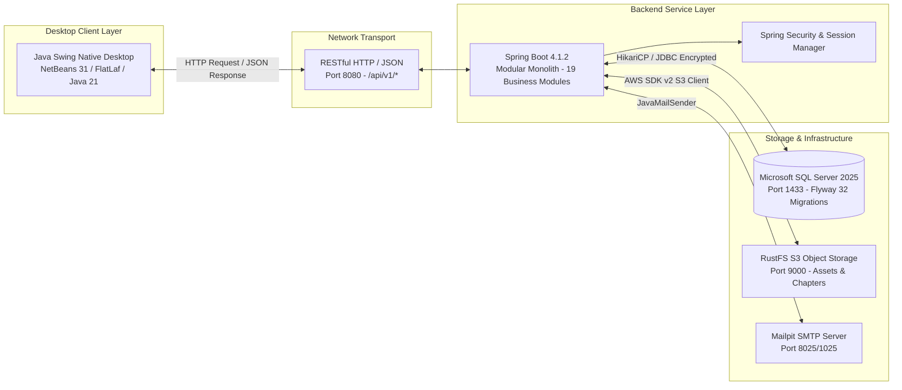
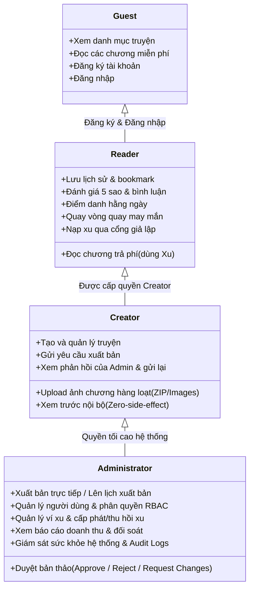

# 00. TỔNG QUAN DỰ ÁN VÀ MỤC TIÊU HỆ THỐNG COMIC NET

---

## 1. GIỚI THIỆU DỰ ÁN

**Comic Net** (tên thiết kế gốc: *Comic Platform — Nền tảng đọc truyện tranh đa nền tảng*) là một hệ thống phần mềm toàn diện phục vụ quản lý xuất bản số, phân phối nội dung, tương tác cộng đồng và số hóa trải nghiệm đọc truyện tranh bản quyền.

- **Loại hình dự án:** Đồ án tốt nghiệp Đại học ngành Công nghệ Thông tin / Dự án phát triển phần mềm ứng dụng doanh nghiệp thực tế.
- **Mã nguồn thực tế:** [Comic Net Repository](file:///c:/Users/studi/OneDrive/Documents/Tools/Comic%20Net)
- **Kiến trúc cốt lõi:** **Modular Monolith** phân tách rõ ràng Frontend (Java Swing Desktop Application) và Backend (Spring Boot REST Application), giao tiếp phi trạng thái qua giao thức HTTP/JSON, lưu trữ dữ liệu bền vững trên Microsoft SQL Server 2025 kết hợp dịch vụ lưu trữ đối tượng tương thích S3 (RustFS/MinIO).

---

## 2. BỐI CẢNH VÀ MỤC TIÊU XÂY DỰNG

### 2.1. Bối cảnh thực tiễn
Thị trường đọc truyện tranh trực tuyến tại Việt Nam và quốc tế hiện nay đối mặt với nhiều bài toán hóc búa:
1. **Bản quyền và kiểm soát nội dung:** Việc tải lên tự do dễ dẫn đến vi phạm bản quyền và nội dung không phù hợp. Hệ thống cần quy trình kiểm duyệt đa bước (Creator nộp bản thảo $\to$ Admin thẩm định $\to$ Duyệt/Yêu cầu chỉnh sửa $\to$ Xuất bản).
2. **Trải nghiệm đọc chuyên biệt:** Trình đọc truyện tranh đòi hỏi khả năng xử lý hình ảnh tối ưu, nạp mượt mà, lưu vết tiến độ chính xác theo từng trang và pixel cuộn dọc, hoạt động mượt mà trên môi trường máy tính để bàn (Desktop).
3. **Kinh tế số và Gamification:** Để giữ chân người đọc và thúc đẩy tương tác, nền tảng cần tích hợp hệ thống kinh tế ảo (Ví xu trả phí và xu miễn phí), cùng các cơ chế Gamification hấp dẫn (Điểm danh nhận quà hằng ngày, Vòng quay may mắn chu kỳ 12 giờ, Tích lũy EXP và tăng cấp độc giả).

### 2.2. Mục tiêu kỹ thuật và học thuật của đồ án
- **Tính độc lập và an toàn (Decoupled & Secure):** Desktop Client không bao giờ nhúng driver JDBC hay giữ mật khẩu SQL Server; 100% nghiệp vụ, phân quyền RBAC và ràng buộc toàn vẹn dữ liệu được backend bảo vệ tối thượng.
- **Chuẩn hóa công nghệ doanh nghiệp:** Sử dụng Java 21 LTS (phiên bản Java dài hạn mới nhất), Spring Boot 4.1.2, quản lý di trú cơ sở dữ liệu tự động với Flyway (32 phiên bản migration), lưu trữ tài nguyên lớn phi cấu trúc trên S3.
- **Khả năng kiểm thử và chứng minh (Auditable & Testable):** Đạt 55/55 bài kiểm thử đơn vị (Unit Tests), 174/174 hợp đồng API (OpenAPI MVP Contract), 16 bài kiểm thử tích hợp thực tế trên SQL Server & S3 Storage.

---

## 3. CÁC ĐỐI TƯỢNG NGƯỜI DÙNG (ACTORS)

Hệ thống được thiết kế dựa trên mô hình phân quyền theo vai trò (Role-Based Access Control - RBAC) chặt chẽ:

> [!NOTE]
> **Về vai trò MODERATOR:** Trong phiên bản thiết kế ban đầu, hệ thống dự kiến có thêm vai trò `MODERATOR` (Kiểm duyệt viên). Tuy nhiên, theo quyết định tối ưu hóa kiến trúc tại Migration `V31`, vai trò này đã chính thức **nghỉ hưu (retired)** để tinh gọn bộ máy vận hành. Toàn bộ thẩm quyền kiểm duyệt nội dung được tích hợp trực tiếp vào vai trò `ADMINISTRATOR`.

---

## 4. YÊU CẦU CHỨC NĂNG CỐT LÕI (FUNCTIONAL REQUIREMENTS)

| Nhóm chức năng | Tóm tắt năng lực hệ thống | Thành phần phụ trách |
|---|---|---|
| **Xác thực & Phiên (Identity)** | Đăng ký, đăng nhập nhận JWT Bearer Token (bộ nhớ) và Session Cookie (30 ngày), xác thực OTP qua Email, khôi phục mật khẩu, quản lý và thu hồi phiên đăng nhập từ xa. | `identity` |
| **Danh mục truyện (Catalog)** | Khám phá truyện theo thể loại, từ khóa, tác giả; hiển thị bìa sách, thông tin chi tiết, trạng thái xuất bản, danh sách chương kèm định dạng giá. | `catalog`, `search` |
| **Xưởng xuất bản (Creator Studio V2)** | Tạo truyện wizard 3 bước, tải lên nhiều ảnh hoặc tệp ZIP (tự giải nén, tối ưu hóa WebP/PNG, lưu S3), sắp xếp thứ tự tự nhiên (Natural Sort), quản lý lịch sử phiên bản (Versioning). | `publishing`, `creator` |
| **Quy trình duyệt Admin** | Hàng chờ duyệt dành riêng cho Admin, xem trước chương nội bộ an toàn (không tăng view), đưa ra quyết định duyệt hoặc yêu cầu chỉnh sửa kèm lý do chi tiết. | `admin`, `publishing` |
| **Bộ đọc truyện (Reader Engine)** | Trình đọc tối ưu hóa hiệu năng cuộn hoặc lật trang (Paged/Continuous), phím tắt bàn phím, điều chỉnh độ sáng, tự động ghi nhận tiến độ đọc và điểm đọc dở. | `reader` |
| **Thư viện cá nhân (Library)** | Đồng bộ đa thiết bị: Lịch sử đọc, Truyện đang theo dõi, Truyện yêu thích, Đánh dấu trang (Bookmark), Bộ sưu tập cá nhân tùy biến. | `library` |
| **Tương tác & Cộng đồng** | Đánh giá 5 sao kèm nhận xét chi tiết, bình luận theo chương, thả cảm xúc (Like, Heart, Laugh), báo cáo vi phạm nội dung. | `community`, `recommendation` |
| **Ví xu & Thương mại hóa** | Ví kép (Xu trả phí `PAID` và Xu tặng `FREE`), sổ cái kế toán cân bằng (Double-entry Ledger), mua chương bản quyền, nạp xu qua Sandbox thanh toán nội bộ. | `wallet`, `monetization`, `finance`, `entitlement` |
| **Gamification & Tương tác** | Điểm danh nhận thưởng 7 ngày liên tiếp, Vòng quay may mắn chu kỳ 12 giờ miễn phí, hệ thống cấp độ Độc giả (Cấp 1 - 10) dựa trên EXP đọc truyện và tích lũy. | `gamification` |
| **Vận hành & Giám sát** | Bảng điều khiển Admin: Quản lý người dùng, khóa tài khoản, phân quyền, xem nhật ký kiểm toán (Audit Logs), đo lường JVM Metrics và trạng thái DB. | `admin`, `observability` |

---

## 5. YÊU CẦU PHI CHỨC NĂNG (NON-FUNCTIONAL REQUIREMENTS)

1. **Hiệu năng giao diện Desktop (UI Responsiveness):**
   - 100% các tác vụ gọi mạng HTTP, giải mã hình ảnh Base64/S3 và upload tệp tin nặng đều chạy trên luồng nền (`SwingWorker`, `HttpClient async`).
   - Tuyệt đối không để xảy ra hiện tượng khóa luồng xử lý sự kiện giao diện (Event Dispatch Thread - EDT). Ứng dụng luôn phản hồi các thao tác phím và chuột.
2. **Tính toàn vẹn dữ liệu (Data Consistency):**
   - Các thao tác tài chính, trừ xu, mua chương và điểm danh được bảo vệ bằng giao dịch cơ sở dữ liệu (`@Transactional`) với cơ chế khóa bi quan (`UPDLOCK, HOLDLOCK`) hoặc khóa lạc quan (`Version/ETag`).
   - Cơ chế phòng chống gian lận và gửi lặp (Idempotency Key) ngăn ngừa triệt để lỗi người dùng nhấn đúp nút (double click) hoặc race condition.
3. **Bảo mật và Phân quyền (Security by Design):**
   - Mã hóa mật khẩu một chiều bằng thuật toán mạnh (BCrypt/PBKDF2).
   - Backend luôn là bức tường phòng thủ cuối cùng: Kiểm tra quyền sở hữu tác phẩm (Ownership), kiểm tra quyền đọc chương trả phí trước khi trả về URL tài nguyên ảnh. Việc ẩn/vô hiệu hóa nút trên Desktop Swing chỉ đóng vai trò hỗ trợ trải nghiệm người dùng (UX).
4. **Khả năng tương thích môi trường (Environment Portability):**
   - Mã nguồn được đóng gói theo chuẩn Maven, chạy trực tiếp trên Java 21 LTS độc lập hoặc thông qua IDE Apache NetBeans 31.
   - Cơ sở dữ liệu tự động nâng cấp đồng nhất qua Flyway migration mà không cần chạy tay các script rời rạc.

---

## 6. DANH MỤC TÀI LIỆU TRONG BỘ HỒ SƠ BẢO VỆ

Bộ tài liệu bảo vệ đồ án Comic Net được chia thành 13 văn bản chuyên đề đặt tại thư mục [`docs/defense/`](file:///c:/Users/studi/OneDrive/Documents/Tools/Comic%20Net/docs/defense/):

- **[00_TONG_QUAN.md](file:///c:/Users/studi/OneDrive/Documents/Tools/Comic%20Net/docs/defense/00_TONG_QUAN.md):** Tổng quan dự án, mục tiêu, vai trò người dùng và yêu cầu hệ thống.
- **[01_LICH_SU_THAY_DOI.md](file:///c:/Users/studi/OneDrive/Documents/Tools/Comic%20Net/docs/defense/01_LICH_SU_THAY_DOI.md):** Khảo sát lịch sử phát triển, đối chiếu thiết kế gốc 23 module và 19 module hiện tại; phân tích chi tiết các tính năng đã xóa, gộp và bổ sung.
- **[02_CONG_NGHE_KIEN_TRUC.md](file:///c:/Users/studi/OneDrive/Documents/Tools/Comic%20Net/docs/defense/02_CONG_NGHE_KIEN_TRUC.md):** Phân tích sâu toàn bộ ngăn xếp công nghệ (Java 21, Spring Boot 4, Swing, FlatLaf, SQL Server, S3, Flyway) và sơ đồ kiến trúc Modular Monolith.
- **[03_MODULE_PACKAGE_CLASS.md](file:///c:/Users/studi/OneDrive/Documents/Tools/Comic%20Net/docs/defense/03_MODULE_PACKAGE_CLASS.md):** Giải phẫu chi tiết cấu trúc package, phân loại module kỹ thuật vs nghiệp vụ, danh mục các class chính và phương thức quan trọng.
- **[04_GIAO_DIEN_BUTTON.md](file:///c:/Users/studi/OneDrive/Documents/Tools/Comic%20Net/docs/defense/04_GIAO_DIEN_BUTTON.md):** Kiểm toán toàn diện 26 màn hình, panel, dialog Java Swing; truy vết từng nút bấm đến tận Event Handler, API và cơ sở dữ liệu.
- **[05_DATABASE.md](file:///c:/Users/studi/OneDrive/Documents/Tools/Comic%20Net/docs/defense/05_DATABASE.md):** Toàn bộ schema cơ sở dữ liệu 82 bảng, phân tích khóa chính, khóa ngoại, ràng buộc, lược đồ ERD chuẩn và quy trình di trú Flyway.
- **[06_LUONG_NGHIEP_VU.md](file:///c:/Users/studi/OneDrive/Documents/Tools/Comic%20Net/docs/defense/06_LUONG_NGHIEP_VU.md):** Mô tả 20 luồng nghiệp vụ xương sống của hệ thống kèm sơ đồ tuần tự (Sequence Diagram) từ giao diện đến database.
- **[07_BAO_MAT_PHAN_QUYEN.md](file:///c:/Users/studi/OneDrive/Documents/Tools/Comic%20Net/docs/defense/07_BAO_MAT_PHAN_QUYEN.md):** Phân tích cơ chế bảo mật xác thực JWT/Cookie, ma trận phân quyền RBAC, kiểm tra quyền sở hữu và giải thuật chống tấn công.
- **[08_KIEM_THU_TRIEN_KHAI.md](file:///c:/Users/studi/OneDrive/Documents/Tools/Comic%20Net/docs/defense/08_KIEM_THU_TRIEN_KHAI.md):** Báo cáo kết quả kiểm thử (Unit, Integration, Contract, UI) và hướng dẫn chi tiết cách triển khai từ đầu trên máy Windows sạch.
- **[09_150_CAU_HOI_BAO_VE.md](file:///c:/Users/studi/OneDrive/Documents/Tools/Comic%20Net/docs/defense/09_150_CAU_HOI_BAO_VE.md):** Bộ ngân hàng 150 câu hỏi phản biện đồ án có kèm câu trả lời mẫu, phân tích mã nguồn và mở rộng tình huống.
- **[10_KICH_BAN_THUYET_TRINH.md](file:///c:/Users/studi/OneDrive/Documents/Tools/Comic%20Net/docs/defense/10_KICH_BAN_THUYET_TRINH.md):** Kịch bản thuyết trình bảo vệ 3 phút, 5 phút, kịch bản demo trực quan cho 3 nhóm vai trò và bí quyết xử lý sự cố tại chỗ.
- **[11_TU_DIEN_THUAT_NGU.md](file:///c:/Users/studi/OneDrive/Documents/Tools/Comic%20Net/docs/defense/11_TU_DIEN_THUAT_NGU.md):** Từ điển tra cứu thuật ngữ chuyên ngành, chú thích Java/Spring Annotations và các ký hiệu viết tắt trong đồ án.
- **[12_MA_TRAN_TRUY_VET.md](file:///c:/Users/studi/OneDrive/Documents/Tools/Comic%20Net/docs/defense/12_MA_TRAN_TRUY_VET.md):** Bảng ma trận truy vết khép kín (Traceability Matrix) từ Yêu cầu $\leftrightarrow$ Màn hình $\leftrightarrow$ Nút bấm $\leftrightarrow$ API $\leftrightarrow$ Database $\leftrightarrow$ Bài kiểm thử.
- **[BAO_CAO_TOAN_DIEN_COMIC_NET.md](file:///c:/Users/studi/OneDrive/Documents/Tools/Comic%20Net/docs/BAO_CAO_TOAN_DIEN_COMIC_NET.md):** Báo cáo tổng luận hợp nhất toàn bộ kết quả kiểm toán và phân tích của hệ thống.
