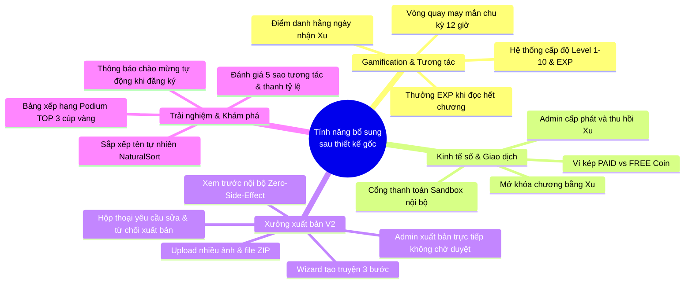

# 01. LỊCH SỬ PHÁT TRIỂN VÀ BIẾN ĐỘNG THIẾT KẾ COMIC NET

---

## 1. TRUY TÌM THIẾT KẾ GỐC (ORIGINAL BASELINE)

### 1.1. Mục tiêu ban đầu của hệ thống
Căn cứ tài liệu đặc tả gốc [prj_app.md](file:///c:/Users/studi/OneDrive/Documents/Tools/Comic%20Net/prj_app.md) (Master Prompt V2.1) và [srs.md](file:///c:/Users/studi/OneDrive/Documents/Tools/Comic%20Net/docs/requirements/srs.md) (Revision 3, ngày 2026-10-27):
- **Sản phẩm dự kiến ban đầu:** Một nền tảng đọc truyện tranh đa nền tảng quy mô doanh nghiệp (*Comic Platform — Enterprise System Architecture*), hỗ trợ đọc truyện, dịch truyện theo nhóm scanlation, kinh doanh số, mạng xã hội người đọc và công cụ trí tuệ nhân tạo (AI).
- **Phạm vi triển khai ưu tiên (MVP - Minimum Viable Product):**
  - **Desktop Swing** là ứng dụng chính chạy và bảo vệ trong NetBeans 31;
  - **Spring Boot REST** là backend duy nhất quyết định nghiệp vụ, phiên đăng nhập, phân quyền và lưu trữ dữ liệu;
  - **Microsoft SQL Server 2025** là cơ sở dữ liệu quan hệ lưu trữ thông tin cấu trúc;
  - **RustFS / MinIO S3** là dịch vụ lưu trữ phân tán đối tượng (ảnh bìa, ảnh chương truyện tranh);
  - **React + TypeScript + Vite + Tailwind CSS** được quy hoạch trong tài liệu gốc là phân hệ Web mở rộng nằm ngoài phạm vi MVP ban đầu (sẽ triển khai khi có yêu cầu).

### 1.2. Danh sách 23 Module gốc trong thiết kế ban đầu
Trong `prj_app.md` và `feature-register.md`, hệ thống ban đầu quy định danh mục 23 module độc lập với tổng cộng 243 chức năng chi tiết:

| STT | Mã Module | Tên Module gốc trong thiết kế | Mục đích dự kiến ban đầu | Trạng thái thực tế hiện tại |
|:---:|:---|:---|:---|:---|
| 1 | `M01` | **identity** | Xác thực, phân quyền RBAC, JWT, Session, MFA, khôi phục tài khoản | **Đang hoạt động** (Class thực tế, API thật, DB thật) |
| 2 | `M02` | **catalog** | Quản lý danh mục truyện, metadata, tác giả, thể loại, bản dịch | **Đang hoạt động** |
| 3 | `M03` | **publishing** | Xuất bản chương truyện, tải ảnh ZIP, duyệt bài, kiểm tra phiên bản | **Đang hoạt động** (Nâng cấp Creator Studio V2) |
| 4 | `M04` | **reader** | Bộ đọc truyện native trên Swing, điều chỉnh khung nhìn, lưu tiến độ | **Đang hoạt động** |
| 5 | `M05` | **storage** | Quản lý tài nguyên số, lưu trữ S3, giải mã và xử lý tối ưu ảnh WebP | **Đang hoạt động** |
| 6 | `M06` | **search** | Tìm kiếm truyện tranh, lịch sử tìm kiếm, gợi ý từ khóa | **Đang hoạt động** |
| 7 | `M07` | **analytics** | Thống kê lượt đọc hợp lệ, bảng xếp hạng ngày/tuần/tháng/toàn thời gian | **Đang hoạt động** |
| 8 | `M08` | **library** | Thư viện cá nhân, lịch sử đọc, theo dõi, yêu thích, bookmark | **Đang hoạt động** |
| 9 | `M09` | **community** | Bình luận, phản hồi, thả cảm xúc emoji, báo cáo vi phạm | **Đang hoạt động** |
| 10 | `M10` | **recommendation** | Đánh giá 5 sao, nhận xét và thuật toán gợi ý truyện liên quan | **Đang hoạt động** |
| 11 | `M11` | **wallet** | Ví tiền ảo kép (Xu nạp PAID và Xu tặng FREE), sổ cái kế toán cân bằng | **Đang hoạt động** |
| 12 | `M12` | **monetization** | Thiết lập giá chương truyện, mua chương bằng xu, quản lý gói nạp xu | **Đang hoạt động** |
| 13 | `M13` | **notification** | Thông báo trong ứng dụng, thông báo hệ thống, cấu hình nhận tin | **Đang hoạt động** |
| 14 | `M14` | **creator** | Danh mục nhóm dịch, quản lý nhóm tác giả / scanlation team | **Đang hoạt động** |
| 15 | `M15` | **admin** | Bảng điều khiển quản trị viên, quản lý tài khoản, nhật ký kiểm toán | **Đang hoạt động** |
| 16 | `M16` | **gamification** | Tích lũy điểm EXP, tính cấp độ (Level 1–10), điểm danh nhận quà | **Đang hoạt động** |
| 17 | `M17` | **minigame** | Vòng quay may mắn, mini-game tương tác giải trí | **Đã gộp vào `gamification`** |
| 18 | `M18` | **ai** | Dịch truyện tự động bằng AI, gỡ chữ bóng thoại tự động (OCR/Inpainting) | **Chưa triển khai (Đã dọn dẹp placeholder)** |
| 19 | `M19` | **offline** | Tải chương truyện về máy để đọc ngoại tuyến, mã hóa DRM | **Chưa triển khai (Đã dọn dẹp placeholder)** |
| 20 | `M20` | **entitlement** | Kiểm soát quyền truy cập tài nguyên số (quyền đọc chương trả phí) | **Đang hoạt động** |
| 21 | `M21` | **observability** | Giám sát hệ thống (Liveness, Readiness), Outbox Event, Idempotency | **Đang hoạt động** |
| 22 | `M22` | **dataprotection** | Chính sách sao lưu/phục hồi, hướng dẫn SSMS backup, bảo vệ dữ liệu | **Đã chuyển thành quy trình/hướng dẫn vận hành** |
| 23 | `M23` | **finance** | Cổng thanh toán Sandbox, xử lý đơn hàng, đối soát doanh thu | **Đang hoạt động** (tích hợp Sandbox Local) |

---

## 2. BÁO CÁO NHỮNG GÌ ĐÃ BỊ XÓA, GỘP HOẶC ĐỔI TÊN

Căn cứ đối chiếu lịch sử Git từ commit gốc `d2125a1` đến commit mới nhất `c30c6be`:

### 2.1. Bảng đối chiếu biến động kiến trúc và mã nguồn

| Hạng mục ban đầu | Hành động | Vị trí mới / Hiện tại | Nguyên nhân | Ảnh hưởng thực tế | Bằng chứng Git / Source |
|---|---|---|---|---|---|
| **Package `minigame`** | **Đã gộp** | `com.comicnet.gamification` | Tránh phân mảnh logic; chức năng Vòng quay may mắn (*Lucky Wheel*) gắn liền mật thiết với điểm thưởng EXP và ví xu của người dùng. | Module `gamification` đảm nhiệm cả điểm danh lẫn vòng quay may mắn, kiến trúc gọn gàng hơn. | Commit `570da4e`, Flyway `V28__gamification_and_lucky_wheel.sql`, `GamificationService.java` |
| **Package `ai`** | **Đã xóa (placeholder)** | N/A | Thiết kế ban đầu dự kiến làm AI dịch truyện tự động, nhưng không thuộc phạm vi đồ án Java/Swing MVP và chưa có API model ngoại vi. | Xóa bỏ file giữ chỗ `package-info.java` rỗng để tránh nhầm lẫn là chức năng đã hoàn thành. | Commit `c30c6be`, `ModuleBoundariesTest.java:34-45` |
| **Package `offline`** | **Đã xóa (placeholder)** | N/A | Tính năng lưu trữ mã hóa offline cục bộ (DRM) phức tạp, không khả thi trong phạm vi ứng dụng đọc trực tuyến client-server. | Xóa bỏ file giữ chỗ `package-info.java` rỗng. Không ảnh hưởng đến luồng đọc trực tuyến. | Commit `c30c6be`, `ModuleBoundariesTest.java` |
| **Package `dataprotection` (Backend)** | **Đã xóa (placeholder)** | `desktop/features/dataprotection` và tài liệu vận hành | Nghiệp vụ sao lưu/phục hồi SQL Server (`.bak`) thuộc về trách nhiệm của Quản trị viên cơ sở dữ liệu (DBA) bằng SSMS, không thể phơi bày API cho phép client gọi lệnh DROP/RESTORE DATABASE vì lý do an ninh. | Thay thế bằng quy trình runbook an toàn tại `BackupRestoreGuidePanel.java` và `INSTALL.md`. | Commit `c30c6be`, `BackupRestoreGuidePanel.java` |
| **Vai trò `MODERATOR`** | **Đã gộp / Nghỉ hưu** | Gộp quyền vào `ADMINISTRATOR` | Trong thực tế vận hành đồ án, việc chia tách Moderator và Administrator gây thừa thãi và rắc rối cho việc duyệt bài; Admin có đủ thẩm quyền cao nhất để kiểm duyệt. | Tinh giản ma trận quyền RBAC; toàn bộ bảng chờ duyệt và công cụ duyệt nội dung được trao cho Admin. | Commit `6853a84`, Migration `V31__creator_studio_v2_and_retire_moderator.sql`, `AdministrationController.java` |
| **Ràng buộc độ tuổi (`AgeRating`)** | **Đã loại bỏ hoàn toàn** | Chuẩn hóa `ALL_AGE` | Ban đầu hệ thống định phân loại truyện 13+, 16+, 18+. Tuy nhiên, logic này dẫn đến việc truyện hợp lệ bị ẩn mất khỏi Trang chủ và gây lỗi lọc API phức tạp không cần thiết. | Loại bỏ toàn bộ `CHECK constraint` về độ tuổi; mọi truyện xuất bản đều có `AgeRating='ALL_AGE'`, người dùng xem được 100% nội dung công khai. | Commit `c30c6be`, Migration `V32__remove_age_restrictions.sql`, `CatalogService.java` |
| **Tab sidebar "Khám phá"** | **Đã đổi tên** | Tab **"Trang chủ"** | Cải thiện trải nghiệm người dùng; người dùng quen thuộc với khái niệm Trang chủ (Home) hơn là Khám phá (Explore). | Giao diện hiển thị thân thiện, đồng bộ trên toàn bộ thanh điều hướng, banner và breadcrumb. | Commit `c30c6be`, `MainFrame.java:181`, `CatalogPanel.java:132` |
| **Creator Studio V1** | **Đã thay thế cách triển khai** | **Creator Studio V2** | Bản V1 giao diện thô sơ, chỉ có form cơ bản, thiếu wizard từng bước, không hỗ trợ kéo thả nhiều ảnh và thiếu cơ chế phản hồi giữa Admin và Creator. | Nâng cấp toàn diện thành bộ 13 màn hình UI chuẩn, hỗ trợ kéo thả nhiều ảnh/ZIP, xem trước nội bộ, lịch sử phiên bản và quy trình phản hồi sửa đổi. | Commit `6853a84`, `ComicEditorWizard.java`, `AdminReviewQueuePanel.java` |

### 2.2. Giải đáp các câu hỏi kiểm toán quan trọng

1. **Những package nào đã bị xóa?**
   - 4 package giữ chỗ không chứa mã nguồn thực tế đã được xóa bỏ khỏi backend: `com.comicnet.ai`, `com.comicnet.dataprotection`, `com.comicnet.minigame`, `com.comicnet.offline`. Trước khi xóa, các package này chỉ có duy nhất 1 file `package-info.java` với nội dung chú thích.
2. **Những class nào đã bị xóa?**
   - Không có bất kỳ class nghiệp vụ đang chạy nào bị xóa! Chỉ có các file `package-info.java` giữ chỗ bị loại bỏ.
3. **Những module nào đã được gộp?**
   - `minigame` gộp vào `gamification`.
   - Quyền hạn kiểm duyệt nội dung của vai trò `MODERATOR` được gộp hoàn toàn vào vai trò `ADMINISTRATOR`.
4. **Chức năng nào bị loại bỏ hoàn toàn?**
   - Chức năng lọc và phân loại truyện theo độ tuổi (`AgeRating: 13+, 16+, 18+`). Đã được gỡ bỏ tận gốc tại Migration `V32` và cập nhật trong các câu query của `CatalogService.java` và `AnalyticsService.java`.
   - Các chức năng AI (dịch thuật tự động) và DRM Offline Reader được xác định không thuộc phạm vi MVP.
5. **Có chức năng nào vô tình mất trong quá trình refactor không?**
   - Không. Toàn bộ 174 endpoint thuộc hợp đồng OpenAPI MVP Contract đều được bảo toàn và vượt qua bài kiểm tra tự động `ApiContractTest` (2/2 tests PASS).
6. **Các chức năng tuổi tác đã được loại bỏ hoàn toàn chưa?**
   - **ĐÃ LOẠI BỎ HOÀN TOÀN.** Bằng chứng:
     - Migration `V32__remove_age_restrictions.sql`: Đã chạy lệnh xóa `sys.check_constraints` trên cột `AgeRating` của bảng `dbo.Comic` và gán mặc định `DF_Comic_AgeRating` là `'ALL_AGE'`.
     - Toàn bộ dữ liệu truyện cũ trong database được chuẩn hóa: `UPDATE dbo.Comic SET AgeRating = 'ALL_AGE'`.
     - Code backend `CatalogService.java`: Đã loại bỏ các mệnh đề `AND c.AgeRating = ?` ngầm định, đảm bảo mọi truyện công khai đều xuất hiện trên Trang chủ.
7. **Có thay đổi nào khiến hành vi hệ thống khác với SRS ban đầu không?**
   - Có 2 điểm khác biệt tích cực so với SRS ban đầu:
     - *Thứ nhất:* Quy trình duyệt nội dung ban đầu dự kiến giao cho Moderator, nay được chuyển giao cho Admin để rút ngắn chuỗi xét duyệt.
     - *Thứ hai:* Bỏ rào cản độ tuổi giúp đơn giản hóa trải nghiệm người dùng, tránh tình trạng độc giả không thấy truyện do bộ lọc tuổi chặn ngầm.

---

## 3. BÁO CÁO CÁC TÍNH NĂNG BỔ SUNG SAU THIẾT KẾ

Trong quá trình phát triển các Phase 4, Phase 5 và hoàn thiện giao diện Desktop Swing, nhóm phát triển đã bổ sung nhiều tính năng vượt trội so với thiết kế lý thuyết ban đầu:

### 3.1. Điểm danh hằng ngày nhận xu (Daily Check-in)
1. **Mục đích:** Khuyến khích độc giả mở ứng dụng mỗi ngày, tăng tỷ lệ quay lại (Retention Rate).
2. **Cách triển khai:** Độc giả bấm nút "Điểm danh ngay", hệ thống kiểm tra chu kỳ ngày (`CAST(CreatedAt AS DATE) = CAST(GETUTCDATE() AS DATE)`). Tặng 5 xu miễn phí và 20 EXP mỗi ngày.
3. **Module thực tế:** `gamification`.
4. **Giao diện liên quan:** [GamificationPanel.java](file:///c:/Users/studi/OneDrive/Documents/Tools/Comic%20Net/desktop-swing/src/main/java/com/comicnet/desktop/features/gamification/GamificationPanel.java).
5. **Backend Controller / Service:** `GamificationController.java`, `GamificationService.java:checkIn()`.
6. **Bảng Database:** `dbo.CheckInHistory`, `dbo.UserGamification`.
7. **Trạng thái:** Hoạt động tốt 100%, có bài test `GamificationFlowIT.java`.

### 3.2. Vòng quay may mắn (Lucky Wheel 12h)
1. **Mục đích:** Tạo cơ chế giải trí trúng thưởng ngẫu nhiên; mỗi 12 giờ người dùng được 1 lượt quay miễn phí; nếu hết lượt có thể tiêu xu để quay tiếp.
2. **Cách triển khai:** Backend sinh góc quay và phần thưởng theo phân phối xác suất ngẫu nhiên bảo đảm tính công bằng trên server; Swing vẽ Canvas bánh xe 8 nan quạt với hiệu ứng quay giảm tốc mượt mà.
3. **Module thực tế:** `gamification`.
4. **Giao diện liên quan:** `GamificationPanel.java` (khối `LuckyWheelCanvas`).
5. **Backend Controller / Service:** `GamificationController.java`, `GamificationService.java:spinWheel()`.
6. **Bảng Database:** `dbo.LuckyWheelHistory`, `dbo.UserGamification`.
7. **Trạng thái:** Hoạt động tốt 100%, có kiểm tra chống quay quá số lần cho phép.

### 3.3. Hệ thống Cấp độ độc giả (Leveling & Reading EXP)
1. **Mục đích:** Thể hiện đẳng cấp và mức độ gắn bó của người dùng trên nền tảng.
2. **Cách triển khai:** Đọc xong 1 chương nhận 15 EXP (`POST /api/v1/chapters/{id}/completion`), điểm danh nhận 20 EXP. Hệ thống tự động tính Level từ 1 đến 10 theo công thức lũy tiến bậc 2: $\text{Level} = \min(10, \lfloor\sqrt{\text{EXP} / 50}\rfloor + 1)$.
3. **Module thực tế:** `gamification`, `reader`.
4. **Giao diện liên quan:** Thanh EXP và huy hiệu Level hiển thị trên `GamificationPanel.java`, `AccountPanel.java` và đầu trang ứng dụng.
5. **Bảng Database:** `dbo.UserGamification`, `dbo.ReadingExpHistory`.
6. **Trạng thái:** Hoạt động tốt 100%, có bài test `GamificationFlowIT.java`.

### 3.4. Mở khóa chương truyện bằng Xu (Chapter Unlocking)
1. **Mục đích:** Mô hình kinh doanh đọc truyện trả phí (Freemium/Pay-to-read).
2. **Cách triển khai:** Creator thiết lập giá xu cho từng chương (ví dụ 5 xu). Độc giả chưa mua khi mở đọc sẽ xuất hiện hộp thoại xác nhận mua chương. Hệ thống tự trừ xu trong ví theo nguyên tắc ưu tiên: trừ xu nạp (`PAID`) trước hoặc trừ xu tặng (`FREE`), ghi nhận quyền truy cập vào `UserEntitlement` và lưu sổ cái `LedgerEntry`.
3. **Module thực tế:** `monetization`, `entitlement`, `wallet`.
4. **Giao diện liên quan:** [ReaderPanel.java](file:///c:/Users/studi/OneDrive/Documents/Tools/Comic%20Net/desktop-swing/src/main/java/com/comicnet/desktop/features/reader/ReaderPanel.java), `CatalogPanel.java`.
5. **Backend Controller / Service:** `ChapterPurchaseController.java`, `ChapterPurchaseService.java`, `EntitlementService.java`.
6. **Bảng Database:** `dbo.ChapterPrice`, `dbo.Purchase`, `dbo.UserEntitlement`, `dbo.LedgerEntry`.
7. **Trạng thái:** Hoạt động tốt 100%, có bài test `ReaderFlowIT.java`, `WalletFlowIT.java`.

### 3.5. Nạp xu và Cổng thanh toán Sandbox (Local Payment Sandbox)
1. **Mục đích:** Cho phép người dùng nạp tiền quy đổi ra Xu ảo để đọc truyện mà không cần kết nối cổng thanh toán thật tốn chi phí.
2. **Cách triển khai:** Mô phỏng cổng thanh toán Sandbox với các gói xu định sẵn (50k VNĐ = 50 Xu, 100k VNĐ = 110 Xu,...); hỗ trợ các phương thức giả lập như VNPay, MoMo, Chuyển khoản ngân hàng. Khi bấm thanh toán, webhook giả lập ghi nhận đơn hàng thành công và cộng xu vào ví tài khoản.
3. **Module thực tế:** `finance`, `wallet`.
4. **Giao diện liên quan:** [WalletPanel.java](file:///c:/Users/studi/OneDrive/Documents/Tools/Comic%20Net/desktop-swing/src/main/java/com/comicnet/desktop/features/wallet/WalletPanel.java).
5. **Backend Controller / Service:** `LocalPaymentSandboxController.java`, `LocalPaymentSandbox.java`, `WalletService.java`.
6. **Bảng Database:** `dbo.CoinPackage`, `dbo.PaymentOrder`, `dbo.PaymentTransaction`, `dbo.WebhookInbox`.
7. **Trạng thái:** Hoạt động tốt 100%, kiểm thử độc lập.

### 3.6. Admin Cấp phát và Thu hồi Xu (Admin Wallet Adjustment)
1. **Mục đích:** Giúp ban quản trị hỗ trợ người dùng khi nạp tiền gặp lỗi, đền bù sự cố hoặc xử lý tài khoản gian lận.
2. **Cách triển khai:** Giao diện chuyên dụng cho Admin tìm kiếm theo username, hiển thị số dư hiện tại, cho phép bấm "Cấp xu" hoặc "Thu hồi xu", bắt buộc nhập lý do điều chỉnh; ghi nhận bút toán kiểm toán cân bằng vào sổ cái.
3. **Module thực tế:** `wallet`, `admin`.
4. **Giao diện liên quan:** [AdminWalletPanel.java](file:///c:/Users/studi/OneDrive/Documents/Tools/Comic%20Net/desktop-swing/src/main/java/com/comicnet/desktop/features/wallet/AdminWalletPanel.java).
5. **Backend Controller / Service:** `AdminWalletController.java`, `WalletService.java:adjust()`.
6. **Bảng Database:** `dbo.WalletAccount`, `dbo.LedgerEntry`, `dbo.AuditLog`.
7. **Trạng thái:** Hoạt động tốt 100%.

### 3.7. Creator Studio V2: Tải lên nhiều ảnh và nén tệp ZIP
1. **Mục đích:** Giải quyết điểm nghẽn lớn nhất của các nền tảng truyện tranh là việc tải từng trang ảnh rất chậm và tốn công.
2. **Cách triển khai:** Hỗ trợ chọn cùng lúc hàng chục file ảnh hoặc chọn trực tiếp 1 file `.zip`. Hệ thống tự động phân loại theo giải thuật so sánh tên tự nhiên (`NaturalSort`: 1, 2, ... 9, 10), tải lên RustFS S3, tạo công việc nền `UploadJob`, giải nén trên server, tạo thumbnail và lưu vào `ChapterVersionPage`.
3. **Module thực tế:** `publishing`, `storage`.
4. **Giao diện liên quan:** [BulkImageUploadDialog.java](file:///c:/Users/studi/OneDrive/Documents/Tools/Comic%20Net/desktop-swing/src/main/java/com/comicnet/desktop/features/publishing/BulkImageUploadDialog.java).
5. **Backend Controller / Service:** `PublishingController.java`, `UploadCoordinator.java`, `UploadWorker.java`.
6. **Bảng Database:** `dbo.UploadJob`, `dbo.UploadJobItem`, `dbo.ChapterVersionPage`.
7. **Trạng thái:** Hoạt động tốt 100%, tải 88 trang ảnh mượt mà chỉ mất vài giây.

### 3.8. Admin xuất bản trực tiếp không qua hàng chờ (Direct Publish)
1. **Mục đích:** Cho phép tài khoản Admin khi tự sáng tác hoặc biên tập truyện có thể xuất bản ngay tác phẩm của mình lên Trang chủ mà không cần phải tự gửi duyệt và tự duyệt qua nhiều bước phiền phức.
2. **Cách triển khai:** Trong `ComicEditorWizard.java` Bước 3, nếu phát hiện vai trò `ADMINISTRATOR`, giao diện hiển thị badge màu vàng "Quyền Quản Trị Viên" và nút "✓ Xuất bản ngay". Khi bấm, hệ thống gọi duyệt xuất bản tuần tự các chương và chuyển đổi `Comic.Visibility` sang `'PUBLIC'` ngay lập tức.
3. **Module thực tế:** `publishing`, `catalog`.
4. **Giao diện liên quan:** [ComicEditorWizard.java](file:///c:/Users/studi/OneDrive/Documents/Tools/Comic%20Net/desktop-swing/src/main/java/com/comicnet/desktop/features/publishing/ComicEditorWizard.java).
5. **Bảng Database:** `dbo.ChapterVersion`, `dbo.Comic`, `dbo.ComicTranslation`.
6. **Trạng thái:** Hoạt động hoàn hảo, đã được kiểm chứng QA thực tế ngày 2026-10-30.

### 3.9. Tự động gửi thông báo chào mừng (Welcome Notification)
1. **Mục đích:** Tạo ấn tượng chuyên nghiệp cho người dùng mới ngay khi vừa tạo tài khoản hoặc đăng nhập lần đầu.
2. **Cách triển khai:** Khi đăng ký thành công hoặc đăng nhập lần đầu, phương thức `AuthenticationService.welcome(userId)` tự động chèn một bản ghi thông báo hệ thống mang `DedupKey = 'welcome:v1'` vào bảng `dbo.Notification`. Nhờ có khóa chống trùng `DedupKey`, mỗi tài khoản chỉ nhận đúng 1 thông báo chào mừng duy nhất trong suốt vòng đời.
3. **Module thực tế:** `identity`, `notification`.
4. **Giao diện liên quan:** [NotificationsPanel.java](file:///c:/Users/studi/OneDrive/Documents/Tools/Comic%20Net/desktop-swing/src/main/java/com/comicnet/desktop/features/notification/NotificationsPanel.java).
5. **Bảng Database:** `dbo.Notification`.
6. **Trạng thái:** Hoạt động tốt 100%.
