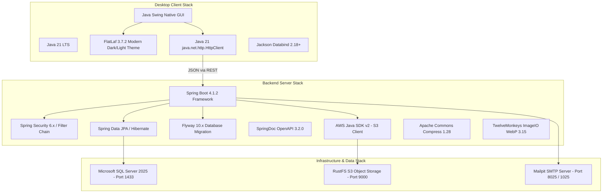
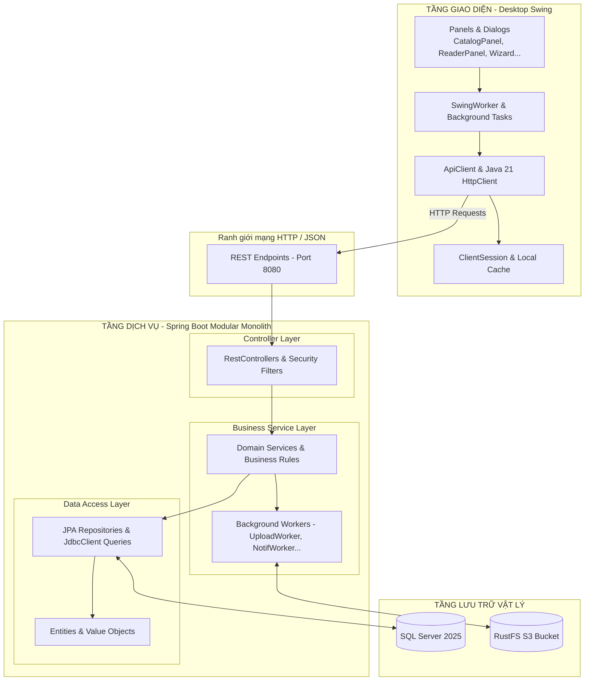
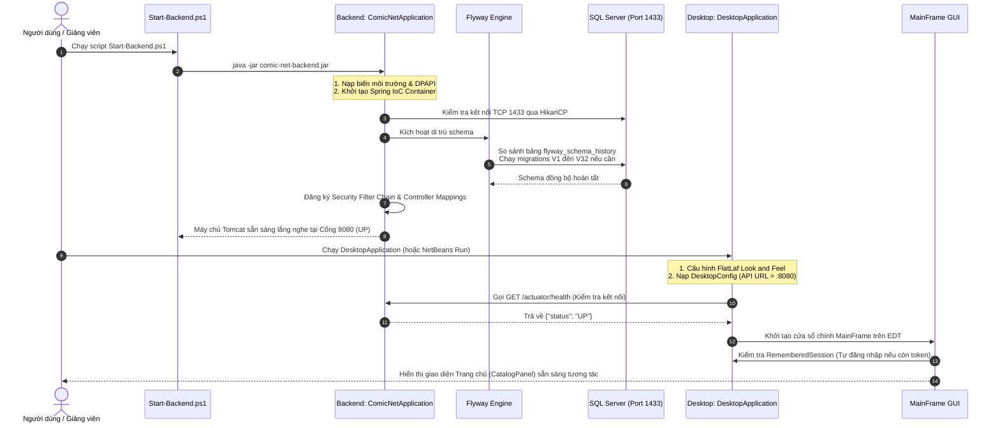

# 02. NỀN TẢNG CÔNG NGHỆ VÀ KIẾN TRÚC HỆ THỐNG COMIC NET

---

## 1. NỀN TẢNG XÂY DỰNG HỆ THỐNG (TECHNOLOGY STACK)

Không chỉ nêu lý thuyết giáo khoa, phần này giải thích chi tiết từng công nghệ dựa trên mã nguồn thực tế của Comic Net theo cấu trúc 7 câu hỏi chuẩn mực:
*(1) Là gì? (2) Dùng để làm gì? (3) Vì sao chọn? (4) Khác gì công nghệ cùng loại? (5) Xuất hiện ở đâu trong mã nguồn? (6) Tham gia vào luồng nào? (7) Nếu bỏ thì hậu quả gì?*

---

### 1.1. Java và JDK 21 LTS
1. **Là gì?** Phiên bản máy ảo và bộ công cụ phát triển phần mềm Java dài hạn (Long-Term Support) mới nhất của Oracle/OpenJDK.
2. **Dùng để làm gì?** Là nền tảng ngôn ngữ lập trình cho cả hai tiến trình độc lập: Backend Spring Boot và Desktop Swing Client.
3. **Vì sao dự án sử dụng?** Khai thác các tính năng hiện đại: **Java Records** (thay thế hoàn toàn boilerplate code và thư viện Lombok), cú pháp `Pattern Matching for switch`, `sealed classes`, kiểu dữ liệu bất biến và chuẩn hóa chuẩn bộ nhớ an toàn.
4. **Khác gì phiên bản cũ (Java 8, Java 11, Java 17)?** Java 21 có hiệu năng bộ nhớ tối ưu vượt bậc, tích hợp bộ thu gom rác thế hệ mới (ZGC/G1), hỗ trợ native HTTP Client 2.0 và Java Records chuẩn hóa không cần công cụ phát sinh mã bên ngoài.
5. **Xuất hiện ở file nào?** Khai báo trong [pom.xml](file:///c:/Users/studi/OneDrive/Documents/Tools/Comic%20Net/pom.xml#L19-L20) (`<java.version>21</java.version>`), mọi file mã nguồn `.java` trong toàn bộ repository.
6. **Tham gia vào luồng nào?** Toàn bộ vòng đời ứng dụng từ khi biên dịch đến khi chạy runtime.
7. **Nếu bỏ thì ảnh hưởng gì?** Toàn bộ dự án không thể biên dịch do các cấu trúc `record`, `switch pattern` và các API Java 21 sẽ báo lỗi cú pháp.

---

### 1.2. Java Swing và FlatLaf 3.7.2
1. **Là gì?** Java Swing là bộ thư viện giao diện đồ họa bản địa (native GUI toolkit) chuẩn của Java; FlatLaf là thư viện Look and Feel hiện đại hàng đầu cho Java Swing mang phong cách phẳng (Flat design) thanh lịch.
2. **Dùng để làm gì?** Xây dựng toàn bộ giao diện tương tác người dùng trên máy tính (Desktop Client): từ cửa sổ đăng nhập, bảng điều khiển Trang chủ, bộ đọc truyện đến Xưởng xuất bản và công cụ quản trị.
3. **Vì sao dự án sử dụng?** Đồ án yêu cầu bảo vệ và trình diễn trực tiếp trên máy tính thông qua NetBeans mà không cần cài đặt Node.js hay mở trình duyệt web. Swing kết hợp FlatLaf giúp giao diện mượt mà, hỗ trợ tốt màn hình độ phân giải cao (HiDPI Scaling 100%, 125%, 150%) và bảng màu hiện đại chuẩn Figma.
4. **Khác gì JavaFX hoặc SWT?** Java Swing được tích hợp sẵn 100% trong JDK tiêu chuẩn, không phụ thuộc thư viện native C++ phức tạp của JavaFX trên các nền tảng máy tính khác nhau, tương thích tuyệt đối với NetBeans GUI Builder.
5. **Xuất hiện ở file nào?** [desktop-swing/pom.xml](file:///c:/Users/studi/OneDrive/Documents/Tools/Comic%20Net/desktop-swing/pom.xml#L15), [DesktopApplication.java](file:///c:/Users/studi/OneDrive/Documents/Tools/Comic%20Net/desktop-swing/src/main/java/com/comicnet/desktop/DesktopApplication.java#L24), [Theme.java](file:///c:/Users/studi/OneDrive/Documents/Tools/Comic%20Net/desktop-swing/src/main/java/com/comicnet/desktop/ui/Theme.java).
6. **Tham gia vào luồng nào?** Hiển thị màn hình, tiếp nhận các sự kiện chuột/phím của người dùng thông qua Event Dispatch Thread (EDT).
7. **Nếu bỏ thì ảnh hưởng gì?** Không có giao diện Desktop để người dùng tương tác và trình diễn đồ án.

---

### 1.3. Spring Boot 4.1.2 & Spring Framework
1. **Là gì?** Khung phát triển ứng dụng doanh nghiệp phía máy chủ (Enterprise Server Framework) hàng đầu của hệ sinh thái Java.
2. **Dùng để làm gì?** Quản lý toàn bộ vòng đời ứng dụng phía backend: nạp cấu hình, khởi tạo máy chủ HTTP nhúng (Embedded Apache Tomcat), xử lý Dependency Injection (Spring IoC), định tuyến REST API và quản lý giao dịch dữ liệu.
3. **Vì sao dự án sử dụng?** Cung cấp mô hình tự động cấu hình (Auto-configuration), loại bỏ việc viết hàng nghìn dòng cấu hình XML rườm rà; tích hợp sẵn Actuator kiểm tra trạng thái sức khỏe máy chủ.
4. **Khác gì Java Servlet thuần hoặc Quarkus/Micronaut?** Spring Boot có cộng đồng hỗ trợ lớn nhất thế giới, tài liệu phong phú, tính ổn định cao và tích hợp liền mạch với Spring Security, Spring Data JPA.
5. **Xuất hiện ở file nào?** [pom.xml](file:///c:/Users/studi/OneDrive/Documents/Tools/Comic%20Net/pom.xml#L6), [backend/pom.xml](file:///c:/Users/studi/OneDrive/Documents/Tools/Comic%20Net/backend/pom.xml), [ComicNetApplication.java](file:///c:/Users/studi/OneDrive/Documents/Tools/Comic%20Net/backend/src/main/java/com/comicnet/ComicNetApplication.java).
6. **Tham gia vào luồng nào?** Tiếp nhận và điều phối mọi yêu cầu mạng từ Desktop gửi đến cổng 8080.
7. **Nếu bỏ thì ảnh hưởng gì?** Không có máy chủ web phía sau để xử lý nghiệp vụ, lưu trữ và xác thực.

---

### 1.4. Spring Security & Bộ lọc Security Filter Chain
1. **Là gì?** Khung bảo mật chuyên dụng bảo vệ các ứng dụng xây dựng trên Spring Framework.
2. **Dùng để làm gì?** Chặn và kiểm tra mọi HTTP Request gửi tới backend: xác thực danh tính (Authentication) qua Bearer Token hoặc Session Cookie, phân quyền theo vai trò (Authorization RBAC: Reader, Creator, Administrator), chống giả mạo nguồn gốc truy cập.
3. **Vì sao dự án sử dụng?** Giúp tách biệt hoàn toàn logic an ninh ra khỏi logic nghiệp vụ của các controller thông qua mô hình mắt xích bộ lọc (Filter Chain).
4. **Khác gì tự viết hàm `checkAuth()` trong từng Controller?** Tự viết trong Controller rất dễ bỏ sót các lỗ hổng truy cập trái phép ở các endpoint mới; Spring Security chặn ngay từ cửa ngõ mạng trước khi yêu cầu chạm vào Controller (`Security-by-Default`).
5. **Xuất hiện ở file nào?** [SecurityConfiguration.java](file:///c:/Users/studi/OneDrive/Documents/Tools/Comic%20Net/backend/src/main/java/com/comicnet/config/SecurityConfiguration.java), [BearerAuthenticationFilter.java](file:///c:/Users/studi/OneDrive/Documents/Tools/Comic%20Net/backend/src/main/java/com/comicnet/identity/controller/BearerAuthenticationFilter.java).
6. **Tham gia vào luồng nào?** Mọi luồng API: Từ đăng nhập, đọc chương trả phí đến kiểm duyệt nội dung của Admin.
7. **Nếu bỏ thì ảnh hưởng gì?** Bất kỳ ai cũng có thể gọi thẳng vào các API nhạy cảm của Admin hoặc nạp/rút xu trái phép mà không bị chặn.

---

### 1.5. Microsoft SQL Server 2025 & JDBC Driver (`mssql-jdbc`)
1. **Là gì?** Hệ quản trị cơ sở dữ liệu quan hệ (RDBMS) cấp doanh nghiệp của Microsoft và thư viện điều khiển kết nối chính thức của Microsoft dành cho Java.
2. **Dùng để làm gì?** Lưu trữ có cấu trúc toàn bộ dữ liệu người dùng, truyện, chương, ví xu, lịch sử đọc, đánh giá và nhật ký hệ thống.
3. **Vì sao dự án sử dụng?** Ràng buộc đồ án bắt buộc sử dụng SQL Server 2025; hỗ trợ cơ chế giao dịch ACID mạnh mẽ, các kiểu dữ liệu Unicode bản địa (`nvarchar`), cơ chế khóa hàng (`UPDLOCK, HOLDLOCK`) phục vụ chống gian lận ví tiền.
4. **Khác gì MySQL hay PostgreSQL?** SQL Server có công cụ quản trị trực quan hàng đầu là SQL Server Management Studio (SSMS), hỗ trợ tốt cơ chế sao lưu phục hồi file `.bak` chuẩn doanh nghiệp và bảo mật cấp phiên bản.
5. **Xuất hiện ở file nào?** [backend/pom.xml](file:///c:/Users/studi/OneDrive/Documents/Tools/Comic%20Net/backend/pom.xml#L27), chuỗi kết nối trong [application.properties](file:///c:/Users/studi/OneDrive/Documents/Tools/Comic%20Net/backend/src/main/resources/application.properties).
6. **Tham gia vào luồng nào?** Mọi luồng đọc ghi dữ liệu bền vững.
7. **Nếu bỏ thì ảnh hưởng gì?** Dữ liệu ứng dụng sẽ bị mất sạch sau mỗi lần tắt máy chủ.

---

### 1.6. Flyway Database Migration
1. **Là gì?** Công cụ quản lý di trú cơ sở dữ liệu dựa trên các kịch bản SQL có đánh số phiên bản (Versioned SQL Migrations).
2. **Dùng để làm gì?** Tự động phát hiện và thực thi tuần tự các kịch bản tạo bảng, thêm cột, tạo khóa ngoại và cập nhật dữ liệu (`V1` đến `V32`) ngay khi backend khởi động.
3. **Vì sao dự án sử dụng?** Đảm bảo cơ sở dữ liệu trên máy tính của tất cả thành viên trong nhóm và máy chấm thi của hội đồng hoàn toàn đồng nhất, không cần người dùng phải chạy tay từng file SQL trong SSMS.
4. **Khác gì `hibernate.hbm2ddl.auto=update`?** Hibernate tự sinh DDL thường gây mất dữ liệu, không kiểm soát được tên khóa chính/khóa ngoại, không thể viết logic chuyển đổi dữ liệu phức tạp. Flyway cho phép viết mã SQL Server chuẩn xác 100%.
5. **Xuất hiện ở file nào?** [backend/pom.xml](file:///c:/Users/studi/OneDrive/Documents/Tools/Comic%20Net/backend/pom.xml#L25), thư mục [db/migration](file:///c:/Users/studi/OneDrive/Documents/Tools/Comic%20Net/backend/src/main/resources/db/migration/).
6. **Tham gia vào luồng nào?** Luồng khởi động backend: Khởi chạy trước khi Hibernate nạp mô hình thực thể.
7. **Nếu bỏ thì ảnh hưởng gì?** Khởi chạy backend trên máy mới sẽ thất bại ngay lập tức vì thiếu bảng.

---

### 1.7. Spring Data JPA & Hibernate
1. **Là gì?** Tầng trừu tượng hóa việc truy cập dữ liệu Object-Relational Mapping (ORM) trong Spring.
2. **Dùng để làm gì?** Ánh xạ bảng cơ sở dữ liệu thành các Java Class thực thể (`ComicEntity`, `UserAccount`) và tự động hóa các thao tác CRUD cơ bản.
3. **Vì sao dự án sử dụng?** Giảm thiểu mã viết truy vấn SQL cho các thực thể quan hệ phân cấp phức tạp.
4. **Khác gì JDBC Template?** Trong Comic Net, dự án sử dụng **mô hình kết hợp thông minh**: Spring Data JPA cho các đối tượng nghiệp vụ cốt lõi, và `JdbcClient` / `NamedParameterJdbcTemplate` cho các truy vấn báo cáo, cập nhật ví xu tốc độ cao và khóa giao dịch bi quan (`UPDLOCK`).
5. **Xuất hiện ở file nào?** [ComicRepository.java](file:///c:/Users/studi/OneDrive/Documents/Tools/Comic%20Net/backend/src/main/java/com/comicnet/catalog/repository/ComicRepository.java), [ComicEntity.java](file:///c:/Users/studi/OneDrive/Documents/Tools/Comic%20Net/backend/src/main/java/com/comicnet/catalog/entity/ComicEntity.java).
6. **Tham gia vào luồng nào?** Luồng quản lý danh mục truyện và tài khoản người dùng.
7. **Nếu bỏ thì ảnh hưởng gì?** Phải viết thêm hàng nghìn dòng mã JDBC thủ công cho từng trường dữ liệu.

---

### 1.8. AWS Java SDK v2 (S3 Client) & RustFS Object Storage
1. **Là gì?** Bộ thư viện Java kết nối dịch vụ lưu trữ đối tượng chuẩn Amazon S3; RustFS là phần mềm lưu trữ đối tượng mã nguồn mở viết bằng Rust siêu nhanh, tương thích hoàn toàn giao thức S3 API (tương tự MinIO).
2. **Dùng để làm gì?** Lưu trữ các file nhị phân dung lượng lớn: Bìa truyện tranh và toàn bộ các trang ảnh của chương truyện tranh.
3. **Vì sao dự án sử dụng?** Không bao giờ lưu trực tiếp tệp ảnh lớn vào trong cơ sở dữ liệu quan hệ SQL Server vì sẽ làm phình to dung lượng database, nghẽn I/O và làm chậm tốc độ sao lưu `.bak`.
4. **Khác gì lưu trữ file trên ổ cứng cục bộ (Local File System)?** S3 SDK cho phép hệ thống dễ dàng chuyển đổi sang môi trường Cloud thực tế (AWS S3, Cloudflare R2) chỉ bằng việc thay đổi cấu hình mà không phải sửa một dòng mã nguồn nào.
5. **Xuất hiện ở file nào?** [backend/pom.xml](file:///c:/Users/studi/OneDrive/Documents/Tools/Comic%20Net/backend/pom.xml#L17), [S3Gateway.java](file:///c:/Users/studi/OneDrive/Documents/Tools/Comic%20Net/backend/src/main/java/com/comicnet/storage/service/S3Gateway.java).
6. **Tham gia vào luồng nào?** Luồng tải lên ảnh chương của Creator và luồng tải ảnh hiển thị trên Reader.
7. **Nếu bỏ thì ảnh hưởng gì?** Ứng dụng không thể lưu trữ và hiển thị ảnh chương truyện.

---

### 1.9. Vì sao dự án KHÔNG dùng Lombok mà dùng Java 21 Records?
1. **Phát hiện kiểm toán:** Trong toàn bộ `pom.xml` của dự án **hoàn toàn không có thư viện Lombok**.
2. **Lý do kiến trúc:**
   - Java 21 cung cấp cấu trúc chuẩn ngôn ngữ là `record` (ví dụ: `public record ComicSummary(...) {}`). Record tự động sinh constructor, getter, `equals()`, `hashCode()` và `toString()` mà không cần bất kỳ plugin tiền xử lý mã nguồn (Annotation Processor) nào.
   - Tránh được hoàn toàn các lỗi xung đột môi trường IDE giữa NetBeans, Eclipse, VS Code và Maven khi thiếu Lombok plugin.
   - Java Record có tính bất biến (Immutability), cực kỳ an toàn khi truyền tải dữ liệu DTO qua mạng và luồng bất đồng bộ.

---

## 2. KIẾN TRÚC PHẦN MỀM (SOFTWARE ARCHITECTURE)

### 2.1. Phân loại mô hình kiến trúc
Hệ thống Comic Net được xây dựng theo mô hình **Modular Monolith** kết hợp phân tách **Client–Server** phân tán:

### 2.2. Phân tích các nguyên lý kiến trúc cốt lõi

1. **Package-by-Feature (Tổ chức theo tính năng):**
   - Thay vì gom tất cả Controller vào một thư mục `controllers`, tất cả Service vào `services` (gây rối rắm khi dự án lớn), Comic Net chia mã nguồn thành các module nghiệp vụ tự quản: `catalog`, `publishing`, `identity`, `gamification`, `wallet`...
   - Mỗi module tự chứa trọn vẹn Controller, Service, DTO, Repository của riêng mình. Điều này giúp dễ dàng cô lập lỗi, nâng cấp tính năng và kiểm thử.
2. **Nguyên lý phân tách trách nhiệm (Separation of Concerns):**
   - **Controller:** Tuyệt đối không chứa logic nghiệp vụ. Chỉ nhận request, validate cú pháp đầu vào, lấy thông tin phiên người dùng (`SecurityContext`) và ủy thác cho Service.
   - **Service:** Là nơi duy nhất chứa các quy tắc nghiệp vụ, tính toán điểm số, trừ tiền, duyệt truyện và quản lý transaction.
   - **Repository:** Chịu trách nhiệm giao tiếp cơ sở dữ liệu.
   - **DTO (Data Transfer Object):** Chỉ đóng gói dữ liệu truyền qua mạng, không bao giờ phơi bày trực tiếp Entity của cơ sở dữ liệu ra ngoài để tránh lỗ hổng lộ thông tin cấu trúc.
3. **Cơ chế phụ thuộc một chiều (Dependency Inversion & No Circular Dependencies):**
   - Tầng Desktop Swing hoàn toàn độc lập, chỉ phụ thuộc vào chuẩn giao tiếp HTTP/JSON của Backend.
   - Giữa các module backend, các mối quan hệ phụ thuộc được kiểm tra bằng bài test tự động `ModuleBoundariesTest.java` để ngăn ngừa triệt để phụ thuộc vòng tròn (Circular Dependency).

---

## 3. PHÂN TÍCH LUỒNG KHỞI ĐỘNG HỆ THỐNG (SYSTEM STARTUP FLOW)

### 3.1. Phân biệt các cổng kết nối vật lý
- **Cổng 1433 (TCP):** Cổng máy chủ SQL Server. **Chỉ duy nhất Backend Spring Boot được kết nối vào cổng này.** Desktop Swing hoàn toàn không có quyền và không có driver để chạm vào cổng 1433.
- **Cổng 8080 (HTTP):** Cổng máy chủ Spring Boot nhúng (Tomcat). Cung cấp các REST API cho Desktop Swing Client giao tiếp.
- **Cổng 9000 (HTTP):** Cổng máy chủ lưu trữ đối tượng RustFS S3.
- **Cổng 8025/1025:** Cổng web xem hộp thư và cổng gửi mail SMTP của Mailpit.

### 3.2. Sơ đồ tuần tự khởi động hệ thống

### 3.3. Xử lý sự cố khi mất kết nối mạng hoặc Backend ngừng hoạt động
- Nếu Backend chưa bật hoặc ngắt kết nối đột ngột:
  - Khi Desktop Client thực hiện request, `ApiClient.java` bắt lỗi `ConnectException` hoặc `HttpConnectTimeoutException`.
  - Hệ thống không để ứng dụng bị crash hay văng lỗi lạ. Thay vào đó, nó hiển thị hộp thoại cảnh báo thân thiện: *"Không thể kết nối đến máy chủ Backend tại http://localhost:8080. Vui lòng kiểm tra dịch vụ!"* kèm nút bấm cho phép thử lại (Retry).
