# 03. GIẢI PHẪU CHI TIẾT PACKAGE, MODULE VÀ CÁC CLASS TRỌNG YẾU

---

## 1. TỔNG QUAN HỆ THỐNG PACKAGE TRONG DỰ ÁN

Mã nguồn Comic Net được tổ chức chặt chẽ theo nguyên tắc **Package-by-Feature** kết hợp kiến trúc **Modular Monolith**. Hệ thống phân định rạch ròi giữa các package kỹ thuật nền tảng (Shared Infrastructure) và các module nghiệp vụ người dùng (Business Modules).

```mermaid
graph TD
    subgraph SharedPackages [Package Kỹ Thuật Dùng Chung]
        common[com.comicnet.common.web<br/>Exception Handling, ETag, Paginations]
        config[com.comicnet.config<br/>Security, CORS, Background Tasks]
        infra[com.comicnet.infrastructure.database<br/>Migration Runners]
        storage[com.comicnet.storage<br/>S3 Gateway, Image Processing]
        obs[com.comicnet.observability<br/>Audit Logs, Health, Idempotency]
    end

    subgraph CoreBusinessModules [Module Nghiệp Vụ Cốt Lõi]
        identity[identity: Quản lý người dùng & RBAC]
        catalog[catalog: Danh mục truyện & Metadata]
        publishing[publishing: Xưởng xuất bản & Review Queue]
        reader[reader: Bộ đọc truyện & Lưu tiến độ]
        library[library: Tủ sách cá nhân & Theo dõi]
        community[community: Bình luận & Cảm xúc]
        recommendation[recommendation: Đánh giá 5 sao & Gợi ý]
        search[search: Tìm kiếm truyện & Lịch sử]
        creator[creator: Danh bạ tác giả & Scanlation]
        admin[admin: Bảng điều khiển quản trị hệ thống]
        analytics[analytics: Xếp hạng & Lượt xem hợp lệ]
    end

    subgraph EconomyGamificationModules [Module Kinh Tế Số & Gamification]
        wallet[wallet: Ví xu kép & Sổ cái kế toán]
        monetization[monetization: Bán chương & Giá truyện]
        finance[finance: Cổng thanh toán Sandbox]
        entitlement[entitlement: Cấp phát & Thu hồi quyền đọc]
        gamification[gamification: Điểm danh, Vòng quay, Cấp độ]
        notification[notification: Trung tâm thông báo]
    end

    CoreBusinessModules --> SharedPackages
    EconomyGamificationModules --> SharedPackages
    EconomyGamificationModules --> CoreBusinessModules
```

---

## 2. BẢNG KIỂM TOÁN TẤT CẢ CÁC PACKAGE THỰC TẾ

### 2.1. Phân loại Module Nghiệp Vụ (19 Business Modules)

| Package | Tên tiếng Việt | Ý nghĩa tiếng Anh | Mục đích tồn tại | Các Class chính | Bảng Database liên quan | Giao diện Swing tương ứng |
|---|---|---|---|---|---|---|
| `identity` | Định danh & Xác thực | Identity & Authentication | Quản lý vòng đời tài khoản, đăng ký, đăng nhập, cấp phát JWT Bearer, quản lý phiên đăng nhập và phân quyền RBAC. | `AuthenticationService`, `AuthController`, `SessionController`, `SqlAccountAdministration`, `BearerAuthenticationFilter`, `UserAccount` | `dbo.[User]`, `dbo.[Role]`, `dbo.UserRole`, `dbo.UserSession`, `dbo.RefreshToken` | `AuthScreens.java` (Login/Register), `AccountPanel.java`, `SessionsDialog.java` |
| `catalog` | Danh mục truyện tranh | Comic Catalog | Quản lý thông tin tác phẩm truyện tranh, tác giả, thể loại, tình trạng phát hành và danh sách chương công khai. | `CatalogService`, `CatalogController`, `ComicEntity`, `ComicRepository`, `CatalogDtos` | `dbo.Comic`, `dbo.Author`, `dbo.Genre`, `dbo.Tag`, `dbo.ComicTranslation` | `CatalogPanel.java` (Trang chủ), `ComicPicker.java` |
| `publishing` | Xưởng xuất bản | Publishing Pipeline | Quy trình tải lên ảnh chương hàng loạt (ZIP/Images), xử lý bản thảo, hàng chờ Admin duyệt nội dung và xuất bản truyện. | `PublishingService`, `PublishingController`, `UploadCoordinator`, `UploadWorker`, `ScheduledPublishWorker` | `dbo.Chapter`, `dbo.ChapterVersion`, `dbo.ChapterVersionPage`, `dbo.UploadJob` | `PublishingPanel.java`, `ComicEditorWizard.java`, `AdminReviewQueuePanel.java`, `BulkImageUploadDialog.java` |
| `reader` | Bộ đọc truyện | Reading Engine | Cung cấp tài nguyên trang ảnh chương truyện cho độc giả, lưu vết lịch sử đọc và đồng bộ tiến độ đọc chi tiết đến từng pixel. | `ReaderService`, `ReaderController`, `ProgressService`, `ReadingStateController`, `ReadingDtos` | `dbo.ReadingProgress`, `dbo.ReadingHistoryState`, `dbo.ProgressMutation` | `ReaderPanel.java`, `ReaderComfort.java`, `ReaderLocation.java` |
| `library` | Tủ sách cá nhân | Personal Library | Quản lý danh sách truyện độc giả đang theo dõi, yêu thích, lịch sử đọc dở và các bộ sưu tập tùy biến của người dùng. | `LibraryService`, `LibraryController`, `LibraryDtos` | `dbo.LibraryCollection`, `dbo.CollectionItem`, `dbo.ComicFollow`, `dbo.Bookmark` | `LibraryPanel.java` |
| `community` | Cộng đồng & Bình luận | Community & Comments | Hệ thống thảo luận dưới từng chương truyện, phản hồi bình luận phân cấp, thả biểu tượng cảm xúc và báo cáo vi phạm. | `CommentService`, `CommentController`, `CommentText`, `CommentDtos` | `dbo.Comment`, `dbo.CommentReaction`, `dbo.CommentReport`, `dbo.UserBlock` | `CommentDialog.java` |
| `recommendation` | Đánh giá & Gợi ý | Rating & Recommendation | Hệ thống chấm điểm 5 sao có nhận xét và thuật toán gợi ý truyện tương tự dựa trên thể loại độc giả yêu thích. | `RatingService`, `RatingController`, `RecommendationService`, `RecommendationController` | `dbo.ComicRating` | `RatingDialog.java`, `RecommendationDialog.java` |
| `search` | Tìm kiếm & Tra cứu | Search & Discovery | Tìm kiếm truyện tranh đa tiêu chí (tiêu đề, tác giả, thể loại), lưu vết lịch sử tìm kiếm cá nhân và gợi ý từ khóa hot. | `SearchHistoryService`, `SearchController`, `SearchHistoryController` | `dbo.SearchHistory` | Thanh tìm kiếm trên `CatalogPanel.java`, `SearchAssist.java` |
| `creator` | Nhóm sáng tác / Scanlation | Creator Directory | Quản lý danh bạ các nhóm tác giả, nhóm dịch truyện tranh trên nền tảng. | `SqlCreatorDirectory`, `CreatorDirectory` | `dbo.CreatorTeam`, `dbo.TeamMember` | Hiển thị thông tin nhóm dịch trong chi tiết truyện |
| `admin` | Bảng điều khiển Quản trị | Admin Control Center | Cung cấp các công cụ vận hành tối cao cho Administrator: Phân quyền tài khoản, khóa người dùng, tra cứu Audit Logs. | `AdministrationController`, `OperationsController` | `dbo.[User]`, `dbo.AuditLog` | `AdministrationPanel.java`, `OperationsPanel.java` |
| `analytics` | Thống kê & Xếp hạng | Ranking & Analytics | Ghi nhận lượt đọc hợp lệ (View counting chống spam bot) và tổng hợp bảng xếp hạng truyện theo Ngày, Tuần, Tháng, Mọi thời đại. | `AnalyticsService`, `AnalyticsController`, `AnalyticsDtos` | `dbo.ComicView`, `dbo.ComicStatDaily` | `RankingPanel.java` (Podium Top 3 & Danh sách) |
| `wallet` | Ví tiền ảo & Sổ cái | Dual-token Wallet | Quản lý ví xu của độc giả với 2 loại tiền tệ: Xu nạp (`PAID`) và Xu thưởng (`FREE`); quản lý sổ cái kế toán cân bằng kép. | `WalletService`, `WalletController`, `AdminWalletController`, `WalletOperations` | `dbo.WalletAccount`, `dbo.LedgerEntry`, `dbo.CurrencyDefinition` | `WalletPanel.java`, `AdminWalletPanel.java` |
| `monetization` | Thương mại hóa nội dung | Content Monetization | Thiết lập giá xu cho từng chương truyện, cho phép độc giả mua quyền truy cập vĩnh viễn vào chương trả phí. | `ChapterPurchaseService`, `ChapterPurchaseController`, `AdminChapterPurchaseController` | `dbo.ChapterPrice`, `dbo.Purchase` | Hộp thoại xác nhận mua chương trên `ReaderPanel.java` |
| `entitlement` | Kiểm soát quyền truy cập | Digital Entitlements | Cấp phát và thẩm định quyền đọc nội dung số; xác minh người dùng đã mua chương truyện hay chưa trước khi cấp URL ảnh. | `EntitlementService`, `EntitlementController`, `MvpReadingAccess` | `dbo.UserEntitlement`, `dbo.EntitlementGrant`, `dbo.EntitlementRevocation` | Kiểm tra ngầm khi bấm mở chương trên Reader |
| `finance` | Cổng thanh toán Sandbox | Financial Sandbox | Giả lập cổng thanh toán trực tuyến (VNPay, MoMo, Ngân hàng), xử lý đơn hàng nạp xu và đối soát giao dịch tài chính. | `LocalPaymentSandbox`, `LocalPaymentSandboxController` | `dbo.CoinPackage`, `dbo.PaymentOrder`, `dbo.PaymentTransaction`, `dbo.WebhookInbox` | Dialog nạp xu trên `WalletPanel.java` |
| `gamification` | Trò chơi hóa & Tương tác | Gamification Engine | Tích lũy điểm kinh nghiệm (EXP), tính toán cấp độ Level 1–10, Điểm danh nhận quà hằng ngày và Vòng quay may mắn chu kỳ 12 giờ. | `GamificationService`, `GamificationController`, `GamificationDtos` | `dbo.UserGamification`, `dbo.CheckInHistory`, `dbo.LuckyWheelHistory`, `dbo.ReadingExpHistory` | `GamificationPanel.java` (Bánh xe may mắn & Điểm danh) |
| `notification` | Hệ thống thông báo | Notification System | Trung tâm gửi và tiếp nhận thông báo: Thông báo hệ thống, thông báo duyệt truyện, thông báo nạp xu, thông báo chào mừng. | `NotificationService`, `NotificationController`, `NotificationWorker`, `NotificationDtos` | `dbo.Notification`, `dbo.NotificationPreference`, `dbo.Announcement` | `NotificationsPanel.java` |

---

### 2.2. Phân loại Package Kỹ Thuật Dùng Chung (Infrastructure & Shared)

| Package | Mục đích kỹ thuật | Các Class cốt lõi |
|---|---|---|
| `common.web` | Chuẩn hóa tầng Web: Xử lý ngoại lệ toàn cục (`ApiExceptionHandler`), chuẩn hóa lỗi chuẩn RFC 7807 (`ApiProblem`), cơ chế ETag kiểm soát tương tranh (`Etags`), phân trang (`PageResult`). | `ApiExceptionHandler.java`, `ApiProblem.java`, `DomainException.java`, `Etags.java`, `PageResult.java` |
| `config` | Cấu hình máy chủ: Thiết lập bảo mật lọc nguồn gốc CORS (`OriginPolicyFilter`), cấu hình luồng chạy nền TaskScheduler (`BackgroundConfiguration`), bảo vệ kết nối database (`DatabaseConfigurationGuard`). | `SecurityConfiguration.java`, `OriginPolicyFilter.java`, `BackgroundConfiguration.java` |
| `storage` | Tầng lưu trữ tài nguyên lớn: Tích hợp AWS S3 Client kết nối RustFS/MinIO, giải mã ảnh WebP/PNG bằng TwelveMonkeys, điều phối lưu trữ ảnh bìa và ảnh chương. | `S3Gateway.java`, `ImageDecoder.java`, `SqlAssetStore.java`, `AssetController.java` |
| `observability` | Giám sát và độ tin cậy hệ thống: Nhật ký kiểm toán an ninh (`SqlAuditWriter`), cơ chế xử lý sự kiện qua Transactional Outbox (`SqlEventOutbox`), cơ chế chống lặp yêu cầu (`SqlIdempotency`), kiểm tra sức khỏe hệ thống (`FoundationHealthIndicator`). | `SqlAuditWriter.java`, `SqlEventOutbox.java`, `SqlIdempotency.java`, `FoundationHealthIndicator.java`, `SystemController.java` |
| `infrastructure.database` | Khởi chạy và kiểm soát lệnh di trú cơ sở dữ liệu. | `MigrationCommand.java` |

---

## 3. GIẢI THÍCH CÁC ANNOTATION JAVA & SPRING QUAN TRỌNG

Dự án Comic Net tuân thủ tiêu chuẩn lập trình Spring Boot hiện đại, sử dụng các annotation cốt lõi sau:

- `@RestController`: Đánh dấu class là một HTTP Web Controller xử lý các yêu cầu RESTful API; tự động chuyển đổi dữ liệu trả về của phương thức thành định dạng JSON gửi về cho client.
- `@Service`: Đánh dấu class chứa logic nghiệp vụ thuần túy (Business Logic Layer) do Spring IoC Container quản lý vòng đời.
- `@Repository`: Đánh dấu tầng truy cập dữ liệu (Data Access Object - DAO); tự động bắt và chuyển đổi các ngoại lệ SQL từ JDBC/JPA sang Spring DataAccessException.
- `@Entity` & `@Table`: Khai báo class là một thực thể dữ liệu JPA được ánh xạ trực tiếp tới một bảng trong cơ sở dữ liệu Microsoft SQL Server.
- `@Transactional`: Quản lý giao dịch cơ sở dữ liệu mang tính nguyên tử (Atomicity). Nếu trong phương thức xảy ra bất kỳ `RuntimeException` nào, toàn bộ các câu lệnh SQL đã chạy trước đó sẽ tự động được Rollback, không để lại dữ liệu rác.
- `@Autowired` / Constructor Injection: Cơ chế Tiêm phụ thuộc (Dependency Injection). Trong Comic Net, dự án sử dụng **Constructor Injection** chuẩn mực (không dùng field injection `@Autowired` trên thuộc tính), giúp class dễ dàng viết bài kiểm thử đơn vị (Unit Test) độc lập.
- `@Configuration`: Đánh dấu class chứa các cấu hình hệ thống (như Spring Security Filter Chain, Task Scheduler).
- `@GetMapping`, `@PostMapping`, `@PutMapping`, `@DeleteMapping`: Ánh xạ các HTTP Request tương ứng với các thao tác CRUD chuẩn RESTful API.

---

## 4. PHÂN TÍCH CÁC CLASS TRỌNG YẾU BẬC NHẤT

### 4.1. Phía Backend Spring Boot

#### 1. `ComicNetApplication.java`
- **Tầng:** Application Entry Point.
- **Mục đích:** Là điểm khởi đầu duy nhất của toàn bộ hệ thống backend.
- **Phương thức chính:** `main(String[] args)` gọi `SpringApplication.run(ComicNetApplication.class, args)`.
- **Cơ chế:** Kích hoạt quá trình quét component (`@SpringBootApplication`), nạp cấu hình `application.properties`, khởi tạo HikariCP kết nối SQL Server 1433 và mở cổng HTTP 8080.

#### 2. `AuthenticationService.java`
- **Tầng:** Business Service (`identity`).
- **Mục đích:** Trọng tâm xử lý xác thực danh tính người dùng.
- **Phương thức quan trọng:**
  - `register(RegisterRequest req)`: Băm mật khẩu bằng PBKDF2/BCrypt, tạo người dùng với vai trò mặc định `READER`, tự động chèn thông báo chào mừng qua hàm `welcome(userId)`.
  - `login(LoginRequest req)`: Kiểm tra thông tin đăng nhập, sinh cặp JWT Bearer Token (thời hạn 10 phút lưu trên RAM) và Session Cookie (thời hạn 30 ngày lưu trong `dbo.UserSession`).
  - `refresh(String raw)`: Kiểm tra tính hợp lệ của Refresh Token, tự động xoay vòng token (Token Rotation) và thu hồi token cũ để chống tấn công phát lại (Replay Attack).

#### 3. `PublishingService.java`
- **Tầng:** Business Service (`publishing`).
- **Mục đích:** Quản lý quy trình xuất bản truyện tranh và hàng chờ duyệt Admin.
- **Phương thức quan trọng:**
  - `submitForReview(long versionId, Actor actor)`: Đổi trạng thái bản thảo từ `DRAFT` sang `READY_FOR_REVIEW`, đưa vào hàng chờ thẩm định.
  - `review(long versionId, ReviewDecision decision, Actor actor)`: Chỉ cho phép tài khoản có quyền `ADMINISTRATOR` thẩm định. Quyết định có thể là `APPROVE` (duyệt), `REJECT` (từ chối) hoặc `REQUEST_CHANGES` (yêu cầu sửa).
  - `publish(long chapterId, Actor actor)`: Đổi trạng thái chương sang `PUBLISHED` và kích hoạt tính năng đọc công khai.

#### 4. `WalletService.java`
- **Tầng:** Business Service (`wallet`).
- **Mục đích:** Quản lý tiền tệ ảo và hạch toán kế toán kép (Balanced Ledger).
- **Phương thức quan trọng:**
  - `adjust(long userId, long amount, CurrencyType type, String reason, Actor actor)`: Điều chỉnh số dư ví xu có ghi nhật ký kiểm toán.
  - Sử dụng giao dịch `@Transactional` kết hợp câu lệnh SQL `SELECT ... WITH (UPDLOCK, HOLDLOCK)` để khóa hàng dữ liệu của ví, triệt tiêu hoàn toàn lỗi Race Condition khi nhiều yêu cầu trừ tiền diễn ra cùng một mili-giây.

#### 5. `GamificationService.java`
- **Tầng:** Business Service (`gamification`).
- **Mục đích:** Xử lý điểm danh nhận quà, vòng quay may mắn và tính cấp độ độc giả.
- **Phương thức quan trọng:**
  - `checkIn(Actor actor)`: Kiểm tra người dùng đã điểm danh trong ngày hôm nay chưa; cộng 5 xu và 20 EXP.
  - `spinWheel(Actor actor)`: Tính toán thời gian chu kỳ 12 giờ miễn phí; quay thưởng ngẫu nhiên trên server bảo đảm tính trung thực.
  - `calculateLevel(long exp)`: Tính toán cấp độ theo công thức chuẩn: `min(10, floor(sqrt(exp / 50)) + 1)`.

---

### 4.2. Phía Desktop Java Swing Client

#### 1. `DesktopApplication.java`
- **Mục đích:** Entry point của giao diện Swing trên máy tính.
- **Luồng chạy:**
  - Thiết lập giao diện hiện đại: `FlatDarkLaf.setup()` hoặc `FlatLightLaf.setup()`.
  - Cấu hình phông chữ tiếng Việt chuẩn.
  - Gọi `SwingUtilities.invokeLater(...)` để đẩy việc tạo cửa sổ `MainFrame` vào luồng Event Dispatch Thread (EDT).

#### 2. `ApiClient.java`
- **Mục đích:** Lớp cầu nối mạng (Network Bridge) trung tâm của toàn bộ ứng dụng Swing.
- **Đặc điểm kỹ thuật:**
  - Sử dụng thư viện chuẩn Java 21 `java.net.http.HttpClient` với kết nối HTTP/2 và CookieJar tự động lưu trữ Session Cookie.
  - Tự động đính kèm `Authorization: Bearer <token>` vào mọi yêu cầu nếu người dùng đã đăng nhập.
  - Tự động sinh mã `Idempotency-Key` (chuỗi UUID) cho các thao tác ghi dữ liệu nhạy cảm để chống gửi lặp.

#### 3. `ComicEditorWizard.java`
- **Mục đích:** Trình hướng dẫn tạo và biên tập truyện 3 bước chuẩn chuyên nghiệp:
  - *Bước 1:* Nhập thông tin truyện, chọn ảnh bìa 2:3.
  - *Bước 2:* Quản lý danh sách chương (Master-Detail), tải lên nhiều ảnh hoặc ZIP qua `BulkImageUploadDialog`.
  - *Bước 3:* Xem lại checklist và gửi Admin duyệt (đối với Creator) hoặc xuất bản trực tiếp ngay lập tức (đối với Admin).

#### 4. `ReaderPanel.java`
- **Mục đích:** Khung canvas hiển thị nội dung chương truyện cho độc giả.
- **Đặc điểm kỹ thuật:**
  - Hỗ trợ chế độ cuộn dọc liên tục (Continuous Scroll) hoặc lật trang (Paged Mode).
  - Tích hợp phím tắt bàn phím (`Mũi tên`, `Page Up`, `Page Down`, `Home`, `End`).
  - Tự động bắt sự kiện cuộn chuột để gửi API lưu tiến độ đọc dở về backend; khi cuộn hết trang cuối cùng sẽ tự động kích hoạt API hoàn thành chương để nhận thưởng 15 EXP.
