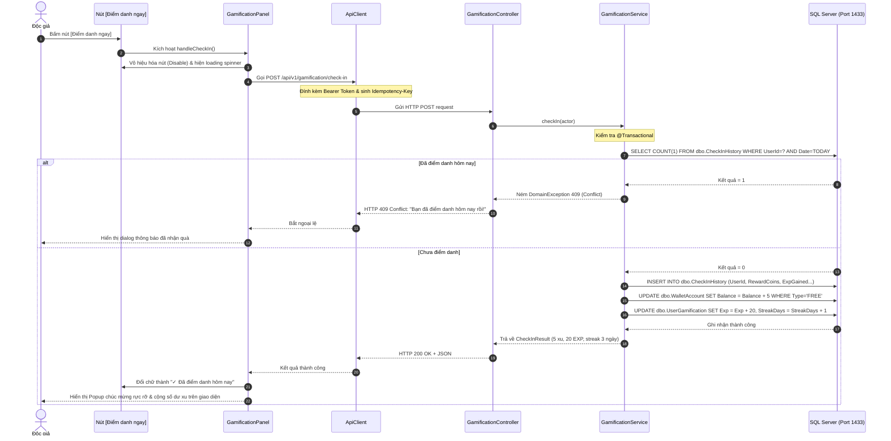
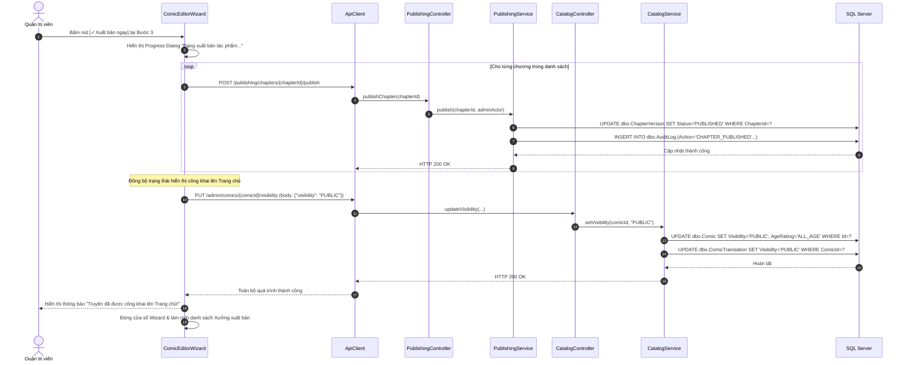

# 04. KIỂM TOÁN TOÀN BỘ GIAO DIỆN JAVA SWING VÀ TRUY VẾT BUTTON

---

## 1. DANH MỤC 26 GIAO DIỆN VÀ MÀN HÌNH KIỂM TOÁN THỰC TẾ

Toàn bộ giao diện người dùng của Comic Net được xây dựng hoàn toàn bằng **Java Swing** bản địa kết hợp bộ giao diện **FlatLaf 3.7.2**. Dưới đây là danh sách kiểm toán 26 màn hình, panel và hộp thoại (dialog) thực tế:

```mermaid
graph TD
    subgraph Auth [Xác thực & Phiên]
        M01[AuthScreens: Đăng nhập / Đăng ký / Quên mật khẩu]
        M02[SessionsDialog: Quản lý phiên đăng nhập từ xa]
    end

    subgraph Shell [Khung Ứng Dụng Chính]
        Main[MainFrame: Sidebar Navigation & Shell Window]
    end

    subgraph ReaderExperience [Khám Phá & Đọc Truyện]
        M03[CatalogPanel: Trang chủ & Danh mục truyện]
        M04[ReaderPanel: Trình đọc truyện tối ưu & Phím tắt]
        M05[RatingDialog: Đánh giá 5 sao & Nhận xét]
        M06[CommentDialog: Bình luận chương & Thả cảm xúc]
        M07[RecommendationDialog: Gợi ý truyện tương tự]
        M08[RankingPanel: Bảng xếp hạng TOP 3 Podium]
        M09[LibraryPanel: Tủ sách cá nhân & Theo dõi]
    end

    subgraph CreatorStudio [Xưởng Xuất Bản V2]
        M10[PublishingPanel: Dashboard Xưởng xuất bản]
        M11[ComicEditorWizard: Trình tạo & sửa truyện 3 bước]
        M12[BulkImageUploadDialog: Tải nhiều ảnh & tệp ZIP]
        M13[ChapterPreviewDialog: Đọc thử nội bộ Zero-Side-Effect]
        M14[AdminReviewQueuePanel: Hàng chờ duyệt bài của Admin]
        M15[ReviewDecisionDialogs: Hộp thoại yêu cầu sửa / từ chối]
        M16[CreatorFeedbackPanel: Xem góp ý của Admin & Gửi lại]
        M17[VersionHistoryDialog: Lịch sử phiên bản & Rollback]
    end

    subgraph EconomyGamification [Kinh Tế Số & Gamification]
        M18[WalletPanel: Ví xu & Nạp xu Sandbox]
        M19[AdminWalletPanel: Cấp phát/Thu hồi xu & Đối soát]
        M20[GamificationPanel: Điểm danh 7 ngày & Vòng quay 12h]
        M21[NotificationsPanel: Trung tâm thông báo]
        M22[AccountPanel: Hồ sơ cá nhân & Đổi mật khẩu]
    end

    subgraph OpsAdmin [Quản Trị & Vận Hành]
        M23[AdministrationPanel: Quản lý tài khoản & Audit Logs]
        M24[OperationsPanel: Giám sát RAM JVM & Sức khỏe hệ thống]
        M25[BackupRestoreGuidePanel: Hướng dẫn sao lưu SSMS]
        M26[ComicPicker: Bộ chọn truyện nhanh]
    end

    Main --> M01
    Main --> M03
    Main --> M08
    Main --> M09
    Main --> M10
    Main --> M14
    Main --> M18
    Main --> M19
    Main --> M20
    Main --> M21
    Main --> M22
    Main --> M23
    Main --> M24
    M03 --> M04
    M04 --> M05
    M04 --> M06
    M10 --> M11
    M11 --> M12
    M11 --> M13
```

---

## 2. BẢNG TRUY VẾT TỪNG BUTTON THAO TÁC CỐT LÕI (TRACEABILITY TABLE)

| Màn hình | Tên Button | Chức năng nghiệp vụ | Event Handler đầu tiên | API / Endpoint được gọi | Tác động SQL Server | Phản hồi cập nhật giao diện (UI) |
|---|---|---|---|---|---|---|
| `AuthScreens` | **Đăng nhập** | Xác thực danh tính độc giả/creator/admin | `doLogin(ActionEvent)` | `POST /api/v1/auth/login` | Đọc `dbo.[User]`, ghi `dbo.UserSession`, `dbo.AuditLog` | Lưu JWT token, nạp vai trò người dùng, chuyển sang `CatalogPanel` |
| `AuthScreens` | **Đăng ký** | Tạo tài khoản độc giả mới | `doRegister(ActionEvent)` | `POST /api/v1/auth/register` | Ghi `dbo.[User]`, gán vai trò `READER`, chèn thông báo `dbo.Notification` | Hiển thị popup chúc mừng, tự động điền form đăng nhập |
| `CatalogPanel` | **Đọc từ đầu** | Đọc truyện từ Chapter 1, Trang 1 | `startFromBeginning()` | `GET /api/v1/comics/{id}/chapters` | Đọc `dbo.Chapter`, kiểm tra `dbo.UserEntitlement` | Mở `ReaderPanel` tại chương đầu tiên, reset vị trí đọc |
| `CatalogPanel` | **Đọc tiếp** | Khôi phục chương và vị trí đang đọc dở | `resumeReading()` | `GET /api/v1/me/history` | Đọc `dbo.ReadingProgress`, `dbo.ReadingHistoryState` | Mở `ReaderPanel` tại đúng chương và offset pixel lưu trước đó |
| `CatalogPanel` | **Theo dõi** | Bật/tắt theo dõi truyện tranh | `toggleFollow(comicId)` | `POST /api/v1/comics/{id}/follow` | Thêm/xóa dòng trong `dbo.ComicFollow` | Đổi icon nút sang hình tim đầy và chữ "Đã theo dõi" |
| `ReaderPanel` | **Mua chương** | Trừ xu mở khóa chương trả phí | `confirmPurchase()` | `POST /api/v1/chapters/{id}/purchase` | Khóa `dbo.WalletAccount`, ghi `dbo.Purchase`, `dbo.LedgerEntry` | Trừ xu trên thanh tiêu đề, mở quyền hiển thị toàn bộ trang ảnh |
| `ReaderPanel` | **Đánh giá** | Mở hộp thoại chấm điểm 5 sao | `openRatingDialog()` | `GET /api/v1/comics/{id}/rating` | Đọc `dbo.ComicRating` | Hiển thị `RatingDialog` với số sao độc giả đã chấm |
| `RatingDialog` | **Gửi đánh giá** | Lưu điểm số và nhận xét | `submitRating()` | `PUT /api/v1/comics/{id}/rating` | Ghi/cập nhật `dbo.ComicRating`, tính lại điểm trung bình | Cập nhật điểm 5 sao trên trang chủ và danh sách nhận xét |
| `Gamification` | **Điểm danh ngay** | Nhận quà đăng nhập mỗi ngày | `handleCheckIn()` | `POST /api/v1/gamification/check-in` | Ghi `dbo.CheckInHistory`, cộng Xu vào `dbo.WalletAccount`, cộng EXP | Nút chuyển thành "Đã điểm danh hôm nay", hiển thị banner nhận 5 xu |
| `Gamification` | **Quay may mắn** | Quay thưởng bánh xe 12h | `startWheelSpin()` | `POST /api/v1/gamification/wheel-spin` | Ghi `dbo.LuckyWheelHistory`, cộng Xu/EXP trúng thưởng | Bánh xe quay giảm tốc mượt mà, dừng đúng nan quạt trúng thưởng |
| `Publishing` | **+ Tạo truyện** | Khởi động wizard tạo truyện mới | `openComicWizard()` | Client dialog khởi tạo | Chưa tác động DB | Mở cửa sổ `ComicEditorWizard` tại Bước 1 (Thông tin) |
| `ComicEditorWizard`| **+ Thêm chương** | Thêm một chương mới vào truyện | `addChapter()` | `POST /publishing/comics/{id}/chapters` | Ghi `dbo.Chapter`, tạo `dbo.ChapterVersion` working copy | Thêm 1 dòng vào danh sách chương, mở form upload ảnh |
| `ComicEditorWizard`| **🗑 Xóa chương** | Xóa bỏ chương tạo nhầm | `deleteCurrentChapter()`| `DELETE /publishing/chapters/{id}` | Xóa `dbo.Chapter`, `dbo.ChapterVersion`, thu hồi ảnh | Bỏ dòng chương khỏi bảng, chọn tự động chương liền kề |
| `ComicEditorWizard`| **× Xóa trang ảnh** | Xóa trang lỗi trong chương | `deletePage(pageId)` | `DELETE /publishing/versions/{v}/pages/{p}`| Xóa `dbo.ChapterVersionPage`, cập nhật `SortOrder` | Gỡ ảnh khỏi dải thumbnail, cập nhật lại số trang |
| `ComicEditorWizard`| **✈ Gửi Admin duyệt** | Creator hoàn tất nộp bản thảo | `submitForReview()` | `POST /publishing/versions/{id}/submit` | Đổi trạng thái `ChapterVersion` sang `READY_FOR_REVIEW` | Hiển thị thông báo thành công, đóng wizard, cập nhật KPI |
| `ComicEditorWizard`| **✓ Xuất bản ngay** | Admin phát hành truyện tức thì | `doAdminDirectPublish()`| `POST /publishing/chapters/{id}/publish` | Đổi `ChapterVersion` sang `PUBLISHED`, `Comic.Visibility='PUBLIC'` | Truyện đổi sang nhãn "Đã xuất bản" và hiện ngay trên Trang chủ |
| `AdminReviewQueue`| **👁 Xem & duyệt** | Mở màn hình thẩm định chi tiết | `openReviewDetail()` | `GET /publishing/versions/{id}` | Đọc thông tin bản thảo và danh sách trang | Mở bảng thông tin tác phẩm, nút xem trước và khối quyết định |
| `AdminReviewQueue`| **Phê duyệt** | Duyệt bản thảo đạt chuẩn | `approveVersion()` | `POST /publishing/versions/{id}/review` | Cập nhật `Status='APPROVED'`, ghi `dbo.AuditLog` | Gỡ truyện khỏi hàng chờ duyệt, gửi thông báo cho Creator |
| `AdminReviewQueue`| **Yêu cầu sửa** | Bắt buộc Creator chỉnh sửa lại | `requestChanges()` | `POST /publishing/versions/{id}/review` | Cập nhật `Status='NEEDS_CHANGES'`, lưu lý do sửa | Gửi thông báo chi tiết đến tab Xưởng xuất bản của Creator |
| `WalletPanel` | **Nạp tiền** | Nạp xu qua cổng Sandbox | `openPaymentDialog()` | `POST /api/v1/payments/orders` | Tạo `dbo.PaymentOrder`, kích hoạt webhook giả lập | Cộng xu vào tài khoản ngay lập tức, làm mới số dư hiển thị |
| `AdminWalletPanel`| **Cấp xu** | Admin tặng xu hỗ trợ độc giả | `grantCoins()` | `POST /api/v1/admin/wallet/adjust` | Khóa ví, ghi `dbo.LedgerEntry`, ghi `dbo.AuditLog` | Cập nhật số dư người dùng trên bảng, thông báo thành công |
| `AdminWalletPanel`| **Thu hồi xu** | Admin trừ xu tài khoản gian lận | `revokeCoins()` | `POST /api/v1/admin/wallet/adjust` | Trừ xu `dbo.LedgerEntry`, ghi `dbo.AuditLog` | Cập nhật số dư người dùng tức thì |
| `Administration` | **Khóa tài khoản** | Đình chỉ người dùng vi phạm | `suspendUser()` | `PUT /api/v1/admin/users/{id}/status` | Đổi `User.Status='SUSPENDED'`, thu hồi mọi `dbo.UserSession` | Người dùng bị đăng xuất ngay lập tức ở lần gọi API tiếp theo |

---

## 3. GIẢI THÍCH CHI TIẾT LUỒNG NÚT BẤM (BUTTON EXECUTION FLOWS)

### 3.1. Ví dụ 1: Luồng nút "Điểm danh ngay" (Daily Check-in Flow)

---

### 3.2. Ví dụ 2: Luồng nút "✓ Xuất bản ngay" của Admin (Direct Publish Flow)

---

## 4. XỬ LÝ CÁC TÌNH HUỐNG NGOẠI LỆ TRÊN GIAO DIỆN

1. **Người dùng không đủ thẩm quyền (HTTP 403 Forbidden):**
   - Khi tài khoản có vai trò `READER` cố tình bấm vào các nút điều khiển của Admin (ví dụ: gỡ truyện, nạp xu), backend trả về mã HTTP 403.
   - `ApiClient.java` nhận diện mã lỗi 403 và hiển thị dialog cảnh báo màu đỏ: *"Bạn không có quyền thực hiện thao tác này. Thao tác đã được ghi lại trong nhật ký an ninh."*
2. **Dữ liệu đầu vào sai định dạng (HTTP 400 Bad Request / 422 Unprocessable Entity):**
   - Trước khi gửi đi, giao diện Swing thực hiện tiền kiểm tra (Pre-validation: kiểm tra chuỗi rỗng, định dạng số, mật khẩu tối thiểu 8 ký tự).
   - Nếu dữ liệu lọt qua client và bị backend chặn (Jakarta Bean Validation), backend trả về cấu trúc lỗi chuẩn RFC 7807 (`ApiProblem`). Client hiển thị chính xác tên trường bị lỗi dưới dạng viền đỏ quanh text field.
3. **Mất kết nối tới máy chủ (Connection Refused):**
   - Nếu backend bị tắt hoặc nghẽn mạng, `HttpClient` ném ngoại lệ `HttpConnectTimeoutException`.
   - Desktop Client bắt ngoại lệ, mở hộp thoại thông báo máy chủ tạm thời không liên lạc được và giữ nguyên toàn bộ dữ liệu form người dùng vừa gõ (không xóa trắng form) để người dùng có thể bấm "Thử lại" sau khi backend bật lại.
