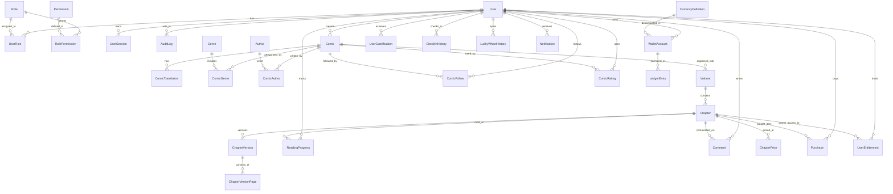

# 05. CẤU TRÚC VÀ QUAN HỆ CƠ SỞ DỮ LIỆU MICROSOFT SQL SERVER

---

## 1. TỔNG QUAN HỆ QUẢN TRỊ CƠ SỞ DỮ LIỆU

Hệ thống Comic Net sử dụng **Microsoft SQL Server 2025** làm cơ sở dữ liệu quan hệ duy nhất lưu trữ toàn bộ dữ liệu có cấu trúc của nền tảng.
- **Tên Database:** `ComicNetDev`
- **Cổng kết nối:** `1433` (TCP)
- **Công cụ di trú:** Flyway với 32 tệp kịch bản (`V1__foundation.sql` đến `V32__remove_age_restrictions.sql`)
- **Tổng số bảng thực tế:** 82 bảng được phân chia theo 12 miền dữ liệu nghiệp vụ (Data Domains).

---

## 2. SƠ ĐỒ MỐI QUAN HỆ THỰC THỂ TỔNG THỂ (CORE ERD)



---

## 3. GIẢI PHẪU CHI TIẾT 12 MIỀN DỮ LIỆU (DATA DOMAINS)

### 3.1. Miền Người Dùng, Xác Thực & Phân Quyền (Identity & RBAC)

1. **`dbo.[User]`:** Bảng lưu thông tin tài khoản người dùng cốt lõi.
   - `Id` (bigint IDENTITY, PK): Mã người dùng tự tăng.
   - `Username` (varchar(50) NOT NULL UNIQUE): Tên đăng nhập duy nhất.
   - `Email` (varchar(255) NULL UNIQUE): Địa chỉ email liên kết.
   - `PasswordHash` (varchar(255) NOT NULL): Chuỗi băm mật khẩu bảo mật (PBKDF2/BCrypt).
   - `Status` (varchar(30) NOT NULL DEFAULT 'ACTIVE'): Trạng thái (`ACTIVE`, `SUSPENDED`, `DELETED`).
   - `EmailVerifiedAt` (datetimeoffset NULL): Thời điểm xác thực email thành công.
   - `CreatedAt`, `UpdatedAt` (datetimeoffset NOT NULL): Dấu thời gian kiểm toán.
2. **`dbo.[Role]` & `dbo.Permission`:** Bảng danh mục vai trò và quyền hạn nguyên tử.
   - Các vai trò chuẩn hệ thống: `READER` (Độc giả), `CREATOR` (Tác giả/Nhóm dịch), `ADMINISTRATOR` (Quản trị viên tối cao).
3. **`dbo.UserRole` & `dbo.RolePermission`:** Bảng quan hệ nhiều - nhiều (N-N) gán vai trò cho người dùng và gán quyền cho vai trò.
4. **`dbo.UserSession` & `dbo.RefreshToken`:** Quản lý phiên đăng nhập và mã làm mới token.
   - `SessionTokenHash` (varchar(128) NOT NULL): Mã băm token phiên; hỗ trợ thu hồi tức thì phiên đăng nhập từ xa.
   - `ExpiresAt` (datetimeoffset NOT NULL): Thời hạn hết hiệu lực (mặc định 30 ngày cho Remember Me).
5. **`dbo.AuditLog`:** Nhật ký kiểm toán an ninh hệ thống.
   - Ghi nhận: Ai thực hiện (`UserId`), hành động gì (`Action`: `USER_LOGIN`, `PASSWORD_CHANGED`, `VERSION_APPROVED`...), tác động lên đối tượng nào (`TargetType`, `TargetId`), kết quả (`Status`: `SUCCESS`, `FAILURE`) và địa chỉ IP.

---

### 3.2. Miền Danh Mục Truyện Tranh (Comic Catalog)

1. **`dbo.Comic`:** Bảng thông tin tác phẩm truyện tranh.
   - `Id` (bigint IDENTITY, PK): Mã định danh duy nhất của truyện.
   - `Title` (nvarchar(255) NOT NULL): Tên chính của truyện tranh.
   - `Slug` (varchar(255) NOT NULL UNIQUE): Đường dẫn thân thiện SEO.
   - `CoverAssetId` (bigint NULL): Khóa ngoại trỏ đến ảnh bìa lưu trên S3.
   - `Visibility` (varchar(30) NOT NULL DEFAULT 'HIDDEN'): Trạng thái hiển thị (`PUBLIC`, `HIDDEN`, `REMOVED`).
   - `PublicationState` (varchar(30) NOT NULL DEFAULT 'DRAFT'): Tình trạng (`DRAFT`, `PUBLISHED`, `ARCHIVED`).
   - `AgeRating` (varchar(30) NOT NULL DEFAULT 'ALL_AGE'): Đã chuẩn hóa toàn bộ về `ALL_AGE` theo Migration `V32`.
   - `Format` (varchar(30) NOT NULL): Định dạng truyện (`MANGA`, `MANHWA`, `MANHUA`, `COMIC`).
   - `Synopsis` (nvarchar(max) NULL): Tóm tắt cốt truyện.
2. **`dbo.Author`, `dbo.Genre`, `dbo.Tag`, `dbo.Publisher`:** Các bảng danh mục tra cứu metadata chuẩn.
3. **`dbo.ComicGenre`, `dbo.ComicAuthor`, `dbo.ComicTag`:** Các bảng quan hệ nhiều - nhiều liên kết thể loại, tác giả với truyện.
4. **`dbo.ComicTranslation`:** Quản lý bản dịch ngôn ngữ cho truyện (`LanguageCode`: `vi`, `en`...).

---

### 3.3. Miền Xuất Bản & Quản Lý Chương (Publishing Pipeline)

1. **`dbo.Volume`:** Bảng phân tập truyện (Tập 1, Tập 2...).
2. **`dbo.Chapter`:** Bảng chương truyện.
   - `Id` (bigint IDENTITY, PK).
   - `ComicId` (bigint NOT NULL FK): Thuộc về truyện nào.
   - `ChapterNumber` (decimal(8,2) NOT NULL): Số thứ tự chương (ví dụ: Chapter 1, Chapter 1.5).
   - `Title` (nvarchar(255) NOT NULL): Tiêu đề chương.
   - `SortOrder` (int NOT NULL): Thứ tự sắp xếp hiển thị tăng dần.
3. **`dbo.ChapterVersion`:** Bảng quản lý phiên bản của chương (Versioning).
   - `Id` (bigint IDENTITY, PK).
   - `ChapterId` (bigint NOT NULL FK): Chương tương ứng.
   - `VersionNumber` (int NOT NULL): Số phiên bản (Version 1, Version 2...).
   - `Status` (varchar(30) NOT NULL): Trạng thái (`DRAFT`, `READY_FOR_REVIEW`, `NEEDS_CHANGES`, `APPROVED`, `PUBLISHED`, `REJECTED`, `ARCHIVED`).
   - `IsWorkingCopy` (bit NOT NULL DEFAULT 1): Cờ đánh dấu bản thảo đang chỉnh sửa.
   - `ReviewNotes` (nvarchar(max) NULL): Ghi chú nhận xét phản hồi từ Admin gửi Creator.
4. **`dbo.ChapterVersionPage`:** Quản lý từng trang ảnh bên trong phiên bản chương.
   - `PageNumber` (int NOT NULL): Số trang (Trang 1, Trang 2...).
   - `AssetId` (bigint NOT NULL FK): Trỏ đến đối tượng ảnh trong `dbo.Asset`.
   - `Width`, `Height`, `ByteSize`: Kích thước pixel và dung lượng trang ảnh.
5. **`dbo.UploadJob` & `dbo.UploadJobItem`:** Quản lý tiến trình xử lý ảnh tải lên nền (Asynchronous Background Job).
   - Trạng thái Job: `QUEUED`, `RUNNING`, `SUCCEEDED`, `FAILED`.

---

### 3.4. Miền Đọc Truyện & Tiến Độ (Reading State)

1. **`dbo.ReadingProgress`:** Lưu vết tiến độ đọc của từng người dùng trên từng chương.
   - `UserId`, `ChapterId` (Composite PK): Định danh người đọc và chương truyện.
   - `CurrentPage` (int NOT NULL DEFAULT 1): Trang truyện người dùng đang xem.
   - `ScrollOffset` (int NOT NULL DEFAULT 0): Vị trí cuộn pixel chiều dọc.
   - `IsCompleted` (bit NOT NULL DEFAULT 0): Cờ đánh dấu đã đọc xong chương.
   - `LastReadAt` (datetimeoffset NOT NULL): Thời gian đọc gần nhất.
2. **`dbo.ReadingHistoryState`:** Bảng tối ưu hóa truy vấn lịch sử đọc nhanh của độc giả trên Trang chủ.

---

### 3.5. Miền Kinh Tế Số, Ví Xu & Sổ Cái Kế Toán (Wallet & Double-Entry Ledger)

1. **`dbo.CurrencyDefinition`:** Bảng định nghĩa hai loại tiền tệ ảo trong hệ thống:
   - `Code = 'PAID'`: Xu nạp (được mua bằng tiền thật qua cổng nạp).
   - `Code = 'FREE'`: Xu tặng (nhận được qua điểm danh hằng ngày và quay may mắn).
2. **`dbo.WalletAccount`:** Bảng lưu tài khoản ví của từng người dùng.
   - `UserId` (bigint NOT NULL FK).
   - `CurrencyCode` (varchar(10) NOT NULL FK).
   - `Balance` (bigint NOT NULL DEFAULT 0 CHECK(Balance >= 0)): **Ràng buộc kiểm tra số dư không bao giờ được âm!**
3. **`dbo.LedgerEntry`:** Sổ cái kế toán ghi nhận mọi biến động tài chính (Audit Ledger).
   - Mỗi giao dịch biến động ví đều sinh một bản ghi bút toán không thể chỉnh sửa (`IMMUTABLE`), ghi nhận: Số tiền biến động (`Amount`), loại giao dịch (`TOP_UP`, `CHAPTER_PURCHASE`, `ADMIN_ADJUSTMENT`, `DAILY_REWARD`), số dư trước và sau giao dịch.
4. **`dbo.ChapterPrice`:** Thiết lập giá bán của chương truyện (ví dụ: Miễn phí = 0 xu, Trả phí = 5 xu).
5. **`dbo.Purchase`:** Lưu vết giao dịch mua chương truyện thành công của độc giả.
6. **`dbo.UserEntitlement`:** Quyền truy cập nội dung số vĩnh viễn đã được cấp phát cho người dùng sau khi thanh toán.

---

### 3.6. Miền Trò Chơi Hóa (Gamification & Rewards)

1. **`dbo.UserGamification`:** Quản lý điểm kinh nghiệm và đẳng cấp của độc giả.
   - `UserId` (bigint PRIMARY KEY FK).
   - `Exp` (bigint NOT NULL DEFAULT 0): Tổng điểm kinh nghiệm tích lũy.
   - `Level` (int NOT NULL DEFAULT 1): Cấp độ độc giả (Level 1 đến 10).
   - `StreakDays` (int NOT NULL DEFAULT 0): Số ngày điểm danh liên tiếp.
2. **`dbo.CheckInHistory`:** Lưu vết lịch sử điểm danh mỗi ngày.
   - `UserId`, `CheckInDate` (UNIQUE): Mỗi ngày độc giả chỉ được nhận thưởng đúng 1 lần.
3. **`dbo.LuckyWheelHistory`:** Lưu vết các lượt quay vòng quay may mắn.
   - `IsFreeSpin` (bit NOT NULL): Đánh dấu lượt quay miễn phí chu kỳ 12 giờ hay lượt quay trả phí bằng xu.
   - `PrizeType`, `PrizeAmount`: Phần thưởng nhận được (Xu hoặc EXP).
4. **`dbo.ReadingExpHistory`:** Lưu vết nhận thưởng 15 EXP sau khi đọc xong một chương truyện.

---

### 3.7. Miền Thống Kê & Đánh Giá (Analytics & Community)

1. **`dbo.ComicView`:** Ghi nhận từng lượt đọc hợp lệ (đã qua cơ chế lọc chống spam bot: cùng 1 IP/User trong vòng 10 phút chỉ tính 1 lượt xem).
2. **`dbo.ComicStatDaily`:** Bảng tổng hợp số liệu theo ngày phục vụ tính toán Bảng xếp hạng (Top Daily, Weekly, Monthly).
3. **`dbo.ComicRating`:** Đánh giá truyện từ 1 đến 5 sao và nhận xét của độc giả.
4. **`dbo.Comment`:** Bình luận chương truyện hỗ trợ phân cấp cha - con (ParentId) để trả lời bình luận.

---

## 4. CÁC NGUYÊN TẮC BẢO VỆ TÍNH TOÀN VẸN DỮ LIỆU

### 4.1. Khóa chính và Khóa ngoại (PK & FK)
- 100% các bảng đều có Khóa chính (`PRIMARY KEY`) định danh rõ ràng.
- Các quan hệ dữ liệu liên bảng đều được bảo vệ bằng Khóa ngoại (`FOREIGN KEY REFERENCES`) với ràng buộc chặt chẽ, ngăn ngừa triệt để dữ liệu mồ côi (Orphan Records).

### 4.2. Ràng buộc kiểm tra (CHECK Constraints) & Khóa chống trùng
- Ràng buộc không âm: `CHECK (Balance >= 0)` trong `dbo.WalletAccount` đảm bảo hệ thống không bao giờ xảy ra lỗi chi tiêu âm dù có bị tấn công gửi gói tin liên tục.
- Khóa chống trùng (`UNIQUE Constraint` hoặc `DedupKey`):
  - `dbo.CheckInHistory`: Khóa cặp `(UserId, CheckInDate)` ngăn chặn việc nhận thưởng điểm danh lần 2 trong cùng ngày.
  - `dbo.Notification`: Khóa `DedupKey` ngăn chặn gửi trùng lặp thông báo hệ thống.

### 4.3. Cơ chế Khóa giao dịch Bi quan (Pessimistic Locking: `UPDLOCK, HOLDLOCK`)
Trong các nghiệp vụ tài chính nhạy cảm như trừ tiền mua chương hoặc nạp xu:
```sql
SELECT Balance FROM dbo.WalletAccount WITH (UPDLOCK, HOLDLOCK)
WHERE UserId = @UserId AND CurrencyCode = @CurrencyCode;
```
Cú pháp `WITH (UPDLOCK, HOLDLOCK)` của SQL Server yêu cầu khóa độc quyền dòng dữ liệu của tài khoản ví ngay từ thời điểm đọc cho đến khi giao dịch kết thúc. Nếu có 2 yêu cầu trừ tiền gửi đến cùng lúc từ 2 tiến trình khác nhau, yêu cầu thứ hai buộc phải xếp hàng chờ yêu cầu thứ nhất hoàn tất, triệt tiêu 100% lỗi Race Condition.
