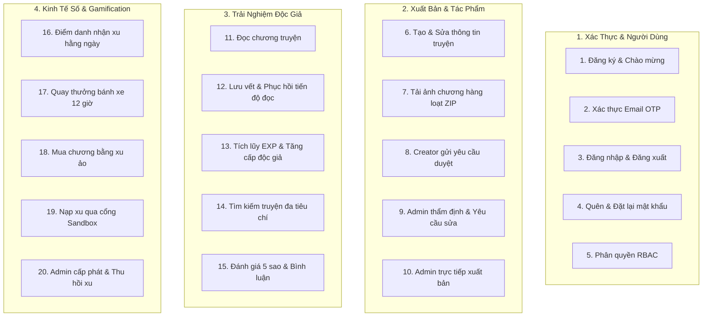
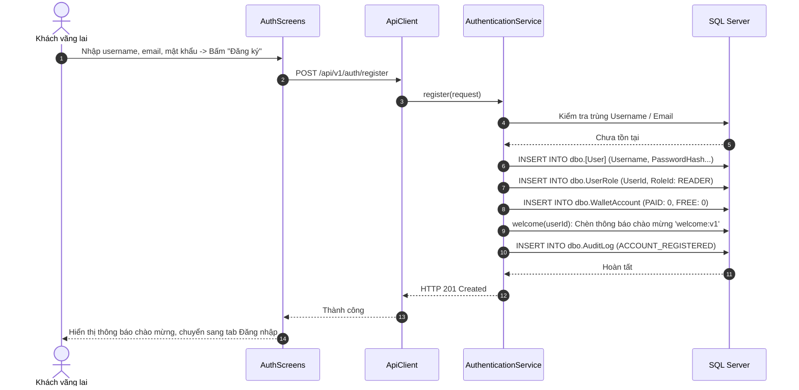
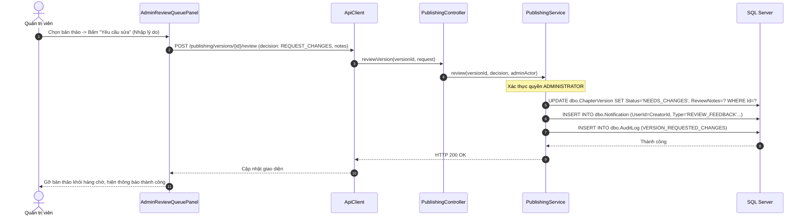
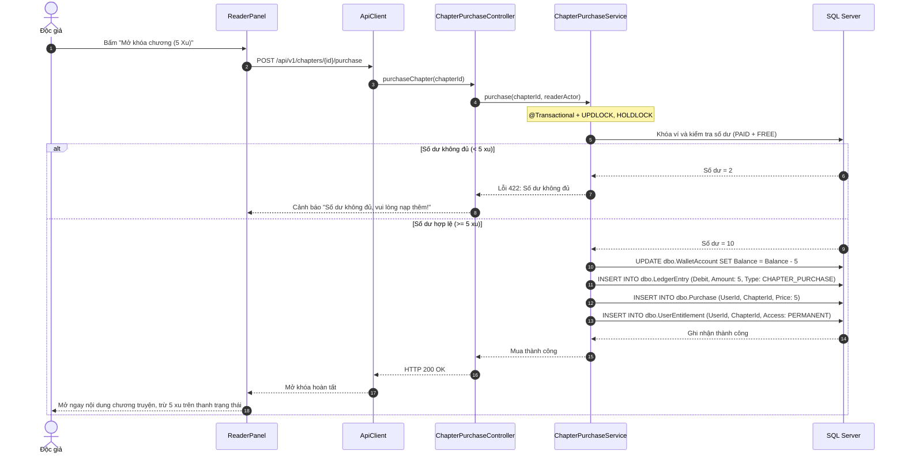

# 06. PHÂN TÍCH 20 LUỒNG NGHIỆP VỤ XƯƠNG SỐNG VÀ SEQUENCE DIAGRAMS

---

## 1. TỔNG QUAN HỆ THỐNG LUỒNG NGHIỆP VỤ

Mọi quy trình trong Comic Net đều được thiết kế khép kín từ giao diện **Java Swing** đến **Spring Boot REST** và kết thúc tại **Microsoft SQL Server 2025** cùng kho lưu trữ **RustFS S3**.

Dưới đây là 20 luồng nghiệp vụ xương sống của hệ thống:



---

## 2. PHÂN TÍCH CHI TIẾT TỪNG NGHIỆP VỤ

### 2.1. Nghiệp vụ 1: Đăng ký tài khoản mới & Tự động chào mừng
- **Điều kiện trước:** Người dùng chưa đăng nhập.
- **Actor:** Khách vãng lai (`Guest`).
- **Trigger:** Điền thông tin form và bấm nút **"Đăng ký"** trên `AuthScreens.java`.
- **File & Method:** `AuthenticationService.java:register()`, `welcome(userId)`.
- **Các bước xử lý:**
  1. Validate định dạng username (chữ cái/số, 3-30 ký tự), email hợp lệ, mật khẩu tối thiểu 8 ký tự.
  2. Băm mật khẩu an toàn bằng PBKDF2/BCrypt.
  3. Chèn bản ghi vào bảng `dbo.[User]`, gán vai trò mặc định `READER` vào `dbo.UserRole`.
  4. Khởi tạo tài khoản ví rỗng `dbo.WalletAccount` cho cả 2 loại tiền `PAID` và `FREE`.
  5. Gọi hàm `welcome(userId)` chèn thông báo chào mừng hệ thống mang `DedupKey = 'welcome:v1'` vào `dbo.Notification`.
  6. Ghi nhật ký kiểm toán vào `dbo.AuditLog` với `Action = 'ACCOUNT_REGISTERED'`.
- **Chống gian lận:** Khóa Unique trên cột `Username` và `Email`; bộ lọc `AuthRateLimitFilter` ngăn chặn việc dùng script đăng ký tài khoản rác ồ ạt.



---

### 2.2. Nghiệp vụ 3: Đăng nhập, Duy trì phiên và Đăng xuất
- **Điều kiện trước:** Tài khoản đang ở trạng thái `ACTIVE`.
- **Actor:** Người dùng (`Reader`, `Creator`, `Administrator`).
- **File & Method:** `AuthenticationService.java:login()`, `refresh()`, `logout()`.
- **Cơ chế xác thực kép (Dual Token Mechanism):**
  - **Access Token (JWT Bearer):** Thời hạn 10 phút, lưu trên bộ nhớ RAM của ứng dụng Swing (`ClientSession`), không ghi vào ổ đĩa. Dùng đính kèm vào header `Authorization: Bearer <token>` ở mỗi request.
  - **Refresh Token / Session Cookie:** Thời hạn 30 ngày, lưu trong CookieJar và bảng `dbo.UserSession`. Dùng để tự động cấp mới Access Token mà không bắt người dùng phải đăng nhập lại mỗi khi mở app.
- **Đăng xuất an toàn:** Khi bấm "Đăng xuất", Desktop Swing gửi `POST /api/v1/auth/logout`. Backend xóa bản ghi phiên trong `dbo.UserSession`, thu hồi Refresh Token và Swing xóa sạch token trong RAM.

---

### 2.3. Nghiệp vụ 6: Tạo và chỉnh sửa tác phẩm truyện tranh
- **Điều kiện trước:** Tài khoản có vai trò `CREATOR` hoặc `ADMINISTRATOR`.
- **Actor:** Tác giả / Nhóm dịch / Admin.
- **Trigger:** Bấm nút **"+ Tạo truyện"** trên tab "Xưởng xuất bản".
- **File & Method:** `ComicEditorWizard.java`, `CatalogService.java:createComic()`.
- **Các bước xử lý:**
  1. Người dùng chọn ảnh bìa (tỷ lệ 2:3), nhập tiêu đề, tên gốc, định dạng (Manga/Manhwa), thể loại và tóm tắt nội dung.
  2. Swing tải ảnh bìa lên S3 qua `S3StagingStore`, nhận về `AssetId`.
  3. Gửi `POST /catalog/comics` với payload metadata.
  4. Backend lưu vào `dbo.Comic` với trạng thái mặc định `Visibility = 'HIDDEN'`, `PublicationState = 'DRAFT'`, `AgeRating = 'ALL_AGE'`.
  5. Liên kết các bảng quan hệ: `dbo.ComicGenre`, `dbo.ComicAuthor`, `dbo.ComicTranslation`.
  6. Trả về `ComicId` và tự động chuyển sang Bước 2 (Quản lý chương).

---

### 2.4. Nghiệp vụ 7: Tải lên nhiều ảnh và tệp ZIP chương truyện
- **Điều kiện trước:** Truyện đã được tạo, đang ở Bước 2 của Wizard hoặc màn hình quản lý chương.
- **Trigger:** Bấm nút "Tải nhiều ảnh" hoặc kéo thả file `.zip` vào dropzone.
- **File & Method:** `BulkImageUploadDialog.java`, `UploadCoordinator.java`, `UploadWorker.java`.
- **Xử lý bất đồng bộ (Asynchronous Processing):**
  1. Desktop đọc file, sắp xếp theo tên tự nhiên qua `NaturalSort.java` (ví dụ: `page_1.png, page_2.png... page_10.png`).
  2. Nén và tải tệp lên endpoint `POST /publishing/versions/{id}/uploads`.
  3. Backend tạo bản ghi `dbo.UploadJob` với trạng thái `QUEUED` và đẩy vào luồng thực thi nền `UploadWorker`.
  4. `UploadWorker` giải nén file ZIP, giải mã định dạng ảnh (hỗ trợ JPG, PNG, WebP), tính toán chiều rộng, chiều cao, tạo thumbnail và đẩy ảnh vào RustFS S3.
  5. Chèn danh sách trang vào `dbo.ChapterVersionPage`. Cập nhật Job sang `SUCCEEDED`.
  6. Dialog Swing polling API `GET /publishing/jobs/{jobId}` mỗi giây để hiển thị thanh tiến trình %; khi hoàn tất sẽ hiển thị toàn bộ thumbnail trang trên màn hình.

---

### 2.5. Nghiệp vụ 8 & 9: Creator gửi duyệt và Admin thẩm định nội dung
- **Quy trình gửi duyệt của Creator:**
  - Creator bấm nút **"✈ Gửi Admin duyệt"** tại Bước 3.
  - Backend kiểm tra điều kiện tiên quyết: Chương phải có tối thiểu 1 trang ảnh và không có lỗi tải lên.
  - Cập nhật `dbo.ChapterVersion.Status = 'READY_FOR_REVIEW'`, `IsWorkingCopy = 0`.
- **Quy trình thẩm định của Admin (`AdminReviewQueuePanel.java`):**
  - Mở danh sách bản thảo chờ duyệt $\to$ Bấm nút **"👁 Xem & duyệt"**.
  - Bấm **"👁 Đọc thử"**: Mở `ChapterPreviewDialog.java` để đọc thử toàn bộ chương (đọc nội bộ an toàn, không tính lượt xem và không nhận thưởng).
  - Admin đưa ra 1 trong 3 quyết định:
    1. **Phê duyệt (`APPROVE`):** Đổi trạng thái sang `APPROVED`, sẵn sàng xuất bản.
    2. **Yêu cầu sửa (`REQUEST_CHANGES`):** Bắt buộc nhập lý do chi tiết (tối thiểu 10 ký tự); đổi trạng thái sang `NEEDS_CHANGES`, gửi phản hồi về tab của Creator.
    3. **Từ chối xuất bản (`REJECT`):** Bắt buộc nhập lý do vi phạm bản quyền hoặc nội dung xấu; lưu trữ bản thảo thất bại.



---

### 2.6. Nghiệp vụ 10: Admin trực tiếp xuất bản không qua hàng chờ (Direct Publish)
- **Ý nghĩa:** Giải quyết bất cập khi Admin tự sáng tác truyện; không cần tự đóng vai Creator để nộp rồi chuyển tài khoản để duyệt.
- **Thực thi:**
  - Tại Bước 3 `ComicEditorWizard.java`, nếu vai trò là `ADMINISTRATOR`, hiển thị nút **"✓ Xuất bản ngay"**.
  - Khi bấm nút, hệ thống duyệt xuất bản toàn bộ các chương hợp lệ qua `POST /publishing/chapters/{id}/publish`.
  - Đồng thời cập nhật trạng thái hiển thị công khai: `PUT /admin/comics/{comicId}/visibility` (`visibility = 'PUBLIC'`).
  - Truyện lập tức xuất hiện ở vị trí đầu tiên trên Trang chủ.

---

### 2.7. Nghiệp vụ 11 & 12: Đọc chương truyện và Tự động lưu tiến độ
- **Luồng đọc truyện:**
  1. Độc giả bấm vào chương truyện trên `CatalogPanel`.
  2. Giao diện kiểm tra chương miễn phí hay trả phí:
     - Nếu miễn phí: Mở thẳng `ReaderPanel`.
     - Nếu trả phí: Kiểm tra quyền sở hữu trong `dbo.UserEntitlement`. Nếu chưa sở hữu, bật hộp thoại hỏi mua chương bằng xu.
  3. `ReaderPanel` gọi API `GET /api/v1/chapters/{id}/pages` lấy danh sách URL ảnh bảo mật từ RustFS S3.
  4. Hiển thị ảnh trên khung canvas cuộn dọc mượt mà.
- **Cơ chế tự động lưu tiến độ (Auto-Save Progress):**
  - Trong quá trình cuộn, bộ đếm thời gian (Debounce Timer 1.5 giây) theo dõi vị trí cuộn `scrollOffset` và số trang hiện tại `currentPage`.
  - Gửi yêu cầu ngầm `PUT /api/v1/chapters/{id}/progress` về server.
  - Ghi nhận vào bảng `dbo.ReadingProgress`. Khi người dùng quay lại ở bất kỳ thiết bị nào, bấm nút **"Đọc tiếp"** sẽ khôi phục chính xác từng pixel đọc dở.

---

### 2.8. Nghiệp vụ 13: Tích lũy EXP và Tăng cấp độc giả (Leveling)
- **Trigger:** Độc giả cuộn tới mép cuối cùng của trang ảnh cuối cùng trong chương.
- **Xử lý:**
  - `ReaderPanel` phát hiện chạm đáy (Scroll to end), kích hoạt gửi `POST /api/v1/chapters/{id}/completion`.
  - Backend kiểm tra trong bảng `dbo.ReadingExpHistory`: Độc giả đã nhận EXP cho chương này chưa?
  - Nếu chưa nhận: Cộng ngay **15 EXP**, chèn bản ghi lịch sử, cập nhật tổng EXP trong `dbo.UserGamification`.
  - Tính toán lại Level theo công thức: $\text{Level} = \min(10, \lfloor\sqrt{\text{EXP} / 50}\rfloor + 1)$.
  - Trả về thông báo: *"Chúc mừng bạn đã đọc xong chương và nhận được 15 EXP!"*.

---

### 2.9. Nghiệp vụ 14: Điểm danh hằng ngày nhận xu (Daily Check-in)
- **Trigger:** Độc giả bấm nút "Điểm danh ngay" trên `GamificationPanel`.
- **Xử lý an toàn trên Database:**
  - Kiểm tra điều kiện: `CAST(CreatedAt AS DATE) = CAST(GETUTCDATE() AS DATE)`.
  - Sử dụng giao dịch `@Transactional`: Chèn `dbo.CheckInHistory`, cộng 5 xu vào `dbo.WalletAccount` (loại `FREE`), cộng 20 EXP vào `dbo.UserGamification`, tăng số ngày điểm danh liên tiếp `StreakDays`.
  - Nếu gửi lặp: Khóa Unique ngăn chặn nhận quà 2 lần trong cùng ngày.

---

### 2.10. Nghiệp vụ 15: Quay thưởng bánh xe may mắn chu kỳ 12 giờ (Lucky Wheel)
- **Cơ chế:**
  - Mỗi 12 giờ: Hệ thống cấp 1 lượt quay hoàn toàn miễn phí (`IsFreeSpin = true`).
  - Hết lượt miễn phí: Có thể tiêu 2 xu để mua thêm lượt quay.
  - Giải thuật ngẫu nhiên trên Server (Server-Side RNG): Backend quyết định trước nan quạt trúng thưởng (1 xu, 2 xu, 5 xu, 10 xu, 20 EXP, Chúc may mắn lần sau...) dựa trên bảng tỷ lệ xác suất công bằng.
  - Swing nhận kết quả góc quay từ server và thực hiện hoạt ảnh quay bánh xe giảm tốc trong 4 giây rồi dừng đúng nan quạt đã trúng.

---

### 2.11. Nghiệp vụ 16: Mua chương truyện bằng Xu ảo
- **Điều kiện trước:** Chương truyện có giá bán lớn hơn 0; độc giả chưa sở hữu quyền đọc.
- **Nguyên tắc trừ tiền ưu tiên:** Trừ xu nạp (`PAID`) trước; nếu không đủ thì trừ tiếp xu tặng (`FREE`).
- **Khóa bi quan chống chi tiêu âm:**
  ```sql
  SELECT Balance FROM dbo.WalletAccount WITH (UPDLOCK, HOLDLOCK)
  WHERE UserId = ? AND CurrencyCode = 'PAID';
  ```
  Nếu tổng số dư cả hai ví nhỏ hơn giá chương $\to$ Ném ngoại lệ `DomainException: Số dư xu không đủ, vui lòng nạp thêm!`.
- Khi thành công:
  - Trừ số dư trong `dbo.WalletAccount`.
  - Ghi bút toán sổ cái vào `dbo.LedgerEntry`.
  - Ghi nhận đơn hàng vào `dbo.Purchase`.
  - Cấp quyền đọc vĩnh viễn vào `dbo.UserEntitlement`.



---

### 2.12. Nghiệp vụ 17: Nạp xu qua Cổng thanh toán Sandbox nội bộ
- **Ý nghĩa:** Mô phỏng quy trình nạp tiền thanh toán trực tuyến của các nền tảng thương mại thực tế mà không phải mất phí kết nối cổng thanh toán thật.
- **Các bước:**
  1. Người dùng chọn gói nạp trên `WalletPanel` (ví dụ: Gói 50.000 VNĐ nhận 50 xu).
  2. Chọn phương thức: VNPay, MoMo hoặc Chuyển khoản QR.
  3. Bấm **"Thanh toán ngay"**: Gửi `POST /api/v1/payments/orders`.
  4. Backend tạo đơn hàng `dbo.PaymentOrder` ở trạng thái `PENDING`.
  5. Cổng Sandbox giả lập xử lý thành công, gửi Webhook nội bộ cập nhật đơn hàng sang `COMPLETED`.
  6. Tự động cộng 50 xu nạp (`PAID`) vào `dbo.WalletAccount` và ghi nhận sổ cái `dbo.LedgerEntry`.
  7. Hiển thị popup chúc mừng nạp xu thành công.

---

### 2.13. Nghiệp vụ 18: Admin cấp phát và thu hồi xu
- **Actor:** `ADMINISTRATOR`.
- **Giao diện:** `AdminWalletPanel.java`.
- **Mục đích:** Hỗ trợ người dùng khi gặp lỗi nạp tiền hoặc xử lý tài khoản có hành vi gian lận.
- **Thực hiện:**
  - Nhập tên người dùng cần tra cứu $\to$ Hiển thị số dư hiện tại của 2 ví.
  - Bấm **"Cấp xu"** hoặc **"Thu hồi xu"**: Bắt buộc nhập số lượng và **lý do điều chỉnh**.
  - Backend thực thi phương thức `WalletService.adjust()`, ghi nhận bút toán kiểm toán `dbo.LedgerEntry` và lưu nhật ký an ninh `dbo.AuditLog`.

---

### 2.14. Nghiệp vụ 19: Tra cứu và Tìm kiếm truyện đa tiêu chí
- **Actor:** Mọi người dùng (`Guest`, `Reader`).
- **Giao diện:** Thanh tìm kiếm trên `CatalogPanel.java` và `SearchAssist.java`.
- **Cơ chế tìm kiếm:**
  - Tìm kiếm linh hoạt theo từ khóa tiêu đề truyện, tên tác giả hoặc lọc theo thể loại (Action, Romance, Comedy...).
  - Lưu vết lịch sử tìm kiếm vào bảng `dbo.SearchHistory` để hiển thị danh sách từ khóa vừa tìm khi người dùng nhấp vào thanh tìm kiếm.

---

### 2.15. Nghiệp vụ 20: Đánh giá 5 sao và Bình luận cộng đồng
- **Đánh giá 5 sao (`RatingDialog.java`):**
  - Độc giả chọn số sao từ 1 đến 5 bằng vector Graphics2D tương tác và nhập nhận xét văn bản.
  - Backend lưu vào `dbo.ComicRating`, tự động tính toán lại điểm số trung bình (ví dụ: 4.8★) và hiển thị thanh tỷ lệ phân phối từ 5★ đến 1★ trên giao diện chi tiết truyện.
- **Bình luận chương (`CommentDialog.java`):**
  - Độc giả gửi bình luận dưới mỗi chương truyện.
  - Hỗ trợ trả lời (Reply) bình luận của người khác, thả biểu tượng cảm xúc (Thích, Tim, Cười) và bấm nút báo cáo vi phạm nội dung lên Admin.
