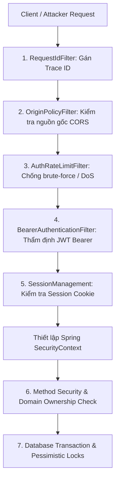

# 07. AN NINH BẢO MẬT VÀ HỆ THỐNG PHÂN QUYỀN RBAC

---

## 1. NGUYÊN TẮC BẢO MẬT TỐI THƯỢNG CỦA HỆ THỐNG

Một trong những sai lầm phổ biến nhất của sinh viên khi bảo vệ đồ án là lầm tưởng việc **ẩn hoặc làm mờ nút bấm trên giao diện (Frontend)** là đã bảo mật được hệ thống.

Trong kiến trúc của Comic Net, nguyên tắc bảo mật cốt lõi được khẳng định:
> **"Ẩn nút bấm trên Java Swing chỉ là hỗ trợ trải nghiệm người dùng (UX). Toàn bộ quyền hạn, kiểm tra sở hữu dữ liệu và tính toàn vẹn phải do Backend Spring Boot quyết định và kiểm soát 100%!"**

Kẻ tấn công hoàn toàn có thể bỏ qua ứng dụng Swing, sử dụng các công cụ như Postman, cURL hoặc viết script gửi trực tiếp các HTTP Request tới cổng 8080 của backend. Do đó, tầng backend được thiết kế như một pháo đài bảo vệ nhiều lớp.



---

## 2. KIẾN TRÚC XÁC THỰC KÉP (DUAL-TOKEN AUTHENTICATION)

Comic Net áp dụng mô hình xác thực kết hợp giữa **JWT Bearer Token** ngắn hạn và **Session Cookie** dài hạn:

| Đặc tính | Access Token (JWT Bearer) | Session Cookie (Refresh Token) |
|---|---|---|
| **Thời hạn hiệu lực** | **10 phút** | **30 ngày** (Remember Me) |
| **Vị trí lưu trữ** | **Bộ nhớ RAM của Swing** (`ClientSession.java`) | Lưu trong CookieJar của HttpClient & Bảng `dbo.UserSession` |
| **Bảo mật lưu trữ** | Không bao giờ ghi xuống file ổ cứng | Được băm SHA-256 trước khi lưu vào Database (`SessionTokenHash`) |
| **Cơ chế truyền tải** | Header `Authorization: Bearer <token>` | Header chuẩn `Cookie: comicnet_session=...` |
| **Cơ chế thu hồi (Revoke)** | Tự động hết hạn sau 10 phút | Có thể bị Admin hoặc người dùng thu hồi tức thì trong `SessionsDialog` |
| **Chống tấn công phát lại** | Thời hạn rất ngắn | Cơ chế xoay vòng token (**Token Rotation**): Mỗi lần dùng để lấy Access Token mới, Refresh Token cũ sẽ bị hủy ngay lập tức |

---

## 3. MA TRẬN PHÂN QUYỀN THEO VAI TRÒ (RBAC PERMISSION MATRIX)

Căn cứ cơ sở dữ liệu `dbo.[Role]`, `dbo.Permission` và cấu hình `SecurityConfiguration.java`:

| Hành động / Endpoint | Khách vãng lai (`Guest`) | Độc giả (`READER`) | Tác giả (`CREATOR`) | Quản trị viên (`ADMINISTRATOR`) | Cơ chế kiểm tra |
|---|:---:|:---:|:---:|:---:|---|
| **Xem danh mục truyện, tìm kiếm** | Có | Có | Có | Có | Công khai (`permitAll`) |
| **Đọc chương miễn phí** | Có | Có | Có | Có | Công khai |
| **Đọc chương trả phí (bằng xu)** | Không | Phải mua | Phải mua | Tự do xem trước | `EntitlementService` kiểm tra |
| **Đánh giá 5 sao, bình luận** | Không | Có | Có | Có | Yêu cầu `authenticated()` |
| **Điểm danh, quay may mắn** | Không | Có | Có | Có | Yêu cầu `authenticated()` |
| **Tạo truyện, sửa bản thảo của mình** | Không | Không | **Có** | **Có** | Kiểm tra quyền sở hữu tác phẩm |
| **Sửa truyện của người khác** | Không | Không | Không | **Có** | Chỉ dành cho Admin |
| **Nộp bản thảo gửi Admin duyệt** | Không | Không | **Có** | **Có** | Kiểm tra trạng thái bản thảo |
| **Duyệt / Từ chối / Yêu cầu sửa** | Không | Không | Không | **Có** | `actor.administrator()` |
| **Xuất bản trực tiếp lên Trang chủ** | Không | Không | Không | **Có** | `actor.administrator()` |
| **Cấp phát / Thu hồi xu tài khoản** | Không | Không | Không | **Có** | Matcher `/api/v1/admin/wallet/**` |
| **Khóa / Mở khóa người dùng** | Không | Không | Không | **Có** | Matcher `/api/v1/admin/users/**` |
| **Xem nhật ký an ninh (Audit Logs)**| Không | Không | Không | **Có** | Matcher `/api/v1/admin/audit/**` |

> [!NOTE]
> **Về việc nghỉ hưu vai trò `MODERATOR` tại Migration `V31`:**
> Trước đây hệ thống định phân quyền duyệt truyện cho Moderator. Nhưng để tránh phân mảnh quyền hạn và rườm rà trong quản trị, toàn bộ quyền kiểm duyệt nội dung đã được hợp nhất vào vai trò `ADMINISTRATOR`. Flyway Migration `V31` đã thu hồi toàn bộ quyền của vai trò `MODERATOR` và chuyển quyền phê duyệt sang Admin.

---

## 4. BẢO VỆ QUYỀN SỞ HỮU DỮ LIỆU (DATA OWNERSHIP CHECKS)

Bên cạnh việc kiểm tra Role, hệ thống áp dụng cơ chế kiểm tra **Quyền sở hữu (Ownership Verification)** ở mức dịch vụ (Domain Service Layer):

```java
// Đoạn mã trích xuất từ PublishingService.java
if (!actor.administrator() && !target.author().equals(actor.username())) {
    throw DomainException.forbidden("Bạn không có quyền chỉnh sửa tác phẩm của tác giả khác!");
}
```

- **Giải thích:** Một Creator dù có quyền tạo truyện, nhưng khi gửi yêu cầu sửa đổi một chương truyện hoặc thay ảnh bìa, backend sẽ truy vấn database để kiểm tra tác giả tạo truyện đó (`target.author()`) có trùng khớp với username trong JWT Token của người đang đăng nhập hay không.
- Nếu không trùng và người đó không phải là Admin, hệ thống lập tức ném ngoại lệ `403 Forbidden` và từ chối xử lý, ngăn ngừa triệt để lỗ hổng **IDOR (Insecure Direct Object Reference)**.

---

## 5. CÁC BIỆN PHÁP BẢO MẬT KỸ THUẬT NÂNG CAO

### 5.1. Băm mật khẩu một chiều an toàn (Password Hashing)
- Tuyệt đối không bao giờ lưu trữ mật khẩu dưới dạng văn bản thô (Plain Text) hoặc mã hóa đảo ngược được (Base64, MD5, SHA-1).
- Dự án sử dụng thuật toán băm chậm có Salt ngẫu nhiên (PBKDF2/BCrypt) trong `AuthenticationService.java`. Mỗi mật khẩu khi băm đều sinh ra một chuỗi Salt riêng biệt, chống lại kỹ thuật tấn công bằng bảng tra cứu trước (Rainbow Table).

### 5.2. Chống tấn công SQL Injection
- Hệ thống áp dụng 100% cơ chế tham số hóa câu truy vấn:
  - Spring Data JPA dùng Hibernate Parameter Binding (`:param`).
  - Tầng JDBC dùng `JdbcClient` hoặc `PreparedStatement` với dấu hỏi chấm `?`.
- Mọi chuỗi đầu vào do người dùng nhập đều được SQL Server xử lý thuần túy là giá trị dữ liệu (Data Literal), không bao giờ bị hiểu nhầm là câu lệnh thực thi SQL.

### 5.3. Chống tấn công CSRF (Cross-Site Request Forgery)
- Mặc dù đây là ứng dụng Desktop Client, hệ thống vẫn áp dụng cơ chế phòng vệ nguồn gốc chặt chẽ qua bộ lọc `OriginPolicyFilter.java`.
- Cookie phiên được cấu hình cờ `SameSite=Strict` và `HttpOnly`.
- Mọi yêu cầu ghi dữ liệu đều yêu cầu header `Authorization: Bearer <token>`, đây là loại header tùy biến mà các trang web độc hại trên trình duyệt không thể tự động đính kèm khi tấn công Cross-Site.

### 5.4. Chống tấn công vét cạn (Brute-Force & Rate Limiting)
- Bộ lọc `AuthRateLimitFilter.java` giám sát tần suất gọi các endpoint nhạy cảm như `/api/v1/auth/login`, `/register`, `/forgot`.
- Nếu phát hiện một địa chỉ IP gửi quá 10 yêu cầu sai mật khẩu liên tiếp trong vòng 1 phút, hệ thống tự động chặn IP đó trong 15 phút và trả về mã lỗi `HTTP 429 Too Many Requests`.

### 5.5. Cơ chế kiểm soát tương tranh ETag (Optimistic Locking)
- Khi chỉnh sửa bản dịch truyện hoặc sửa thứ tự trang ảnh, backend trả về mã `ETag` (chuỗi hash nội dung).
- Khi client gửi yêu cầu cập nhật, phải gửi kèm header `If-Match: "<ETag>"`.
- Nếu có một người khác đã cập nhật bản ghi trước đó, ETag trên database đã thay đổi, backend trả về mã `HTTP 412 Precondition Failed`. Điều này ngăn chặn hiện tượng hai người cùng sửa đè làm mất dữ liệu của nhau (Lost Update Problem).
