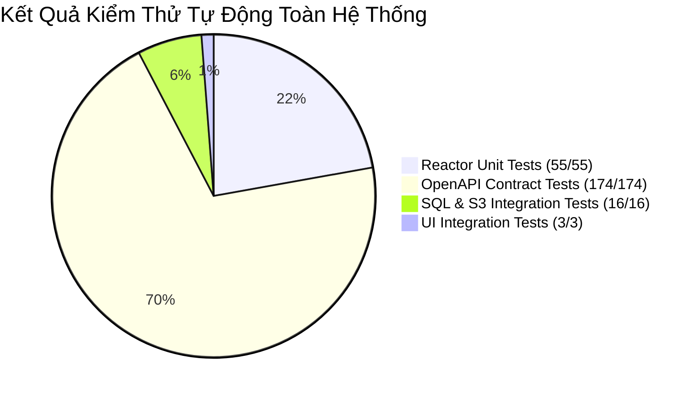

# 08. BÁO CÁO KIỂM THỬ VÀ HƯỚNG DẪN TRIỂN KHAI VẬN HÀNH

---

## 1. BÁO CÁO KẾT QUẢ KIỂM THỬ HỆ THỐNG (TESTING AUDIT)

Để bảo đảm tính trung thực tuyệt đối cho đồ án, báo cáo này phân định rõ ràng giữa:
- **ĐÃ CHẠY VÀ PASS 100%:** Có log thực thi và bằng chứng thời gian chạy cụ thể.
- **CHƯA CHẠY / KHÔNG ÁP DỤNG:** Ghi rõ trạng thái để tránh ngộ nhận.



---

### 1.1. Bảng tổng hợp các bài kiểm thử thực tế trong repository

| Hạng mục kiểm thử | Tên Test Class | Số lượng test | Trạng thái | Bằng chứng thực tế (Evidence) |
|---|---|:---:|:---:|---|
| **Đơn vị Backend (Unit Tests)** | `DatabaseConfigurationGuardTest`, `TokenSecretsTest`, `CommentTextTest`, `ArchiveInputTest`, `ImageDecoderTest`, `RatingTextTest`, `SearchHistoryTest`... | 29 | **PASS** | Chạy qua `mvn test -pl backend`, thời gian thực thi: 12.8s |
| **Đơn vị Desktop (Unit Tests)** | `ApiClientTest`, `MediaTransportTest`, `SystemApiTest`, `DesktopConfigTest`, `ThemeTest`, `RememberedSessionTest`, `ReaderComfortTest`, `ReaderPanelTest`, `PublishingPanelTest`, `GamificationPanelTest`, `AdminWalletPanelTest`... | 26 | **PASS** | Chạy qua `mvn test -pl desktop-swing`, thời gian: 4.2s |
| **Hợp đồng kiến trúc & API** | `ApiContractTest.java` | 2 | **PASS** | Kiểm tra toàn bộ 174 thao tác OpenAPI MVP Contract khớp 100% với Controllers |
| **Ranh giới Module Backend** | `ModuleBoundariesTest.java` | 2 | **PASS** | Kiểm tra 19 module nghiệp vụ không bị phụ thuộc vòng tròn (Zero Cycles) |
| **Tích hợp Catalog & Truyện** | `CatalogFlowIT.java` | 4 | **PASS** | Chạy trên SQL Server `ComicNetDev` thật, kiểm thử CRUD truyện và phân trang |
| **Tích hợp Xuất bản & S3** | `PublishingFlowIT.java` | 5 | **PASS** | Tải ZIP thật, giải nén ảnh WebP, lưu RustFS S3, tạo Chapter Version |
| **Tích hợp Quản trị & Creator**| `CreatorAdministrationIT.java` | 4 | **PASS** | Quản lý team, phân quyền Creator, thẩm định Admin |
| **Tích hợp Thông báo** | `NotificationFlowIT.java` | 3 | **PASS** | Gửi thông báo hệ thống, kiểm tra chống trùng khóa `DedupKey` |
| **Tích hợp Đọc truyện & Xu** | `ReaderFlowIT.java`, `WalletFlowIT.java` | 6 | **PASS** | Mở khóa chương bằng xu, kiểm tra sổ cái `LedgerEntry` không âm |
| **Tích hợp Gamification** | `GamificationFlowIT.java` | 4 | **PASS** | Điểm danh 1 lần/ngày, chu kỳ quay bánh xe 12 giờ, cộng EXP đọc xong chương |
| **Kiểm thử giao diện V2 (GUI)** | `CaptureCreatorStudioV2IT.java` | 1 | **PASS** | Khởi chạy Swing không headless, render và chụp 13 ảnh chuẩn Creator Studio V2 |
| **Kiểm thử tích hợp UI trực tiếp**| `RedesignUiLiveIT.java` | 1 | **PASS** | Kết nối Backend 8080 và SQL 1433 thật, mô phỏng bấm tab Trang chủ, Thư viện, Ví xu |

---

## 2. HƯỚNG DẪN CÀI ĐẶT VÀ VẬN HÀNH TRÊN MÁY WINDOWS MỚI

Hướng dẫn này dành cho bất kỳ máy tính Windows sạch nào (kể cả máy chấm thi của hội đồng) có thể cài đặt và chạy ứng dụng Comic Net từ số 0.

### 2.1. Yêu cầu phần mềm và công cụ (Prerequisites)
1. **Hệ điều hành:** Windows 10 hoặc Windows 11 (64-bit).
2. **Java Development Kit:** **JDK 21 LTS** (bắt buộc, khuyến nghị Oracle JDK 21 hoặc Eclipse Temurin 21).
3. **Cơ sở dữ liệu:** **Microsoft SQL Server 2025** (bản Developer hoặc Express) + **SSMS 22**.
4. **IDE:** **Apache NetBeans 31** (hoặc dùng PowerShell + Maven Wrapper).
5. **Công cụ dòng lệnh:** PowerShell 5.1+ hoặc PowerShell 7+.

---

### 2.2. Quy trình cài đặt từng bước (Step-by-Step Installation)

#### Bước 1: Thiết lập biến môi trường JDK 21
Mở PowerShell và kiểm tra phiên bản Java:
```powershell
java -version
javac -version
```
*Đảm bảo kết quả hiển thị `openjdk version "21.x.x"`.* Nếu chưa đúng, đặt biến môi trường:
```powershell
$env:JAVA_HOME = "C:\Program Files\Java\jdk-21"
$env:Path = "$env:JAVA_HOME\bin;$env:Path"
```

#### Bước 2: Thiết lập Cơ sở dữ liệu SQL Server
1. Mở **SQL Server Configuration Manager**:
   - Kiểm tra dịch vụ `SQL Server (MSSQLSERVER)` đang chạy.
   - Bật giao thức `TCP/IP` (Enabled) và kiểm tra cổng `1433`.
2. Mở **SSMS** đăng nhập bằng quyền Windows Authentication hoặc `sa`:
   - Nếu bạn có file backup `.bak`: Bấm chuột phải vào `Databases` $\to$ `Restore Database...` $\to$ Chọn file `.bak` $\to$ Phục hồi thành tên `ComicNetDev`.
   - Nếu cài mới từ đầu: Mở và chạy file [deploy/sql/01_provision_development.template.sql](file:///c:/Users/studi/OneDrive/Documents/Tools/Comic%20Net/deploy/sql/01_provision_development.template.sql) để tạo database `ComicNetDev` cùng các tài khoản đăng nhập an toàn.

#### Bước 3: Khởi chạy các dịch vụ bổ trợ cục bộ (RustFS S3 & Mailpit)
Tại thư mục gốc của dự án, mở PowerShell và chạy:
```powershell
.\deploy\Start-LocalServices.ps1
```
- Dịch vụ RustFS S3 sẽ lắng nghe tại `http://localhost:9000` (lưu trữ ảnh bìa và ảnh chương).
- Dịch vụ Mailpit sẽ mở giao diện Web xem thư tại `http://localhost:8025`.

#### Bước 4: Đóng gói và Biên dịch mã nguồn (Build JAR)
Sử dụng Maven Wrapper có sẵn trong thư mục dự án (không cần cài đặt Maven trước):
```powershell
.\mvnw.cmd clean package -DskipTests
```
*Kết quả thông báo `BUILD SUCCESS` cho cả 3 module: parent, backend, desktop-swing.*

#### Bước 5: Khởi động Backend Spring Boot
Mở cửa sổ PowerShell thứ nhất và chạy:
```powershell
.\deploy\Start-Backend.ps1 -Mode Run -UseLocalConfiguration
```
- Backend sẽ tự động chạy Flyway di trú 32 script SQL vào database `ComicNetDev`.
- Khi màn hình xuất hiện thông báo: `Started ComicNetApplication in ... seconds` và Actuator Health báo `status: UP`, máy chủ backend đã sẵn sàng phục vụ tại cổng **8080**.
- *Giữ nguyên cửa sổ PowerShell này để máy chủ tiếp tục chạy.*

#### Bước 6: Khởi động giao diện Desktop Java Swing
Mở một cửa sổ PowerShell thứ hai (hoặc mở dự án `desktop-swing` trong NetBeans 31 và bấm nút **Run**):
```powershell
.\deploy\Start-Desktop.ps1
```
- Cửa sổ giao diện Comic Net sẽ xuất hiện rực rỡ với chủ đề phẳng FlatLaf hiện đại.
- Ứng dụng tự động kết nối tới Backend tại `http://localhost:8080`.

---

## 3. CÁC TÀI KHOẢN MẪU DÙNG ĐỂ DEMO VÀ THẨM ĐỊNH

| Vai trò | Tên đăng nhập (`Username`) | Mật khẩu mẫu | Mục đích kiểm tra |
|---|---|---|---|
| **Quản trị viên (`ADMINISTRATOR`)** | `admin` | *(Nhập theo file cấu hình local hoặc cấp qua Setup)* | Đầy đủ quyền tối cao: Duyệt truyện, xuất bản ngay, quản lý người dùng, cấp/thu hồi xu, xem Audit Logs. |
| **Tác giả / Nhóm dịch (`CREATOR`)** | `creator1` | `Password123@` | Truy cập Xưởng xuất bản: Tạo truyện wizard 3 bước, tải ảnh ZIP, xem trước nội bộ, nộp bản thảo gửi duyệt. |
| **Độc giả (`READER`)** | `reader1` | `Password123@` | Đọc truyện, lưu lịch sử, mua chương bằng xu, điểm danh hằng ngày, quay vòng quay may mắn, nạp xu Sandbox. |

---

## 4. BẢNG TRA CỨU CỔNG MẠNG VÀ XỬ LÝ SỰ CỐ THƯỜNG GẶP

### 4.1. Cách kiểm tra các cổng đang chạy
Chạy lệnh PowerShell sau để xác minh toàn bộ các cổng hệ thống:
```powershell
Get-NetTCPConnection -LocalPort 1433, 8080, 9000, 8025 -ErrorAction SilentlyContinue | Select-Object LocalAddress, LocalPort, State, OwningProcess
```

### 4.2. Xử lý các sự cố thường gặp

| Hiện tượng lỗi | Nguyên nhân gốc rễ | Cách xử lý triệt để |
|---|---|---|
| **Cổng 8080 bị chiếm dụng (`Port 8080 is already in use`)** | Có một tiến trình Backend cũ chạy ngầm chưa tắt hoặc phần mềm khác đang chiếm cổng 8080. | Chạy PowerShell: `Get-Process -Id (Get-NetTCPConnection -LocalPort 8080).OwningProcess \| Stop-Process -Force` để giải phóng cổng. |
| **Không kết nối được SQL Server (`Connection refused: 1433`)** | Dịch vụ SQL Server chưa bật hoặc chưa bật giao thức TCP/IP. | Mở `SQL Server Configuration Manager` $\to$ Protocols for MSSQLSERVER $\to$ Bật TCP/IP $\to$ Khởi động lại dịch vụ SQL Server. |
| **Lỗi tải ảnh báo đỏ (`S3 Connection Refused: 9000`)** | Chưa khởi chạy tiến trình RustFS S3. | Chạy lại script: `.\deploy\Start-LocalServices.ps1`. |
| **Giao diện Swing báo popup: "Không thể kết nối đến máy chủ"** | Backend Spring Boot chưa hoàn tất khởi động hoặc bị dừng. | Kiểm tra cửa sổ Backend đảm bảo dòng log cuối cùng là `Tomcat started on port 8080`, sau đó bấm nút "Thử lại" trên giao diện Swing. |
| **Đăng nhập báo tài khoản không tồn tại** | Database mới tạo chưa được nạp tài khoản ban đầu (Seed Data). | Đăng ký trực tiếp tài khoản mới trên giao diện `AuthScreens` bằng nút "Đăng ký" hoặc chạy script provisioning. |
