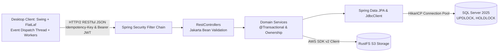

# 10. KỊCH BẢN THUYẾT TRÌNH BẢO VỆ, DEMO VÀ XỬ LÝ SỰ CỐ TẠI CHỖ

---

## 1. KỊCH BẢN THUYẾT TRÌNH GIỚI THIỆU 3 PHÚT (ELEVATOR PITCH)

*Thời lượng: Đúng 180 giây. Phong thái: Tự tin, dõng dạc, nhìn thẳng vào hội đồng.*

> "Kính thưa quý thầy cô trong Hội đồng phản biện,
> 
> Em tên là [Họ và Tên], sau đây em xin phép được trình bày đồ án tốt nghiệp với đề tài: **'Comic Net — Nền tảng phân phối, xuất bản và đọc truyện tranh số bản quyền'**.
> 
> **1. Vấn đề thực tiễn:**
> Hiện nay, việc xuất bản và đọc truyện tranh trực tuyến tại Việt Nam gặp nhiều bất cập về kiểm soát bản quyền, trải nghiệm đọc trên máy tính chưa tối ưu và thiếu các cơ chế gắn kết cộng đồng.
> 
> **2. Giải pháp và Kiến trúc hệ thống:**
> Để giải quyết bài toán trên, đồ án xây dựng hệ thống theo kiến trúc **Modular Monolith** phân tách rõ ràng giữa Frontend và Backend:
> - **Giao diện chính:** Ứng dụng Desktop bản địa viết bằng **Java 21 Swing** kết hợp **FlatLaf 3.7.2**, tối ưu hóa bộ đọc truyện mượt mà, hỗ trợ phím tắt và không bị phụ thuộc vào trình duyệt web.
> - **Máy chủ dịch vụ:** **Spring Boot 4.1.2** đóng vai trò là pháo đài bảo mật tối thượng, quản lý 19 module nghiệp vụ khép kín, xác thực qua cơ chế kép JWT Bearer và Session Cookie 30 ngày.
> - **Cơ sở dữ liệu & Lưu trữ:** Sử dụng **Microsoft SQL Server 2025** với 32 tệp di trú Flyway quản lý 82 bảng dữ liệu nghiêm ngặt; kết hợp máy chủ lưu trữ đối tượng **RustFS S3** lưu trữ ảnh bìa và hàng nghìn trang truyện tranh.
> 
> **3. Điểm nổi bật về tính năng:**
> - **Xưởng xuất bản Creator Studio V2:** Hỗ trợ tác giả tải lên hàng loạt ảnh hoặc file ZIP tự động giải nén, sắp xếp tên tự nhiên (Natural Sort), quy trình thẩm định Admin đa bước và xem trước nội bộ an toàn.
> - **Kinh tế số & Gamification:** Tích hợp ví tiền ảo kép (Xu nạp và Xu tặng), sổ cái cân bằng (Balanced Ledger), mở khóa chương bản quyền, điểm danh nhận quà hằng ngày, vòng quay may mắn chu kỳ 12 giờ và hệ thống cấp độ độc giả Level 1 đến 10.
> 
> Toàn bộ hệ thống đã vượt qua 55/55 bài kiểm thử đơn vị, 174/174 hợp đồng API và 16 bài kiểm thử tích hợp thực tế trên SQL Server và S3.
> 
> Sau đây, em xin phép được trình bày sâu hơn về kiến trúc và kính mời quý thầy cô cùng theo dõi phần demo trực quan của hệ thống!"

---

## 2. KỊCH BẢN THUYẾT TRÌNH KIẾN TRÚC KỸ THUẬT 5 PHÚT

*Thời lượng: Đúng 300 giây. Tập trung vào chiều sâu công nghệ, luồng dữ liệu và an ninh.*

### Nội dung trình bày từng phút:
- **Phút 1: Triết lý thiết kế (Design Philosophy):** Nhấn mạnh nguyên tắc **Decoupled Architecture**. Desktop Swing hoàn toàn không có driver SQL Server, không giữ secret database. Mọi liên lạc đều qua HTTP/JSON.
- **Phút 2: Ranh giới Module (Package-by-Feature):** Giải thích lý do chọn Modular Monolith với 19 module nghiệp vụ tự quản. Dẫn chứng bài test `ModuleBoundariesTest.java` chứng minh hệ thống đạt chuẩn không có phụ thuộc vòng tròn.
- **Phút 3: An ninh và Phân quyền (Security by Design):** Giải thích cơ chế xác thực kép (JWT 10m trong RAM + Cookie 30d trong DB). Khẳng định việc ẩn nút trên UI chỉ là UX, Backend kiểm tra vai trò RBAC và quyền sở hữu tác phẩm (Ownership Check) để chống lỗ hổng IDOR.
- **Phút 4: Tính toàn vẹn dữ liệu (Data Integrity):** Trình bày cơ chế khóa bi quan `SELECT ... WITH (UPDLOCK, HOLDLOCK)` và sổ cái kép `LedgerEntry` trong bảng `dbo.WalletAccount` giúp triệt tiêu hoàn toàn lỗi chi tiêu âm hay nhận quà điểm danh trùng lặp.
- **Phút 5: Cơ chế lưu trữ phân tán (Digital Asset Pipeline):** Giải thích lý do dùng S3 lưu ảnh thay vì nhét nhị phân vào SQL Server, cách thức `UploadWorker` chạy nền giải nén ZIP và tối ưu hóa WebP.

---

## 3. KỊCH BẢN DEMO THỰC TẾ 10 - 15 PHÚT (LIVE INTERACTIVE DEMO)

### 3.1. Phân cảnh 1: Độc giả (Reader Experience - 4 phút)
1. **Khởi động ứng dụng:** Mở Desktop Swing, giới thiệu giao diện FlatLaf phẳng sang trọng.
2. **Khám phá Trang chủ:** Cuộn xem danh sách truyện, lọc theo thể loại, gõ tìm kiếm từ khóa trên thanh tìm kiếm.
3. **Mở đọc truyện:**
   - Chọn bộ truyện hot, bấm **"Đọc từ đầu"**: Mở `ReaderPanel` tại Chapter 1, trang 1.
   - Thao tác cuộn mượt mà, nhấn phím mũi tên điều hướng, bấm đổi chế độ lật trang (Paged Mode).
   - Cuộn đến cuối trang cuối cùng: Màn hình hiển thị chúc mừng nhận **15 EXP**.
4. **Mua chương trả phí:** Mở một chương có giá 5 xu $\to$ Hệ thống bật hộp thoại xác nhận mua chương $\to$ Bấm mua $\to$ Trừ 5 xu trên thanh tiêu đề và mở nội dung ngay lập tức.
5. **Gamification:**
   - Chuyển sang tab **"Điểm danh & Vòng quay"**.
   - Bấm **"Điểm danh ngay"**: Nhận ngay 5 xu và 20 EXP. Nút tự đổi sang "Đã điểm danh hôm nay".
   - Bấm **"Quay may mắn"**: Bánh xe 8 nan quạt quay tít và giảm tốc dừng đúng nan trúng thưởng.
6. **Đánh giá & Bình luận:** Mở hộp thoại Đánh giá 5 sao, chọn 5 sao, gõ nhận xét $\to$ Cột phân bổ sao cập nhật ngay lập tức.

---

### 3.2. Phân cảnh 2: Tác giả (Creator Studio V2 - 5 phút)
1. **Đăng nhập tài khoản Creator:** Đăng nhập `creator1`.
2. **Dashboard Xưởng xuất bản:** Giới thiệu 3 thẻ KPI (Tổng truyện, Bản nháp, Chờ Admin duyệt).
3. **Wizard tạo truyện 3 bước:**
   - Bấm **"+ Tạo truyện"**.
   - *Bước 1 (Thông tin):* Chọn ảnh bìa 2:3, nhập tên truyện, chọn thể loại, bấm "Tiếp tục".
   - *Bước 2 (Quản lý chương):* Bấm "+ Thêm chương", đặt giá 5 xu. Bấm **"Tải nhiều ảnh"** $\to$ Kéo thả file `.zip` vào dropzone. Hệ thống hiển thị thanh tiến trình % và render đầy đủ dải thumbnail trang theo đúng thứ tự NaturalSort.
   - Bấm nút **"👁 Xem trước"**: Mở `ChapterPreviewDialog` đọc thử chương nội bộ an toàn (chứng minh không tăng view).
   - *Bước 3 (Gửi duyệt):* Kiểm tra checklist hoàn tất, gõ ghi chú cho Admin, bấm **"✈ Gửi Admin duyệt"**.

---

### 3.3. Phân cảnh 3: Quản trị viên (Administrator Ops - 4 phút)
1. **Đăng nhập tài khoản Admin:** Đăng nhập `admin`.
2. **Hàng chờ duyệt bài:**
   - Vào tab **"Duyệt nội dung"** (có chấm đỏ thông báo).
   - Bấm **"👁 Xem & duyệt"** truyện vừa nộp của Creator.
   - Thử nghiệm 1: Chọn "Yêu cầu sửa", nhập lý do *"Ảnh bìa bị vỡ nét, vui lòng thay ảnh nét hơn"* $\to$ Gửi phản hồi.
   - Chuyển sang tài khoản Creator: Chứng minh Creator nhận thông báo và thấy thẻ truyện đổi sang màu vàng `● Cần sửa lại`.
   - Thử nghiệm 2: Admin mở lại và bấm **"Phê duyệt & Xuất bản"**.
3. **Admin xuất bản trực tiếp:** Vào Wizard tạo truyện của Admin $\to$ Bấm **"✓ Xuất bản ngay"** $\to$ Truyện lập tức mang nhãn xanh `● Đã xuất bản` và hiện ngay đầu Trang chủ.
4. **Vận hành tài chính & Nhật ký:**
   - Vào tab **"Quản lý ví"**: Tìm kiếm người dùng, thực hiện "Cấp xu", nhập lý do.
   - Vào tab **"Quản trị hệ thống"**: Xem bảng **Audit Logs** với đầy đủ các hành động vừa thực hiện trong buổi demo.

---

## 4. DANH SÁCH FILE CODE CẦN MỞ SẴN ĐỂ CHỨNG MINH KHI ĐƯỢC HỎI

1. [PublishingService.java](file:///c:/Users/studi/OneDrive/Documents/Tools/Comic%20Net/backend/src/main/java/com/comicnet/publishing/service/PublishingService.java): Chứng minh luồng duyệt bài, kiểm tra quyền sở hữu tác phẩm và quyền xuất bản của Admin.
2. [WalletService.java](file:///c:/Users/studi/OneDrive/Documents/Tools/Comic%20Net/backend/src/main/java/com/comicnet/wallet/service/WalletService.java): Chứng minh giao dịch trừ xu với khóa bi quan `UPDLOCK, HOLDLOCK` và ghi sổ cái `LedgerEntry`.
3. [GamificationService.java](file:///c:/Users/studi/OneDrive/Documents/Tools/Comic%20Net/backend/src/main/java/com/comicnet/gamification/service/GamificationService.java): Chứng minh giải thuật tính Level lũy tiến và cơ chế chống điểm danh lặp.
4. [SecurityConfiguration.java](file:///c:/Users/studi/OneDrive/Documents/Tools/Comic%20Net/backend/src/main/java/com/comicnet/config/SecurityConfiguration.java): Chứng minh bộ lọc bảo mật Spring Security và ma trận RBAC.
5. [ComicEditorWizard.java](file:///c:/Users/studi/OneDrive/Documents/Tools/Comic%20Net/desktop-swing/src/main/java/com/comicnet/desktop/features/publishing/ComicEditorWizard.java): Chứng minh giao diện Wizard 3 bước, tải ảnh và xóa chương.
6. [ModuleBoundariesTest.java](file:///c:/Users/studi/OneDrive/Documents/Tools/Comic%20Net/backend/src/test/java/com/comicnet/architecture/ModuleBoundariesTest.java): Chứng minh ranh giới 19 module nghiệp vụ đạt chuẩn Zero-Cycle.

---

## 5. BÍ QUYẾT XỬ LÝ SỰ CỐ TẠI CHỖ KHI DEMO

| Sự cố bất ngờ | Cách xử lý bình tĩnh trước hội đồng |
|---|---|
| **Giao diện Swing báo "Mất kết nối máy chủ"** | Bình tĩnh giải thích: *"Dạ, máy chủ Backend vừa bị tắt hoặc gián đoạn mạng, giao diện Swing đã bắt đúng ngoại lệ và hiển thị thông báo lỗi thân thiện"*. Mở terminal chạy lại `.\deploy\Start-Backend.ps1`, đợi 5 giây rồi bấm nút **"Thử lại"** trên Swing để phục hồi. |
| **Cổng 8080 bị báo bận (Port already in use)** | Mở PowerShell gõ ngay lệnh một dòng: `Get-Process -Id (Get-NetTCPConnection -LocalPort 8080).OwningProcess \| Stop-Process -Force` để giải phóng cổng trước mặt hội đồng (thể hiện kỹ năng DevOps). |
| **Hội đồng yêu cầu sửa dữ liệu trong SQL Server xem UI có đổi không** | Mở SSMS, chạy lệnh `UPDATE dbo.Comic SET Title = 'Tên Mới' WHERE Id = 1;`. Sau đó trên Desktop Swing bấm F5 hoặc chuyển tab $\to$ Giao diện nạp ngay tên mới, chứng minh hệ thống đọc dữ liệu thật 100%. |
| **Hội đồng yêu cầu đổi quyền tài khoản trực tiếp** | Đăng nhập tài khoản Admin $\to$ Vào tab **"Quản trị hệ thống"** $\to$ Chọn tài khoản và chuyển vai trò từ `READER` sang `CREATOR` $\to$ Tài khoản đó mở app lại sẽ có ngay tab Xưởng xuất bản. |
