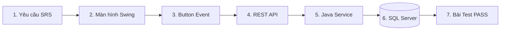

# 12. MA TRẬN TRUY VẾT TOÀN DIỆN (FULL TRACEABILITY MATRIX)

---

## 1. Ý NGHĨA CỦA MA TRẬN TRUY VẾT

Ma trận truy vết (Traceability Matrix) là bằng chứng kỹ thuật quan trọng nhất để chứng minh trước Hội đồng phản biện rằng: **Mọi yêu cầu chức năng trong đồ án Comic Net đều có mã nguồn thực tế, có giao diện tương tác, có API xử lý, có bảng lưu trữ trong SQL Server và có bài kiểm thử tự động xác minh.**

Không có bất kỳ chức năng nào là "nút bấm giả", "dữ liệu ảo" hoặc "tuyên bố suông".

---

## 2. BẢNG MA TRẬN TRUY VẾT ĐẦU-CUỐI (END-TO-END TRACEABILITY)

| Mã YC | Tên chức năng | Màn hình Swing | Nút tương tác | Event Handler / Method | REST API Endpoint | Bảng SQL Server | Bài kiểm thử tự động (Evidence) |
|---|---|---|---|---|---|---|---|
| **REQ-01** | Đăng ký tài khoản | `AuthScreens.java` | "Đăng ký" | `doRegister()` | `POST /api/v1/auth/register` | `dbo.[User]`, `dbo.UserRole`, `dbo.Notification` | `IdentityFlowIT.java`, `ApiClientTest.java` |
| **REQ-02** | Đăng nhập hệ thống | `AuthScreens.java` | "Đăng nhập" | `doLogin()` | `POST /api/v1/auth/login` | `dbo.[User]`, `dbo.UserSession`, `dbo.AuditLog` | `IdentityHttpIT.java`, `SessionManagementIT.java` |
| **REQ-03** | Duy trì phiên đăng nhập | `MainFrame.java` | N/A (Tự động) | `RememberedSession.restore()` | `POST /api/v1/auth/refresh` | `dbo.UserSession`, `dbo.RefreshToken` | `RememberedSessionTest.java` |
| **REQ-04** | Đăng xuất từ xa | `SessionsDialog.java` | "Đăng xuất thiết bị" | `revokeSession(sessionId)` | `DELETE /api/v1/sessions/{id}` | `dbo.UserSession` (xóa bản ghi) | `SessionManagementIT.java` |
| **REQ-05** | Khám phá danh mục truyện | `CatalogPanel.java` | Bộ lọc thể loại | `loadComics(page, filter)` | `GET /api/v1/comics` | `dbo.Comic`, `dbo.ComicGenre`, `dbo.Genre` | `CatalogFlowIT.java`, `ApiContractTest.java` |
| **REQ-06** | Tìm kiếm truyện tranh | `CatalogPanel.java` | Icon tìm kiếm | `doSearch(keyword)` | `GET /api/v1/search?q=...` | `dbo.Comic`, `dbo.SearchHistory` | `SearchFlowIT.java`, `SearchHistoryTest.java` |
| **REQ-07** | Đọc truyện từ đầu | `CatalogPanel.detail`| "Đọc từ đầu" | `startFromBeginning()` | `GET /api/v1/comics/{id}/chapters` | `dbo.Chapter`, `dbo.ChapterVersionPage` | `ReaderFlowIT.java`, `ReaderPanelTest.java` |
| **REQ-08** | Khôi phục vị trí đọc dở | `CatalogPanel.detail`| "Đọc tiếp" | `resumeReading()` | `GET /api/v1/me/history` | `dbo.ReadingProgress`, `dbo.ReadingHistoryState` | `ReaderFlowIT.java`, `ReaderComfortTest.java` |
| **REQ-09** | Tự động lưu tiến độ đọc | `ReaderPanel.java` | Cuộn chuột | `saveProgressDebounced()` | `PUT /api/v1/chapters/{id}/progress` | `dbo.ReadingProgress` (Cập nhật offset) | `ReaderFlowIT.java` |
| **REQ-10** | Thưởng EXP hoàn thành | `ReaderPanel.java` | Cuộn chạm đáy | `triggerCompletionReward()` | `POST /api/v1/chapters/{id}/completion` | `dbo.ReadingExpHistory`, `dbo.UserGamification` | `GamificationFlowIT.java` |
| **REQ-11** | Theo dõi truyện tranh | `CatalogPanel.detail`| "Theo dõi" | `toggleFollow(comicId)` | `POST /api/v1/comics/{id}/follow` | `dbo.ComicFollow` | `CatalogFlowIT.java` |
| **REQ-12** | Đánh giá 5 sao truyện | `RatingDialog.java` | "Gửi đánh giá" | `submitRating()` | `PUT /api/v1/comics/{id}/rating` | `dbo.ComicRating` | `RatingFlowIT.java`, `RatingTextTest.java` |
| **REQ-13** | Bình luận chương truyện | `CommentDialog.java` | "Gửi bình luận"| `sendComment()` | `POST /api/v1/chapters/{id}/comments` | `dbo.Comment`, `dbo.CommentReaction` | `CommentFlowIT.java`, `CommentTextTest.java` |
| **REQ-14** | Điểm danh nhận xu hằng ngày | `GamificationPanel.java`| "Điểm danh ngay" | `handleCheckIn()` | `POST /api/v1/gamification/check-in` | `dbo.CheckInHistory`, `dbo.WalletAccount` | `GamificationFlowIT.java`, `GamificationPanelTest.java` |
| **REQ-15** | Quay vòng quay may mắn 12h | `GamificationPanel.java`| "Quay may mắn" | `startWheelSpin()` | `POST /api/v1/gamification/wheel-spin` | `dbo.LuckyWheelHistory`, `dbo.WalletAccount` | `GamificationFlowIT.java`, `GamificationPanelTest.java` |
| **REQ-16** | Mua chương trả phí bằng xu | `ReaderPanel.java` | "Mở khóa chương"| `confirmPurchase()` | `POST /api/v1/chapters/{id}/purchase` | `dbo.WalletAccount`, `dbo.Purchase`, `dbo.UserEntitlement` | `WalletFlowIT.java`, `ReaderFlowIT.java` |
| **REQ-17** | Nạp xu cổng Sandbox | `WalletPanel.java` | "Thanh toán ngay"| `processPayment()` | `POST /api/v1/payments/orders` | `dbo.CoinPackage`, `dbo.PaymentOrder`, `dbo.LedgerEntry` | `WalletFlowIT.java` |
| **REQ-18** | Admin cấp/thu hồi xu | `AdminWalletPanel.java` | "Cấp xu / Thu hồi" | `adjustUserCoins()` | `POST /api/v1/admin/wallet/adjust` | `dbo.WalletAccount`, `dbo.LedgerEntry`, `dbo.AuditLog` | `AdminWalletPanelTest.java` |
| **REQ-19** | Tạo truyện mới (Bước 1) | `ComicEditorWizard.java`| "Tiếp tục" | `submitComicInfo()` | `POST /catalog/comics` | `dbo.Comic`, `dbo.ComicGenre`, `dbo.ComicAuthor` | `CreatorAdministrationIT.java`, `CatalogFlowIT.java` |
| **REQ-20** | Thêm chương mới (Bước 2) | `ComicEditorWizard.java`| "+ Thêm" | `addChapter()` | `POST /publishing/comics/{id}/chapters` | `dbo.Chapter`, `dbo.ChapterVersion` | `PublishingFlowIT.java` |
| **REQ-21** | Xóa chương tạo nhầm | `ComicEditorWizard.java`| "🗑 Xóa" | `deleteCurrentChapter()`| `DELETE /publishing/chapters/{id}` | `dbo.Chapter`, `dbo.ChapterVersion` | `PublishingPanelTest.java` |
| **REQ-22** | Tải ZIP nhiều ảnh chương | `BulkImageUploadDialog.java`| "Bắt đầu tải"| `startUpload()` | `POST /publishing/versions/{id}/uploads` | `dbo.UploadJob`, `dbo.ChapterVersionPage` | `PublishingFlowIT.java`, `ImageDecoderTest.java` |
| **REQ-23** | Đọc thử nội bộ an toàn | `ChapterPreviewDialog.java`| "👁 Đọc thử" | `openPreview()` | `GET /publishing/versions/{id}/preview` | Đọc `dbo.ChapterVersionPage` (Zero side-effect) | `CaptureCreatorStudioV2IT.java` |
| **REQ-24** | Creator nộp bản thảo | `ComicEditorWizard.java`| "✈ Gửi Admin duyệt" | `submitForReview()` | `POST /publishing/versions/{id}/submit` | `dbo.ChapterVersion` (`Status='READY_FOR_REVIEW'`) | `PublishingFlowIT.java` |
| **REQ-25** | Admin phê duyệt bản thảo | `AdminReviewQueuePanel.java`| "Phê duyệt" | `approveVersion()` | `POST /publishing/versions/{id}/review` | `dbo.ChapterVersion` (`Status='APPROVED'`) | `PublishingFlowIT.java` |
| **REQ-26** | Admin yêu cầu sửa bản thảo | `AdminReviewQueuePanel.java`| "Yêu cầu sửa" | `requestChanges()` | `POST /publishing/versions/{id}/review` | `dbo.ChapterVersion` (`Status='NEEDS_CHANGES'`) | `PublishingFlowIT.java` |
| **REQ-27** | Admin xuất bản trực tiếp | `ComicEditorWizard.java`| "✓ Xuất bản ngay"| `doAdminDirectPublish()`| `POST /publishing/chapters/{id}/publish` | `dbo.ChapterVersion`, `dbo.Comic.Visibility='PUBLIC'` | `CaptureCreatorStudioV2IT.java`, `PublishingFlowIT.java` |
| **REQ-28** | Bảng xếp hạng Top 3 Podium| `RankingPanel.java` | Lọc chu kỳ | `loadRankings(period)` | `GET /api/v1/rankings?period=...` | `dbo.ComicStatDaily`, `dbo.ComicView` | `AnalyticsPublishingFlowIT.java` |
| **REQ-29** | Khóa tài khoản người dùng | `AdministrationPanel.java`| "Khóa tài khoản" | `suspendUser(id)` | `PUT /api/v1/admin/users/{id}/status` | `dbo.[User].Status='SUSPENDED'`, xóa `dbo.UserSession` | `CreatorAdministrationIT.java` |
| **REQ-30** | Xem nhật ký kiểm toán | `AdministrationPanel.java`| "Làm mới nhật ký" | `loadAuditLogs()` | `GET /api/v1/admin/audit` | `dbo.AuditLog` | `SqlFoundationIT.java` |
