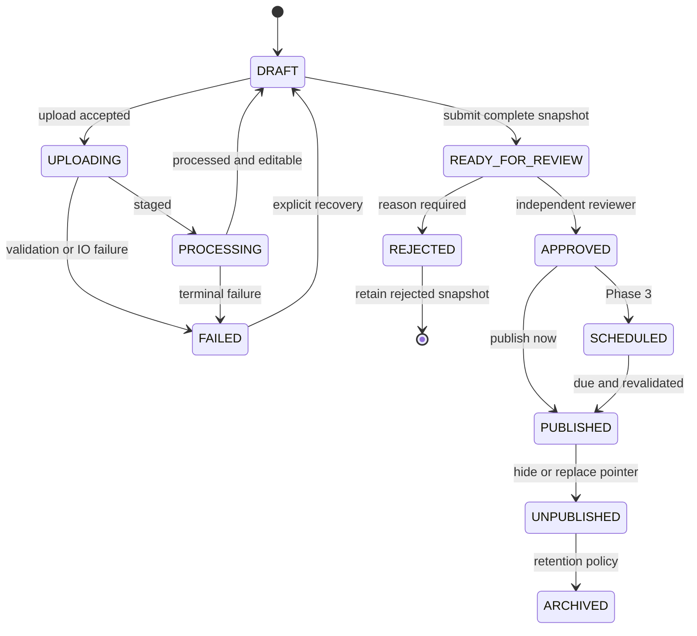
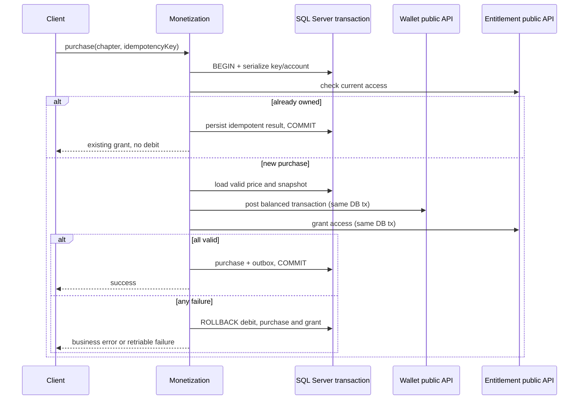

# Business rules, states và 15 workflow gốc + Swing bootstrap

Baseline đề xuất, policy chi tiết còn pending trong decision log. Các diagram dưới đây là thiết kế, không phải bằng chứng runtime.

Revision3: MVP flows thực hiện bằng Swing→REST→SQL/storage, không Web page hoặc client JDBC.19stories có desktop mapping;15 workflow gốc dưới đây giữ nguyên scope, các flows tài chính/game/offline ở phase nâng cao vẫn planned. React Web extension sau MVP dùng cùng API. Email verify/reset token nhập trong dialog Swing; không cần React callback page.

## WF00 — first-admin Swing setup (P2, user đã đồng ý)

Operator bật local setup rõ ràng và lấy token backend an toàn → Swing wizard nhập token/email/name/password → POST setupAdministrator → lock BootstrapState singleton → validate token/expiry/chưa initialized → create verified User/Admin+Reader/Audit trong một transaction → mark initialized/commit → wizard chuyển login chuẩn với CSRF. Không SQL/admin DB credential trong client, không JWT qua setup response.

Alternative: đã initialized thì đăng nhập, Admin provision member/roles qua SW18/SW15; retry lost response không tạo thêm Admin. Exceptions: disabled/nonloopback/browser-Origin404/403 theo security boundary, wrong/expired token401, initialized/account-conflict409, DB failure rollback cả user/role/state/audit. Không public reset setup, không tắt anti-self-review hoặc last-admin guard.

Backup/restore user đã giữ operator procedure; US16 Swing runbook/log viewer, evidence DB+asset restore do operator kiểm chứng. Không thêm workflow/nút RESTORE SQL trong GUI hoặc gọi DB trực tiếp.

## State và invariants

Chapter visibility PUBLIC/HIDDEN/ARCHIVED riêng với ChapterVersion workflow:



MVP không có schedule API; version APPROVED có thể publish ngay. Diagram mô tả lifecycle **một VersionId**; REJECTED snapshot kết thúc luồng đó và giữ nguyên. Sửa sau reject dùng createChapterVersion(copyFromVersionId) tạo ID mới bắt đầu DRAFT, không chuyển snapshot cũ về DRAFT. Recovery lỗi upload cùng draft không phải published rollback; recovery tối thiểu có ở P2, rollback version đã publish P3. Published version đổi pointer không xóa grant/comment/page identity. Unpublish toàn chapter ngăn read/sign mới; signed URL đã cấp có residual TTL được ghi nhận.

Job QUEUED → RUNNING → SUCCEEDED, hoặc RETRY_WAIT → RUNNING, FAILED/CANCELLED. Lease timeout cho worker khác reclaim; unique client key và deterministic object key/reference bảo đảm retry không append trang hai lần.

## Các workflow bắt buộc

| ID / phase | Main flow | Alternative | Exception và nhất quán |
|---|---|---|---|
| WF01 P2 Register/verify/login | Validate → user pending → email token → verify → login session | Resend token có cooldown; user đã verify trả generic | Email adapter lỗi retry qua job; token hết hạn/reuse reject; không cấp access sớm |
| WF02 P2 Create/upload/review/publish | Team scope → comic/translation/chapter/version → upload job → process → reorder → submit → independent review → publish pointer | Reject → clone draft; version cũ vẫn public; schedule P3 | ZIP/asset lỗi không READY; DB commit fail cleanup staging; optimistic conflict 412; publish atomic audit/outbox |
| WF03 P2 Search/detail/read | Query filtered → detail/list chapter → access decision → signed manifest → reader | Guest FREE All-age; RESTRICTED yêu cầu quyền ở P4 | Hidden/age denied không URL; expired URL refresh manifest; missing asset báo retry/system error |
| WF04 P2/P6 Cross-device | Fetch progress revision → save expectedRevision → server commit new revision | Intentional rewind cho phép; user chọn refresh/reapply sau conflict | Stale 409 trả current; không dùng client clock để thắng; offline replay qua mutation ID và generation |
| WF05 P4 Top-up | Create order → provider sandbox → verified webhook inbox → credit paid coin ledger → complete | Frontend poll order; webhook đến trước redirect vẫn hợp lệ | Redirect không cộng coin; duplicate webhook no-op; timeout pending/reconcile; amount/currency mismatch quarantine |
| WF06 P4 Purchase | Idempotency → check access → price snapshot → debit/credit balanced ledger + purchase + grant → commit | Already owned trả entitlement, không debit | Insufficient balance/price stale reject; any error rollback; concurrency locks + uniqueness |
| WF07 P4 Recover payment | Find pending/unknown → query provider → compare → post missing effect idempotently → mark reconciled | Provider unavailable retry with backoff | Không đoán success; terminal failure/manual review; replay cùng provider reference không post lại |
| WF08 P4 Subscription | Plan snapshot → verified payment → subscription ACTIVE + time-bound grant → renew → expiry | CancelAtPeriodEnd giữ quyền đến end; failed renewal grace policy cần chốt | Duplicate renewal event không kéo dài hai lần; refund/chargeback có event riêng; expired grant deny ngay |
| WF09 P5 EXP | Valid domain event → unique source/rule/user → EXP transaction → total/level → reward | Event replay no-op; reversal sửa total bằng transaction mới | Rule cap/day, invalid completion và spam không thưởng; reward side effect atomic hoặc outbox recoverable |
| WF10 P5 Spin | Eligibility → reserve turn/cost → server RNG snapshot → record result → grant reward → commit | Retry cùng key trả cùng result | Concurrent daily spin unique; wallet/reward failure rollback, không cho reroll bằng lỗi mạng |
| WF11 P3 Moderation | User report → queue → moderator scope → decision/tombstone → audit | Appeal/reopen có lịch sử; replies giữ tombstone parent | Moderator thiếu quyền 403; sanitize XSS; edit sau report lưu revision/context |
| WF12 P3 Publish notification | Commit chapter+outbox → consumer subscriber query → delivery unique → send → mark | Preferences mute; batch | Consumer retry/idempotency; mail failure không rollback publish; exhausted đưa failed queue |
| WF13 P6 Offline | Access → manifest/license → queue objects → verify local index → offline read → reconnect progress sync | Partial download resume; quota user chọn xóa | Expired license theo policy; revoke khi online; unsupported crypto không claim secure DRM; stale sync conflict |
| WF14 P5 Payout | Available earning snapshot → request → independent approve → provider payment → reconcile | Reject có reason; failed provider retry cùng key | Không dùng estimated revenue; block duplicate payout; refund/chargeback holds theo policy; audit actor |
| WF15 P2 Admin action | Permission → current resource/version → suspend/hide → revoke sessions/access signing → audit commit | Restore ghi event/audit mới | Last-admin/self-review guard; race 412; audit fail rollback sensitive mutation; issued URL residual TTL |

## Financial sequence: purchase



## Financial sequence: payment, renewal/refund và payout

```mermaid
sequenceDiagram
  participant P as Provider
  participant F as Finance
  participant D as SQL Server
  participant X as Wallet or Entitlement
  P->>F: signed webhook(providerEventId)
  F->>F: verify signature, reference, amount, currency
  F->>D: BEGIN insert unique inbox + lock order
  alt already processed
    F->>D: COMMIT no additional effect
    F-->>P: acknowledge
  else verified event
    F->>X: credit / renewal grant / compensating reversal (same tx)
    F->>D: status + lifecycle event + outbox, COMMIT
    F-->>P: acknowledge after durable commit
  end
  Note over F,D: Failure before commit => rollback; provider retry or reconciliation
  Note over P,F: External payout dispatch outside DB lock; stable provider key
  F->>P: payout request with stable key
  P-->>F: result or timeout
  F->>D: separate tx settle or keep pending for reconcile
```

Refund/chargeback không sửa ledger cũ. Nếu coin đã tiêu, đề xuất freeze spending và manual reconciliation, không âm thầm tạo số dư âm; quyết định chính sách phải chốt trước Phase 4. UserEntitlement revoke theo nguồn, quyền từ nguồn khác vẫn tồn tại. Payout cần approval khác requester, settlement idempotent và đối soát riêng.

## Sync và xóa history

ReadingProgress có revision server; PUT yêu cầu `expectedRevision`, `mutationId` UUID và `historyGeneration`. Tạo mới expectedRevision=0; unique(user,chapter). Conflict trả current snapshot. Retry cùng mutationId + cùng payload trả kết quả cũ; khác payload 409. `ReadingHistoryState` thuộc reader có `HistoryGeneration` tăng khi clear history; request generation cũ 409 HISTORY_RESET, kể cả progress row đã bị xóa. `ProgressMutation` giữ dedup/result ít nhất 30 ngày cho retry MVP; không áp dụng last-write-wins theo client time. Check generation trước replay kết quả cũ để history đã xóa không bị lộ lại qua result cache. GET history trả generation; không coi reader gửi completed=true là bằng chứng EXP, phải validate reading session ở Phase 3–5.
